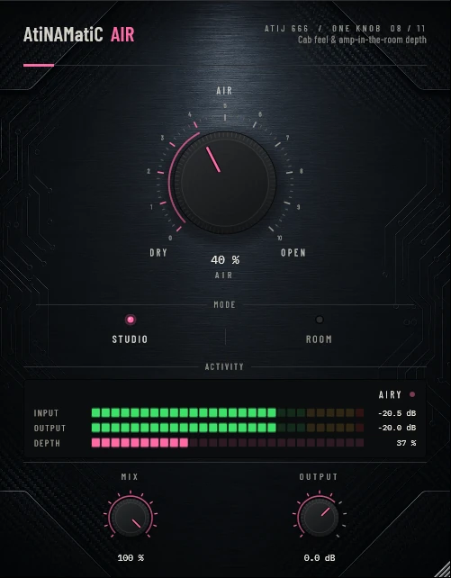

# AtiNAMatiC-Air — User Manual

**Version 1.0.0** · ATIJ STUDIO · Windows · macOS · Linux · VST3 · CLAP · LV2 · AU (macOS) · Free and open source (GPL v3)



---

## What's new in v1.0.0

- First public release, now **free and open source** (GPL v3).
- New look, shared across the whole ONE KNOB Series.
- **Every plug-in format:** VST3, CLAP and LV2 on Windows, macOS and Linux, plus AU on macOS. (The standalone app has been retired: these work best inside your DAW.)
- New **ONE KNOB Series installers** for Windows and macOS: tick the plug-ins and formats you want, skip the rest. Linux gets an install script that asks the same questions.

## What's new in v0.2.0

- **Real depth on mono sources.** A guitar coming out of a mono amp sim has no side signal, so the old M/S widening produced no stereo image at all. Air now builds its depth from a short, mono-safe early-reflection pattern written only into the side channel (Studio: 2–12 ms, Room: 5–29 ms, lows below 150 Hz kept centred). Summing to mono gives exactly the dry-plus-EQ signal back. It is still not a reverb — there is no tail.
- The integer-step Haas delay (which zippered when the knob moved) is gone; the depth meter now shows the side-to-mid energy you actually hear.
- **New interface** — machined knob with a printed 0–10 scale, hardware-style mode switches that follow automation and preset recall, consistent value text ("72 %", "+1.5 dB"), resizable window (75–150 %, remembered per session). Double-click any knob to reset it; hold **Shift** while dragging for fine adjustment.

---

## 1. What it is

AtiNAMatiC-Air is a post-cab "amp-in-the-room" enhancer designed to sit **after** your amp/cab simulator (NAM, Helix Native, ML Sound Lab, IRs, etc.) in the signal chain. It restores three things that get lost when a cab is captured through a single microphone:

1. **Air** — high-shelf lift (10 kHz) plus a 5 kHz presence peak that brings the cab out of the speaker and into the room.
2. **Body** — a gentle 80 Hz peak (Room mode only) that adds the low-mid bloom you hear when standing in front of a real 4×12.
3. **Width & depth** — M/S widening plus a short, mono-safe early-reflection pattern in the side channel (more in Room mode), so even a mono amp sim gets a three-dimensional image.

It is **not** a reverb. It does not add tail. It re-creates the perceptual cues that make a recorded cab feel like a real amp in a real room.

---

## 2. Signal chain placement

```
Guitar  →  Amp Sim (NAM / Helix / etc.)  →  Cab / IR  →  ★ AtiNAMatiC-Air ★  →  Reverb / Delay  →  Master
```

**Always place AtiNAMatiC-Air after the cab/IR, never before.** It is voiced for cab-coloured material, not raw amp distortion.

---

## 3. The Controls

### AIR (large knob, centre)
The master macro. From 0 to 100% it simultaneously increases:
- High-shelf gain at 10 kHz (0 → +5 dB)
- Presence peak at 5 kHz (0 → +2 dB)
- Body peak at 80 Hz (Room mode only, 0 → +2.5 dB)
- Stereo widening (Studio: +0–40% sides · Room: +0–70% sides)
- Early-reflection depth in the side channel (Studio: 2–12 ms, Room: 5–29 ms), mono-safe

Most users live between **30% and 65%**. Above 70% the widening becomes deliberately exaggerated for "WIDE" mix moments.

### MODE (Studio / Room)
- **STUDIO** — Tighter, narrower, no body peak, a few very short reflections. Use for dry mixes, tight metal rhythms, double-tracked guitars where mono compatibility matters.
- **ROOM** — Adds the 80 Hz body peak and a longer early-reflection pattern that recreates the ear-distance cues of standing in a real room. Use for leads, ambient parts, and any track that needs to feel "live".

### MIX (Wet/Dry)
0% = bypass, 100% = full wet. Default 100%. Lower it to blend in just a touch of air without changing the EQ balance of your dry cab.

### OUTPUT (–24 to +12 dB)
Final makeup gain after all processing. Use to compensate for level changes the EQ + widening produces.

### Activity Pill (bottom right)
Real-time indicator showing how much "air" is currently being applied:

| Label  | Meaning                                |
|--------|----------------------------------------|
| DRY    | Knob at 0, or no signal coming in      |
| LIFT   | Subtle enhancement (10–40%)            |
| OPEN   | Standard amp-in-room (40–70%)          |
| WIDE   | Wide-stereo / mix-bus mode (70–100%)   |

The LED brightens as you play and dims as the signal decays — it tracks both **the AIR knob position and the input level** so it idles dim when no notes are being played.

### Activity Meter (INPUT / OUTPUT)
Two horizontal level bars showing peak input (post-cab) and post-processing output, with a dB scale below from –60 dB to 0 dB.

---

## 4. Quick-start presets (manual recipes)

### Tight rhythm (mono-compatible)
- MODE: Studio · AIR: 35% · MIX: 100% · OUT: 0 dB

### Standard rhythm (room feel)
- MODE: Room · AIR: 45% · MIX: 100% · OUT: −1 dB

### Solo / lead
- MODE: Room · AIR: 65% · MIX: 100% · OUT: 0 dB

### Ambient / clean
- MODE: Room · AIR: 80% · MIX: 100% · OUT: −2 dB

### Mix-bus glue (parallel)
- MODE: Studio · AIR: 25% · MIX: 35% · OUT: 0 dB

---

## 5. Plug-in formats & install paths

**Windows (64-bit)**

- **Easiest:** run `ONE-KNOB-Series-v1.0.0-Windows-x64-Setup.exe`, tick the plug-ins and formats you want and untick the rest.
- **Just this plug-in:** unzip `AtiNAMatiC-Air-v1.0.0-Windows-x64.zip` and copy:

| File | Copy to |
|---|---|
| `AtiNAMatiC-Air.vst3` | `C:\Program Files\Common Files\VST3\` |
| `AtiNAMatiC-Air.clap` | `C:\Program Files\Common Files\CLAP\` |
| `AtiNAMatiC-Air.lv2` | `C:\Program Files\Common Files\LV2\` |

**macOS 10.15 or later (Apple Silicon and Intel)**

- **Easiest:** open `ONE-KNOB-Series-v1.0.0-macOS-Installer.pkg`, click **Customize** and tick the plug-ins and formats you want.
- **Just this plug-in:** unzip `AtiNAMatiC-Air-v1.0.0-macOS.zip` and copy:

| File | Copy to |
|---|---|
| `AtiNAMatiC-Air.vst3` | `/Library/Audio/Plug-Ins/VST3/` |
| `AtiNAMatiC-Air.component` (AU) | `/Library/Audio/Plug-Ins/Components/` |
| `AtiNAMatiC-Air.clap` | `/Library/Audio/Plug-Ins/CLAP/` |
| `AtiNAMatiC-Air.lv2` | `/Library/Audio/Plug-Ins/LV2/` |

The plug-ins aren't signed by Apple. If macOS blocks the installer, right-click it and choose **Open**. If you copied files from the zip, clear the quarantine flag in Terminal, e.g. `xattr -cr /Library/Audio/Plug-Ins/VST3/AtiNAMatiC-Air.vst3`.

**Linux (x86_64 and ARM64)**

- **Easiest:** extract `ONE-KNOB-Series-v1.0.0-Linux-x86_64.tar.gz` (or `-Linux-ARM64`) and run `./install.sh`. It asks which plug-ins and formats to install. Use `./install.sh --system` to install for all users.
- **Just this plug-in:** unzip `AtiNAMatiC-Air-v1.0.0-Linux-x86_64.zip` (or `-Linux-ARM64`) and copy the `.vst3` folder to `~/.vst3/`, the `.clap` file to `~/.clap/` and the `.lv2` folder to `~/.lv2/`.

Then rescan plug-ins in your DAW.

## 6. CPU / latency

- Processing is **zero-latency** (no oversampling, no FFT, no look-ahead).
- IIR filtering only: < 1 % CPU on a modern machine, even at 96 kHz.
- Safe to instantiate dozens of times in one session.

---

## 7. Troubleshooting

**"The Activity Pill never lights up beyond DRY"**  
Make sure something is actually feeding the plug-in (NAM upstream, track armed/playing) and the AIR knob is above 0. The pill measures air × input level — both must be non-zero.

**"It sounds harsh"**  
Drop AIR. Above 70% with a bright cab IR the 10 kHz shelf can stack up. Try 35–50% first.

**"It feels narrower than expected"**  
Check that your DAW track (or the insert) is stereo. Air creates its depth from a mono source, but it needs a stereo output to put it in; on a mono track only the EQ is heard.

**"Plug-in is missing after install"**  
Force a VST3 rescan in your DAW (see section 5). Some hosts cache old scan results.

**"Mode switch produces a click"**  
Toggling MODE updates the body filter coefficients. The change is per-block so it should be inaudible during continuous playback; if you automate it, slope the automation across a few ms to be safe.

---

## 8. Credits

- Design & development: **Atij** (Atij 666 Studio)
- Built with **JUCE 8** (juce.com)
- Inspired by the room sound of every great cab anyone ever stood in front of

---

## 9. License & support

Personal & commercial use permitted on machines you own.  
Bug reports / feature requests: see About dialog (click the title in the plug-in window).

---

*AtiNAMatiC-Air is part of the AtiNAMatiC Series — a family of focused, hardware-flavoured guitar tools for the modern post-amp signal chain.*
