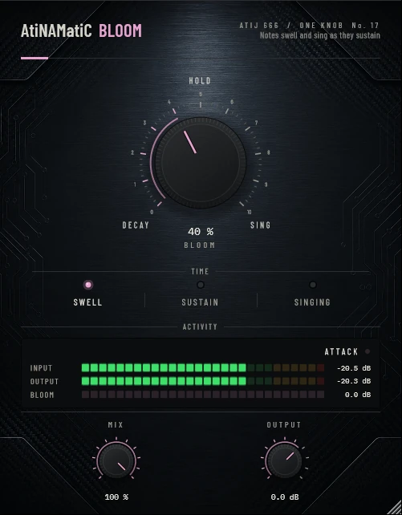

# AtiNAMatiC-Bloom — User Manual

**Version 1.0.0** · ATIJ STUDIO · Windows · macOS · Linux · VST3 · CLAP · LV2 · AU (macOS) · Free and open source (GPL v3)



---

## What's new in v1.0.0

- First public release, now **free and open source** (GPL v3).
- New look, shared across the whole ONE KNOB Series.
- **Every plug-in format:** VST3, CLAP and LV2 on Windows, macOS and Linux, plus AU on macOS. (The standalone app has been retired: these work best inside your DAW.)
- New **ONE KNOB Series installers** for Windows and macOS: tick the plug-ins and formats you want, skip the rest. Linux gets an install script that asks the same questions.

## 1. What it is

A loud amp **blooms**: hold a note or a chord and it seems to grow, fuller and richer, instead of just dying away. AtiNAMatiC-Bloom puts that in front of your amp model.

- On every pick attack Bloom remembers how loud the note started.
- While the note sustains, it gradually brings the decaying sustain back up toward that starting level — never above it — over the bloom time.
- As the note blooms, a little harmonic richness is blended in; in **Singing** mode an upper-mid resonance grows too, like an amp just before it feeds back.
- A new attack resets the bloom instantly, so the next pick is never boosted. Picks over a chord that is still ringing are caught too (the detector also watches the pick click above 4 kHz). Signals below about -50 dBFS are left alone, so decays into noise are never lifted.
- 6 ms latency, reported to your DAW. Bloom uses it to look ahead, so the bloom is already reset when the next pick arrives.

Measured on held notes: the attack is essentially unchanged, the sustain comes up by about +4 dB (50 %) to +8.6 dB (100 %), and peaks stay where they were.

## 2. Signal chain placement

```
Guitar -> Gate -> [AtiNAMatiC-Bloom] -> Boost / Dirt -> Amp sim -> Cab / IR
```

Place Bloom **before** the amp. It is most obvious on held chords, leads and clean or crunch tones; fast riffing barely triggers it (notes end before they bloom), which keeps rhythm parts tight.

## 3. Controls

### BLOOM (big knob, 0–100 %, default 40 %)
How much of the drop between the attack and the sustain is brought back, up to +9 dB. 0 % (DECAY) is a clean pass-through.

### TIME (mode switch)

| Mode | Bloom time | Character |
|---|---|---|
| **Swell** | 0.35 s | quick bloom, notes hold up |
| **Sustain** | 0.9 s | slower, long sustaining notes |
| **Singing** | 1.4 s | slow swell plus an upper-mid "about to feed back" resonance |

### MIX (0–100 %) and OUTPUT (-24 to +12 dB)
Blend with the dry signal and final trim.

## 4. Meters

- **INPUT / OUTPUT** — peak level.
- **BLOOM** — current bloom gain in dB.
- Status: **ATTACK**, **BLOOMING**, **SINGING**.

## 5. Latency and CPU

6 ms latency (look-ahead for the attack reset), reported to your DAW for automatic compensation. Very light on CPU.

## 6. Installation

**Windows (64-bit)**

- **Easiest:** run `ONE-KNOB-Series-v1.0.0-Windows-x64-Setup.exe`, tick the plug-ins and formats you want and untick the rest.
- **Just this plug-in:** unzip `AtiNAMatiC-Bloom-v1.0.0-Windows-x64.zip` and copy:

| File | Copy to |
|---|---|
| `AtiNAMatiC-Bloom.vst3` | `C:\Program Files\Common Files\VST3\` |
| `AtiNAMatiC-Bloom.clap` | `C:\Program Files\Common Files\CLAP\` |
| `AtiNAMatiC-Bloom.lv2` | `C:\Program Files\Common Files\LV2\` |

**macOS 10.15 or later (Apple Silicon and Intel)**

- **Easiest:** open `ONE-KNOB-Series-v1.0.0-macOS-Installer.pkg`, click **Customize** and tick the plug-ins and formats you want.
- **Just this plug-in:** unzip `AtiNAMatiC-Bloom-v1.0.0-macOS.zip` and copy:

| File | Copy to |
|---|---|
| `AtiNAMatiC-Bloom.vst3` | `/Library/Audio/Plug-Ins/VST3/` |
| `AtiNAMatiC-Bloom.component` (AU) | `/Library/Audio/Plug-Ins/Components/` |
| `AtiNAMatiC-Bloom.clap` | `/Library/Audio/Plug-Ins/CLAP/` |
| `AtiNAMatiC-Bloom.lv2` | `/Library/Audio/Plug-Ins/LV2/` |

The plug-ins aren't signed by Apple. If macOS blocks the installer, right-click it and choose **Open**. If you copied files from the zip, clear the quarantine flag in Terminal, e.g. `xattr -cr /Library/Audio/Plug-Ins/VST3/AtiNAMatiC-Bloom.vst3`.

**Linux (x86_64 and ARM64)**

- **Easiest:** extract `ONE-KNOB-Series-v1.0.0-Linux-x86_64.tar.gz` (or `-Linux-ARM64`) and run `./install.sh`. It asks which plug-ins and formats to install. Use `./install.sh --system` to install for all users.
- **Just this plug-in:** unzip `AtiNAMatiC-Bloom-v1.0.0-Linux-x86_64.zip` (or `-Linux-ARM64`) and copy the `.vst3` folder to `~/.vst3/`, the `.clap` file to `~/.clap/` and the `.lv2` folder to `~/.lv2/`.

Then rescan plug-ins in your DAW.

## 7. Tips

- Leads: Singing at 50–80 % into a crunch amp gives that held-note swell.
- Pair with **Sag**: Sag squashes the attack, Bloom brings the sustain up — a very "alive" amp feel.
- Double-click any knob to reset it; hold Shift while dragging for fine control.

---

*AtiNAMatiC-Bloom v1.0.0 · Atij 666 Studio*
