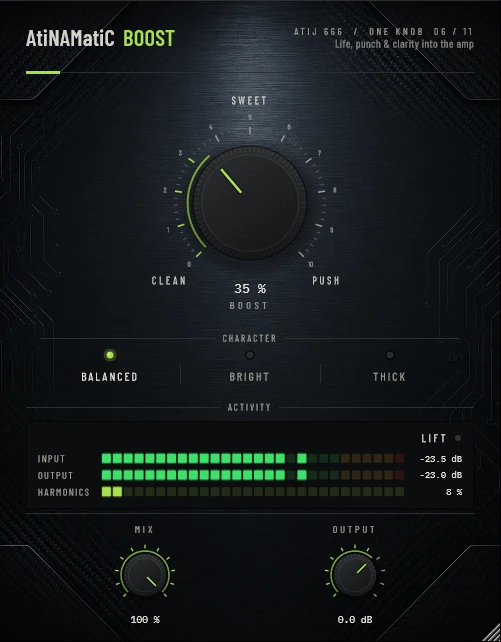

# AtiNAMatiC-Boost — User Manual
**Version 1.0.0** · ATIJ STUDIO · Windows · macOS · Linux · VST3 · CLAP · LV2 · AU (macOS) · Free and open source (GPL v3)


Atij 666 Studio — Designed & developed by Atij

---

## What's new in v1.0.0

- First public release, now **free and open source** (GPL v3).
- New look, shared across the whole ONE KNOB Series.
- **Every plug-in format:** VST3, CLAP and LV2 on Windows, macOS and Linux, plus AU on macOS. (The standalone app has been retired: these work best inside your DAW.)
- New **ONE KNOB Series installers** for Windows and macOS: tick the plug-ins and formats you want, skip the rest. Linux gets an install script that asks the same questions.

## What's new in v0.2.0

- **Constant loudness, clean at 0 %.** BOOST now stays within about ±1 dB across the whole sweep (it used to drop ~3 dB and lose ~10 dB of peak level at PUSH, and add +1.8 dB at 0 %). At CLEAN the curve is effectively linear.
- **4× oversampling** on the saturation stage removes the harsh aliasing that a following amp sim would otherwise amplify. This adds **38 samples** of latency (≈0.8 ms at 48 kHz), reported to your DAW for automatic compensation; the dry path of MIX is delay-matched.
- DC from the asymmetric (2nd-harmonic) bias is now removed, so there are no low-frequency thumps on note attacks.
- **New interface** — machined knob with a printed 0–10 scale, hardware-style mode switches that follow automation and preset recall, consistent value text ("72 %", "+1.5 dB"), resizable window (75–150 %, remembered per session). Double-click any knob to reset it; hold **Shift** while dragging for fine adjustment.

---

## Overview

**AtiNAMatiC-Boost** adds life, punch, and harmonic clarity to any signal — designed to sit **before** your NAM amp sim (it is voiced to feed an amp model), though it also works anywhere you want musical saturation and presence.

Unlike a simple booster, it uses a three-stage soft-saturation engine with character modes and parallel mix control, so you can push the tone without destroying your dynamics.

---

## System Requirements

| | Minimum |
|---|---|
| **OS** | Windows 10 (64-bit) · macOS 10.15+ · Linux (Ubuntu 20.04+) |
| **CPU** | Any modern 64-bit processor |
| **RAM** | 256 MB |
| **Formats** | VST3 · CLAP · LV2 · AU (macOS) |
| **DAW** | Any VST3 or CLAP host |

---

## Installation

**Windows (64-bit)**

- **Easiest:** run `ONE-KNOB-Series-v1.0.0-Windows-x64-Setup.exe`, tick the plug-ins and formats you want and untick the rest.
- **Just this plug-in:** unzip `AtiNAMatiC-Boost-v1.0.0-Windows-x64.zip` and copy:

| File | Copy to |
|---|---|
| `AtiNAMatiC-Boost.vst3` | `C:\Program Files\Common Files\VST3\` |
| `AtiNAMatiC-Boost.clap` | `C:\Program Files\Common Files\CLAP\` |
| `AtiNAMatiC-Boost.lv2` | `C:\Program Files\Common Files\LV2\` |

**macOS 10.15 or later (Apple Silicon and Intel)**

- **Easiest:** open `ONE-KNOB-Series-v1.0.0-macOS-Installer.pkg`, click **Customize** and tick the plug-ins and formats you want.
- **Just this plug-in:** unzip `AtiNAMatiC-Boost-v1.0.0-macOS.zip` and copy:

| File | Copy to |
|---|---|
| `AtiNAMatiC-Boost.vst3` | `/Library/Audio/Plug-Ins/VST3/` |
| `AtiNAMatiC-Boost.component` (AU) | `/Library/Audio/Plug-Ins/Components/` |
| `AtiNAMatiC-Boost.clap` | `/Library/Audio/Plug-Ins/CLAP/` |
| `AtiNAMatiC-Boost.lv2` | `/Library/Audio/Plug-Ins/LV2/` |

The plug-ins aren't signed by Apple. If macOS blocks the installer, right-click it and choose **Open**. If you copied files from the zip, clear the quarantine flag in Terminal, e.g. `xattr -cr /Library/Audio/Plug-Ins/VST3/AtiNAMatiC-Boost.vst3`.

**Linux (x86_64 and ARM64)**

- **Easiest:** extract `ONE-KNOB-Series-v1.0.0-Linux-x86_64.tar.gz` (or `-Linux-ARM64`) and run `./install.sh`. It asks which plug-ins and formats to install. Use `./install.sh --system` to install for all users.
- **Just this plug-in:** unzip `AtiNAMatiC-Boost-v1.0.0-Linux-x86_64.zip` (or `-Linux-ARM64`) and copy the `.vst3` folder to `~/.vst3/`, the `.clap` file to `~/.clap/` and the `.lv2` folder to `~/.lv2/`.

Then rescan plug-ins in your DAW.

## Controls Reference

```
┌─────────────────────────────────────────────┐
│  AtiNAMatiC-Boost          Life, punch...   │
│ ─────────────────────────────────────────── │
│                  BOOST                      │
│               ╭───────╮                     │
│               │   ◈   │   ← main knob       │
│               ╰───────╯                     │
│        CLEAN    SWEET    PUSH               │
│ ─────────────────────────────────────────── │
│             CHARACTER                       │
│  [BALANCED]   [BRIGHT]   [THICK]            │
│ ─────────────────────────────────────────── │
│             ACTIVITY     ◉ CLEAN            │
│  INPUT  ▓▓▓▓▓▓░░░░░░░░░         -90 dB     │
│  OUTPUT ▓▓▓▓▓▓░░░░░░░░░         -90 dB     │
│         -60  -48  -36  -24  -12  0 dB       │
│ ─────────────────────────────────────────── │
│     MIX                  OUTPUT             │
│    [knob]                [knob]             │
│    100 %                 0.00 dB            │
└─────────────────────────────────────────────┘
```

### BOOST
Controls the drive into the saturation engine. Higher values push more harmonic content and add musical compression. The Spark Pill indicator shows the current harmonic activity level.

| Range | Character |
|-------|-----------|
| 0 – 20 % | Transparent gain, subtle warmth |
| 20 – 50 % | Natural harmonic enhancement — sweet spot for most signals |
| 50 – 80 % | Noticeable saturation, aggressive presence |
| 80 – 100 % | Heavy push, leads and solos |

### CHARACTER

Selects the tonal focus of the saturation engine:

| Mode | Description |
|------|-------------|
| **BALANCED** | Flat character — enhances presence evenly across the spectrum |
| **BRIGHT** | High-frequency clarity shelf — adds edge and definition, ideal for single-coil pickups and clean tones |
| **THICK** | Low-mid weight shelf — fattens humbuckers and palm-muted riffs |

### MIX
Parallel blend between the dry signal (0 %) and fully processed signal (100 %). Use lower values (20–50 %) for New York–style parallel saturation — adds harmonic density while preserving the attack transients of the dry signal.

### OUTPUT
Final output trim gain, range **−24 to +12 dB**. Use it to match perceived loudness after boosting, or to drive the next stage harder.

### Activity Meter
Shows real-time input (top) and output (bottom) levels from **−60 to 0 dB**. The output band colour shifts toward the accent colour as harmonic content increases — giving a visual read of how hard the saturation is working.

### Spark Pill
A harmonic activity indicator in the top-right of the meter section:

| Label | Harmonic Amount |
|-------|-----------------|
| **CLEAN** | 0 – 10 % — minimal saturation |
| **LIFT** | 10 – 45 % — light harmonic enhancement |
| **ALIVE** | 45 – 75 % — moderate saturation |
| **PUSH** | 75 – 100 % — heavy drive |

---

## Signal Chain (Under the Hood)

```
Input
  → High-pass filter (35 Hz)     removes sub-bass mud before saturation
  → Clean gain stage             scales signal into saturation range
  → Tanh soft-clipping           adds even-order harmonics
  → 2nd-harmonic bias            warms the saturation character
  → Clarity / Mode shelf EQ      shapes tonal character (per MODE)
  → Auto make-up gain            compensates loudness
  → Output trim                  user-controlled OUTPUT knob
  → Dry/Wet blend                MIX knob
Output
```

---

## Typical Use Cases

### After a NAM amp sim
Place AtiNAMatiC-Boost on the channel after your Neural Amp Modeler. Use **BALANCED** mode at **40–60 % BOOST**, **MIX 100 %**, and trim OUTPUT to match the unprocessed loudness. This adds the "pushed amp" feel that neural captures sometimes lack.

### Parallel saturation bus
Send multiple tracks to an auxiliary. Insert AtiNAMatiC-Boost with **MIX 20–40 %** and **BOOST 70 %** in **THICK** mode. Blend back to taste — adds glue and warmth without thickening transients.

### Lead guitar presence boost
Use **BRIGHT** mode with **BOOST 60–80 %** and **MIX 60 %**. Keeps the dry attack while adding harmonic cut-through. Reduce OUTPUT by 2–4 dB to compensate loudness before automation.

### Drum bus punch
**BALANCED** mode, **BOOST 30 %**, **MIX 30–50 %**. Adds body and snap without obvious saturation. Especially effective on room mics or overheads.

---

## Tips

- The **35 Hz high-pass filter** is always active — this is intentional. Sub-bass energy in the saturation stage creates intermodulation distortion; removing it keeps the low end clean.
- Use **BOOST + low MIX** rather than **low BOOST + full MIX** when you want subtle enhancement — pushing the saturation stage harder and blending less gives richer harmonics at equal perceived loudness.
- For A/B comparison, set **MIX to 0 %** and trim **OUTPUT** until loudness matches, then gradually raise MIX.

---

## About

**AtiNAMatiC-Boost v1.0.0**
Atij 666 Studio
Designed & developed by Atij

Built with:
- JUCE Framework — Raw Material Software Ltd.
- VST3 SDK — Steinberg Media Technologies GmbH
- CLAP SDK — Free Audio / clap-juce-extensions
- Neural Amp Modeler (NAM) — Steven Atkinson & contributors
- The open-source audio & guitar-plugin community

*Thank you to everyone who makes open-source audio tools possible.*

---

*© 2026 Atij 666 Studio. All rights reserved.*
