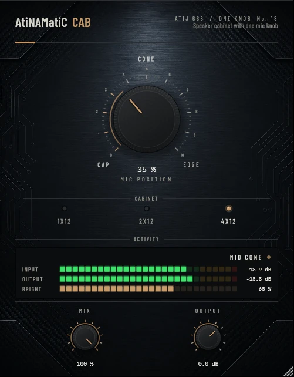

# AtiNAMatiC-Cab — User Manual

**Version 1.0.0** · ATIJ STUDIO · Windows · macOS · Linux · VST3 · CLAP · LV2 · AU (macOS) · Free and open source (GPL v3)



---

## What's new in v1.0.0

- First public release, now **free and open source** (GPL v3).
- New look, shared across the whole ONE KNOB Series.
- **Every plug-in format:** VST3, CLAP and LV2 on Windows, macOS and Linux, plus AU on macOS. (The standalone app has been retired: these work best inside your DAW.)
- New **ONE KNOB Series installers** for Windows and macOS: tick the plug-ins and formats you want, skip the rest. Linux gets an install script that asks the same questions.

## 1. What it is

Many NAM captures are "amp only" (direct out, no cabinet): played straight they sound fizzy and harsh. Normally you'd load an impulse response. AtiNAMatiC-Cab is the one-knob alternative: a speaker cabinet voiced with filters, where the one knob moves the microphone across the speaker.

- Resonant low cut (the "thump" of a closed box), low-mid body, a slight mid scoop, two cone-breakup presence peaks (~2.5 kHz and ~4.5 kHz) and a steep speaker roll-off.
- **MIC** moves the mic from the dust cap (bright, forward) to the cone edge (darker, warmer). Measured on a cab-less amp: the fizz above 7 kHz is cut by about 11 dB at the cap and 29 dB at the edge.
- Loudness is matched automatically from the filter response (within about ±1.5 dB across the knob and cabinets).
- Zero latency, minimum phase, very light on CPU.

It is not an impulse-response loader and does not try to copy a specific cabinet; it is a fast, musical "cab" that is always in tune with the knob.

## 2. Signal chain placement

```
Guitar -> ... -> Amp sim (no cab) -> [AtiNAMatiC-Cab] -> Cohere / Air / Room
```

Use it **after** an amp capture that has no cabinet. Do not stack it after a cab/IR (you'd filter twice).

## 3. Controls

### MIC POSITION (big knob, 0–100 %, default 35 %)

| Position | Sound |
|---|---|
| 0 % (CAP) | brightest, most forward, most presence |
| 50 % (CONE) | balanced |
| 100 % (EDGE) | darker, warmer, rounder low-mids |

### CABINET (mode switch)

| Cabinet | Low cut / thump | Body | Character |
|---|---|---|---|
| **1x12** | 105 Hz, soft | 200 Hz | open-back combo: lighter, looser low end |
| **2x12** | 85 Hz | 160 Hz | balanced |
| **4x12** (default) | 75 Hz, resonant | 140 Hz | closed-back stack: tight, deep thump |

### MIX (0–100 %) and OUTPUT (-24 to +12 dB)
Blend with the raw amp (for a little extra edge) and final trim.

## 4. Meters

- **INPUT / OUTPUT** — peak level.
- **BRIGHT** — where the mic is (100 % = on the cap).
- Status: **ON THE CAP**, **MID CONE**, **CONE EDGE**.

## 5. Installation

**Windows (64-bit)**

- **Easiest:** run `ONE-KNOB-Series-v1.0.0-Windows-x64-Setup.exe`, tick the plug-ins and formats you want and untick the rest.
- **Just this plug-in:** unzip `AtiNAMatiC-Cab-v1.0.0-Windows-x64.zip` and copy:

| File | Copy to |
|---|---|
| `AtiNAMatiC-Cab.vst3` | `C:\Program Files\Common Files\VST3\` |
| `AtiNAMatiC-Cab.clap` | `C:\Program Files\Common Files\CLAP\` |
| `AtiNAMatiC-Cab.lv2` | `C:\Program Files\Common Files\LV2\` |

**macOS 10.15 or later (Apple Silicon and Intel)**

- **Easiest:** open `ONE-KNOB-Series-v1.0.0-macOS-Installer.pkg`, click **Customize** and tick the plug-ins and formats you want.
- **Just this plug-in:** unzip `AtiNAMatiC-Cab-v1.0.0-macOS.zip` and copy:

| File | Copy to |
|---|---|
| `AtiNAMatiC-Cab.vst3` | `/Library/Audio/Plug-Ins/VST3/` |
| `AtiNAMatiC-Cab.component` (AU) | `/Library/Audio/Plug-Ins/Components/` |
| `AtiNAMatiC-Cab.clap` | `/Library/Audio/Plug-Ins/CLAP/` |
| `AtiNAMatiC-Cab.lv2` | `/Library/Audio/Plug-Ins/LV2/` |

The plug-ins aren't signed by Apple. If macOS blocks the installer, right-click it and choose **Open**. If you copied files from the zip, clear the quarantine flag in Terminal, e.g. `xattr -cr /Library/Audio/Plug-Ins/VST3/AtiNAMatiC-Cab.vst3`.

**Linux (x86_64 and ARM64)**

- **Easiest:** extract `ONE-KNOB-Series-v1.0.0-Linux-x86_64.tar.gz` (or `-Linux-ARM64`) and run `./install.sh`. It asks which plug-ins and formats to install. Use `./install.sh --system` to install for all users.
- **Just this plug-in:** unzip `AtiNAMatiC-Cab-v1.0.0-Linux-x86_64.zip` (or `-Linux-ARM64`) and copy the `.vst3` folder to `~/.vst3/`, the `.clap` file to `~/.clap/` and the `.lv2` folder to `~/.lv2/`.

Then rescan plug-ins in your DAW.

## 6. Tips

- High gain: 4x12, MIC 30–50 %. Then **Cohere** if anything still bites.
- Clean / edge of breakup: 1x12, MIC 20–40 %.
- Double-click any knob to reset it; hold Shift while dragging for fine control.

---

*AtiNAMatiC-Cab v1.0.0 · Atij 666 Studio*
