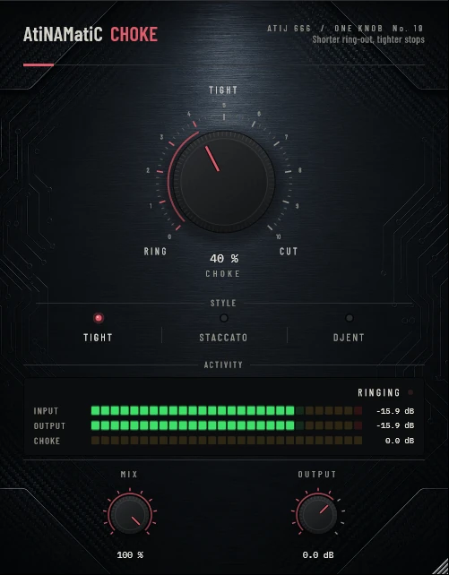

# AtiNAMatiC-Choke — User Manual

**Version 1.0.0** · ATIJ STUDIO · Windows · macOS · Linux · VST3 · CLAP · LV2 · AU (macOS) · Free and open source (GPL v3)



---

## What's new in v1.0.0

- First public release, now **free and open source** (GPL v3).
- New look, shared across the whole ONE KNOB Series.
- **Every plug-in format:** VST3, CLAP and LV2 on Windows, macOS and Linux, plus AU on macOS. (The standalone app has been retired: these work best inside your DAW.)
- New **ONE KNOB Series installers** for Windows and macOS: tick the plug-ins and formats you want, skip the rest. Linux gets an install script that asks the same questions.

## 1. What it is

Tight riffs live and die by how notes **stop**. A gate only removes the noise between notes; it can't make a ringing chord stop sooner. AtiNAMatiC-Choke works inside the note's own decay: once a note has fallen a little below its peak, Choke makes the rest of the decay fall faster. Stops get tighter, the riff gets more staccato, and the pick attack is never touched.

- Choke follows each note's own peak, so it works the same on quiet and loud passages (it is relative, not a fixed threshold).
- Every new pick attack restores full level instantly.
- The level detector holds for a full cycle of a low E, so it never rides the waveform: no distortion on low notes.
- Zero latency.

Measured on held notes (100 %): Tight cuts the late tail by about 17 dB, Staccato by about 37 dB, Djent chokes notes within ~0.3 s. Attacks: unchanged.

## 2. Signal chain placement

```
Guitar -> Gate -> [AtiNAMatiC-Choke] -> ... -> Amp sim          (tighter playing into the amp)
Amp sim -> Cab / IR -> [AtiNAMatiC-Choke]                        (shorter amp ring-out)
```

Both work. Before the amp it shapes how you play into it; after the amp it also shortens the amp's own sustain.

## 3. Controls

### CHOKE (big knob, 0–100 %, default 40 %)
How fast the decay is pulled down once it starts. 0 % (RING) is a clean pass-through.

### STYLE (mode switch)

| Style | Starts cutting | Max ratio (100 %) | For |
|---|---|---|---|
| **Tight** | 9 dB below the note peak | 3.5 : 1 | rhythm that should just sound "tight" |
| **Staccato** | 6 dB below | 5 : 1 | short, stabbing riffs |
| **Djent** | 3 dB below | 8 : 1 | machine-gun stops, chugs, metal breaks |

### MIX (0–100 %) and OUTPUT (-24 to +12 dB)
Blend with the dry signal (a little ring back in) and final trim.

## 4. Meters

- **INPUT / OUTPUT** — peak level.
- **CHOKE** — how much the decay is currently being cut, in dB.
- Status: **RINGING**, **TIGHTENING**, **CHOKED**.

## 5. Installation

**Windows (64-bit)**

- **Easiest:** run `ONE-KNOB-Series-v1.0.0-Windows-x64-Setup.exe`, tick the plug-ins and formats you want and untick the rest.
- **Just this plug-in:** unzip `AtiNAMatiC-Choke-v1.0.0-Windows-x64.zip` and copy:

| File | Copy to |
|---|---|
| `AtiNAMatiC-Choke.vst3` | `C:\Program Files\Common Files\VST3\` |
| `AtiNAMatiC-Choke.clap` | `C:\Program Files\Common Files\CLAP\` |
| `AtiNAMatiC-Choke.lv2` | `C:\Program Files\Common Files\LV2\` |

**macOS 10.15 or later (Apple Silicon and Intel)**

- **Easiest:** open `ONE-KNOB-Series-v1.0.0-macOS-Installer.pkg`, click **Customize** and tick the plug-ins and formats you want.
- **Just this plug-in:** unzip `AtiNAMatiC-Choke-v1.0.0-macOS.zip` and copy:

| File | Copy to |
|---|---|
| `AtiNAMatiC-Choke.vst3` | `/Library/Audio/Plug-Ins/VST3/` |
| `AtiNAMatiC-Choke.component` (AU) | `/Library/Audio/Plug-Ins/Components/` |
| `AtiNAMatiC-Choke.clap` | `/Library/Audio/Plug-Ins/CLAP/` |
| `AtiNAMatiC-Choke.lv2` | `/Library/Audio/Plug-Ins/LV2/` |

The plug-ins aren't signed by Apple. If macOS blocks the installer, right-click it and choose **Open**. If you copied files from the zip, clear the quarantine flag in Terminal, e.g. `xattr -cr /Library/Audio/Plug-Ins/VST3/AtiNAMatiC-Choke.vst3`.

**Linux (x86_64 and ARM64)**

- **Easiest:** extract `ONE-KNOB-Series-v1.0.0-Linux-x86_64.tar.gz` (or `-Linux-ARM64`) and run `./install.sh`. It asks which plug-ins and formats to install. Use `./install.sh --system` to install for all users.
- **Just this plug-in:** unzip `AtiNAMatiC-Choke-v1.0.0-Linux-x86_64.zip` (or `-Linux-ARM64`) and copy the `.vst3` folder to `~/.vst3/`, the `.clap` file to `~/.clap/` and the `.lv2` folder to `~/.lv2/`.

Then rescan plug-ins in your DAW.

## 6. Tips

- Use **Gate** for the noise, Choke for the ring: Gate → Choke → amp is a very tight front end.
- On chord stabs, Staccato at 40–60 % plus Mix 80 % keeps a little natural ring.
- Double-click any knob to reset it; hold Shift while dragging for fine control.

---

*AtiNAMatiC-Choke v1.0.0 · Atij 666 Studio*
