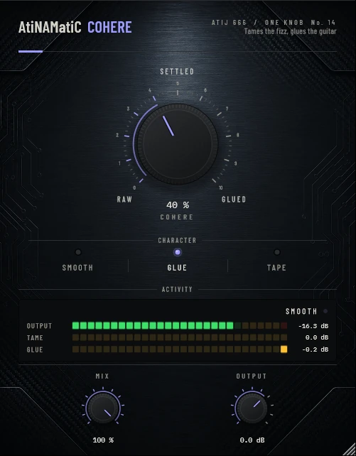

# AtiNAMatiC-Cohere — User Manual

**Version 1.0.0** · ATIJ STUDIO · Windows · macOS · Linux · VST3 · CLAP · LV2 · AU (macOS) · Free and open source (GPL v3)



---

## What's new in v1.0.0

- First public release, now **free and open source** (GPL v3).
- New look, shared across the whole ONE KNOB Series.
- **Every plug-in format:** VST3, CLAP and LV2 on Windows, macOS and Linux, plus AU on macOS. (The standalone app has been retired: these work best inside your DAW.)
- New **ONE KNOB Series installers** for Windows and macOS: tick the plug-ins and formats you want, skip the rest. Linux gets an install script that asks the same questions.

## 1. What it is

Amp sims, NAM captures especially, often carry a harsh **bite** around 3–4 kHz and a **fizz** around 6–9 kHz that jump out on some notes and chords and not others. A static EQ cut dulls every note to fix the few.

AtiNAMatiC-Cohere cuts those two bands **only while they stick out** compared with the guitar's own normal balance, then glues the result with a gentle compressor and a touch of tape-style saturation. The tone you dialled in stays; the moments that hurt get caught.

- Bite and fizz are detected in narrow bands and cut with smooth, wider filters: up to 9 dB (bite) and 12 dB (fizz) on the worst moments, almost nothing on normal playing.
- Measured on a test signal with fizz spikes: spikes cut by about 5 dB, the rest of the playing by under 1 dB.
- Glue compression and make-up are calibrated so the level stays put (within about ±0.7 dB).
- Zero latency.

## 2. Signal chain placement

```
Guitar -> ... -> Amp sim -> Cab / IR -> [AtiNAMatiC-Cohere] -> Air / Double / Squash / Level
```

Place Cohere **after** the amp and cab. It works on single tracks and on a guitar bus.

## 3. Controls

### COHERE (big knob, 0–100 %, default 40 %)
One knob for all three stages. At 0 % (RAW) the signal is untouched. Turning it up lowers the margin a band must stick out by before it is cut (6 dB → 1 dB), deepens the glue compression and blends in the saturation.

### CHARACTER (mode switch)

| Character | Taming | Glue | Saturation | Top end |
|---|---|---|---|---|
| **Smooth** | strongest | light | very light | flat |
| **Glue** (default) | balanced | balanced | light | flat |
| **Tape** | lighter | strongest | most | -1.5 dB shelf above 9 kHz |

### MIX (0–100 %) and OUTPUT (-24 to +12 dB)
Parallel blend (phase-exact, no combing) and final trim.

## 4. Meters

- **OUTPUT** — peak level.
- **TAME** — how much bite/fizz is being cut right now (the larger of the two), in dB.
- **GLUE** — compressor gain reduction, in dB.
- Status: **SMOOTH** (nothing to tame), **TAMING**, **TAMING HARD**.

## 5. Signal chain (inside)

```
Input -> linked detectors: broadband, bite (3.5 kHz, Q 2.5), fizz (7.5 kHz, Q 3)
      -> each band's share vs its own 1.5 s average -> dynamic cuts (Q 1.4 / Q 1.2)
      -> glue: soft-knee RMS compressor (20 ms / 250 ms)
      -> tape-style saturation (blended) -> Tape shelf -> make-up -> MIX -> OUTPUT
```

## 6. Latency and CPU

Zero latency. Light on CPU.

## 7. Installation

**Windows (64-bit)**

- **Easiest:** run `ONE-KNOB-Series-v1.0.0-Windows-x64-Setup.exe`, tick the plug-ins and formats you want and untick the rest.
- **Just this plug-in:** unzip `AtiNAMatiC-Cohere-v1.0.0-Windows-x64.zip` and copy:

| File | Copy to |
|---|---|
| `AtiNAMatiC-Cohere.vst3` | `C:\Program Files\Common Files\VST3\` |
| `AtiNAMatiC-Cohere.clap` | `C:\Program Files\Common Files\CLAP\` |
| `AtiNAMatiC-Cohere.lv2` | `C:\Program Files\Common Files\LV2\` |

**macOS 10.15 or later (Apple Silicon and Intel)**

- **Easiest:** open `ONE-KNOB-Series-v1.0.0-macOS-Installer.pkg`, click **Customize** and tick the plug-ins and formats you want.
- **Just this plug-in:** unzip `AtiNAMatiC-Cohere-v1.0.0-macOS.zip` and copy:

| File | Copy to |
|---|---|
| `AtiNAMatiC-Cohere.vst3` | `/Library/Audio/Plug-Ins/VST3/` |
| `AtiNAMatiC-Cohere.component` (AU) | `/Library/Audio/Plug-Ins/Components/` |
| `AtiNAMatiC-Cohere.clap` | `/Library/Audio/Plug-Ins/CLAP/` |
| `AtiNAMatiC-Cohere.lv2` | `/Library/Audio/Plug-Ins/LV2/` |

The plug-ins aren't signed by Apple. If macOS blocks the installer, right-click it and choose **Open**. If you copied files from the zip, clear the quarantine flag in Terminal, e.g. `xattr -cr /Library/Audio/Plug-Ins/VST3/AtiNAMatiC-Cohere.vst3`.

**Linux (x86_64 and ARM64)**

- **Easiest:** extract `ONE-KNOB-Series-v1.0.0-Linux-x86_64.tar.gz` (or `-Linux-ARM64`) and run `./install.sh`. It asks which plug-ins and formats to install. Use `./install.sh --system` to install for all users.
- **Just this plug-in:** unzip `AtiNAMatiC-Cohere-v1.0.0-Linux-x86_64.zip` (or `-Linux-ARM64`) and copy the `.vst3` folder to `~/.vst3/`, the `.clap` file to `~/.clap/` and the `.lv2` folder to `~/.lv2/`.

Then rescan plug-ins in your DAW.

## 8. Tips

- On a fizzy high-gain capture, start in Smooth at 40–60 %.
- On a guitar bus, Glue at 30–50 % before **Squash** or **Level** gives a more finished sound.
- Double-click any knob to reset it; hold Shift while dragging for fine control.

---

*AtiNAMatiC-Cohere v1.0.0 · Atij 666 Studio*
