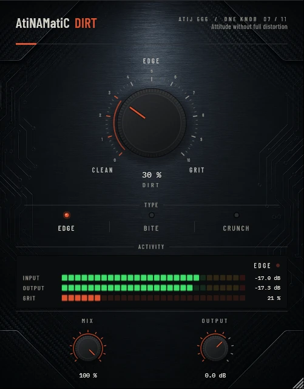

# AtiNAMatiC-Dirt -- User Manual

**Version 1.0.0** · ATIJ STUDIO · Windows · macOS · Linux · VST3 · CLAP · LV2 · AU (macOS) · Free and open source (GPL v3)



---

## What's new in v1.0.0

- First public release, now **free and open source** (GPL v3).
- New look, shared across the whole ONE KNOB Series.
- **Every plug-in format:** VST3, CLAP and LV2 on Windows, macOS and Linux, plus AU on macOS. (The standalone app has been retired: these work best inside your DAW.)
- New **ONE KNOB Series installers** for Windows and macOS: tick the plug-ins and formats you want, skip the rest. Linux gets an install script that asks the same questions.

## What's new in v0.2.0

- **Steady loudness, clean at 0 %.** The drive is now -4 to +24 dB into a unity-slope shaper with curve-derived (static, pedal-style) loudness compensation. The old version jumped +5.7 dB at 0 % in CRUNCH and fell by up to 5 dB at 100 %.
- **4× oversampling** — aliasing at high DIRT was as loud as -12 dB below the note; it is now far lower. Adds **38 samples** of latency (≈0.8 ms at 48 kHz), reported to the host; MIX's dry path is delay-matched.
- Switching TYPE now crossfades the shapers (no click); DIRT, MIX and OUTPUT are all smoothed.
- **New interface** — machined knob with a printed 0–10 scale, hardware-style mode switches that follow automation and preset recall, consistent value text ("72 %", "+1.5 dB"), resizable window (75–150 %, remembered per session). Double-click any knob to reset it; hold **Shift** while dragging for fine adjustment.

---

## 1. What it is

AtiNAMatiC-Dirt is a pre-amp **character drive** stage designed to sit **before** your Neural Amp Modeler (NAM) amp model in the signal chain. It adds grit, edge, and harmonic texture without crossing into full distortion territory. Think of it as giving the amp model a "dirtier guitar" to work with -- attitude without destruction.

It is intentionally subtle by design. The wave-shaper is auto-normalised so loudness barely changes as DIRT increases, making it safe to dial in and out without level jumps.

Three flavours of breakup let you match the character to the style:

| Type   | Character                                                     |
|--------|---------------------------------------------------------------|
| EDGE   | Smooth tanh saturation -- warm, even-harmonic sheen           |
| BITE   | tanh + soft hard-clip ceiling -- sharper transient attack     |
| CRUNCH | Double-tanh compression -- more squashed, fizzy upper grit    |

---

## 2. Signal chain placement

```
Guitar  ->  [AtiNAMatiC-Dirt]  ->  NAM Amp Model  ->  Cab / IR  ->  AtiNAMatiC-Air  ->  Master
```

**Always place AtiNAMatiC-Dirt before the amp model / NAM.** It voices itself for clean-to-crunch source material. Placing it after a fully-distorted amp sim will compound artefacts rather than enhance character.

---

## 3. The Controls

### DIRT (large knob, centre)
The master drive macro. Sweeps from 0% (clean pass-through) to 100% (full harmonic grit). Internally this maps to -4 to +24 dB of drive into a 4× oversampled wave-shaper, with curve-derived loudness compensation so the output level stays steady across the entire sweep.

Most players live between **20% and 55%**. Above 70% the grit becomes deliberate and pronounced -- useful for high-gain styles feeding a clean NAM model.

### TYPE (EDGE / BITE / CRUNCH)
Selects the saturation character (see table above). Each type also shifts the pre-emphasis frequency slightly to focus the grit where guitars project:

- **EDGE** focuses around 1.5 kHz -- the classic "woman tone" nasal body.
- **BITE** focuses a little higher -- attack and pick clarity.
- **CRUNCH** focuses upper-mids -- rasp and compression.

### MIX (Wet/Dry)
0% = bypass, 100% = fully processed. Default 100%. Blend back the dry signal to add just a hint of grit without committing fully -- useful for studio tracking when the engineer wants flexibility.

### OUTPUT (-24 to +12 dB)
Final trim after all processing. Even with auto make-up, different guitar pickups and amp models may need slight level matching here. Use it to match the bypassed level before committing to a setting.

### Activity Meter
Real-time dual-bar meter showing input and output levels (-60 to 0 dBFS). As DIRT increases, the output bar transitions from blue-grey to the rust/ember accent colour, giving a visual reference for how much harmonic content is being added.

### Grit Pill (top-right of meter area)
A LED-style indicator that names the current saturation character:

| Label | Meaning                                      |
|-------|----------------------------------------------|
| CLEAN | Negligible drive -- near-transparent output  |
| GRIT  | Subtle edge -- just kissing the shaper       |
| BITE  | Noticeable character -- harmonic texture     |
| FANG  | Heavy grit -- amp model will respond hard    |

---

## 4. System Requirements

| | Minimum |
|---|---|
| OS | Windows 10 64-bit (or later) |
| CPU | Any x64 processor (SSE2) |
| RAM | 32 MB |
| Formats | VST3, CLAP, LV2 |
| DAW | Any VST3 or CLAP host (Reaper, Ableton, FL Studio, Bitwig, etc.) |

Linux builds (VST3 + CLAP) available via `build-linux.sh`.

---

## 5. Installation

**Windows (64-bit)**

- **Easiest:** run `ONE-KNOB-Series-v1.0.0-Windows-x64-Setup.exe`, tick the plug-ins and formats you want and untick the rest.
- **Just this plug-in:** unzip `AtiNAMatiC-Dirt-v1.0.0-Windows-x64.zip` and copy:

| File | Copy to |
|---|---|
| `AtiNAMatiC-Dirt.vst3` | `C:\Program Files\Common Files\VST3\` |
| `AtiNAMatiC-Dirt.clap` | `C:\Program Files\Common Files\CLAP\` |
| `AtiNAMatiC-Dirt.lv2` | `C:\Program Files\Common Files\LV2\` |

**macOS 10.15 or later (Apple Silicon and Intel)**

- **Easiest:** open `ONE-KNOB-Series-v1.0.0-macOS-Installer.pkg`, click **Customize** and tick the plug-ins and formats you want.
- **Just this plug-in:** unzip `AtiNAMatiC-Dirt-v1.0.0-macOS.zip` and copy:

| File | Copy to |
|---|---|
| `AtiNAMatiC-Dirt.vst3` | `/Library/Audio/Plug-Ins/VST3/` |
| `AtiNAMatiC-Dirt.component` (AU) | `/Library/Audio/Plug-Ins/Components/` |
| `AtiNAMatiC-Dirt.clap` | `/Library/Audio/Plug-Ins/CLAP/` |
| `AtiNAMatiC-Dirt.lv2` | `/Library/Audio/Plug-Ins/LV2/` |

The plug-ins aren't signed by Apple. If macOS blocks the installer, right-click it and choose **Open**. If you copied files from the zip, clear the quarantine flag in Terminal, e.g. `xattr -cr /Library/Audio/Plug-Ins/VST3/AtiNAMatiC-Dirt.vst3`.

**Linux (x86_64 and ARM64)**

- **Easiest:** extract `ONE-KNOB-Series-v1.0.0-Linux-x86_64.tar.gz` (or `-Linux-ARM64`) and run `./install.sh`. It asks which plug-ins and formats to install. Use `./install.sh --system` to install for all users.
- **Just this plug-in:** unzip `AtiNAMatiC-Dirt-v1.0.0-Linux-x86_64.zip` (or `-Linux-ARM64`) and copy the `.vst3` folder to `~/.vst3/`, the `.clap` file to `~/.clap/` and the `.lv2` folder to `~/.lv2/`.

Then rescan plug-ins in your DAW.

## 6. Controls Reference (Quick Summary)

| Control   | Range          | Default | Description                      |
|-----------|----------------|---------|----------------------------------|
| DIRT      | 0 -- 100%      | 30%     | Drive macro (pre-shaper gain)    |
| TYPE      | EDGE/BITE/CRUNCH | EDGE  | Saturation character             |
| MIX       | 0 -- 100%      | 100%    | Dry/wet blend                    |
| OUTPUT    | -24 to +12 dB  | 0 dB    | Final output trim                |

---

## 7. Signal Chain (Internal)

```
Input
  --> HPF 40 Hz (sub tighten)
  --> Pre-emphasis peak (type-dependent, ~1.5 kHz)
  --> Drive gain (0 to +22 dB, driven by DIRT)
  --> Wave-shaper (EDGE / BITE / CRUNCH)
  --> De-emphasis (mirror of pre-emphasis)
  --> Post-tone tilt (gentle darkening as DIRT rises, prevents harshness)
  --> Auto make-up + OUTPUT trim
  --> Dry/wet MIX
Output
```

---

## 8. Typical Use Cases

### Clean-ish NAM model, wants more life
- TYPE: EDGE, DIRT: 25-40%, MIX: 100%
- Adds warmth and even harmonics without obvious distortion.

### High-gain rhythm -- wants attack and clarity
- TYPE: BITE, DIRT: 35-55%, MIX: 80-100%
- Sharpens pick attack, focuses the midrange before the amp model compresses it.

### Lead tone -- compressed, singing grit
- TYPE: CRUNCH, DIRT: 45-65%, MIX: 70-100%
- Double-tanh compression smooths peaks and adds fizzy sustain harmonic content.

### Subtle parallel blend
- Any type, DIRT: 50-80%, MIX: 20-40%
- Blends harmonic texture behind the dry signal -- adds "hair" without obvious effect.

---

## 9. Tips

- **Less is more.** At 30% DIRT even CRUNCH mode is subtle. Increase gradually and listen.
- **Stack with NAM.** AtiNAMatiC-Dirt is designed to excite the NAM model's input stage. Set NAM input gain lower when using high DIRT settings.
- **Use OUTPUT to null-test.** Set MIX to 0% and match levels with OUTPUT. Then raise MIX to hear exactly what Dirt is adding.
- **EDGE for chords, BITE for solos.** Type switching mid-song is valid -- automate it in your DAW.

---

## 10. About

**AtiNAMatiC-Dirt** is part of the **AtiNAMatiC Series** -- a suite of focused utility plug-ins built around the Neural Amp Modeler workflow.

- Designed & developed by **Atij** (Atij 666 Studio)
- Built with JUCE Framework (Raw Material Software Ltd.)
- VST3 SDK (Steinberg Media Technologies GmbH)
- Neural Amp Modeler -- Steven Atkinson & contributors
- CMake, MSVC, clap-juce-extensions, and the open-source audio community

Click the **AtiNAMatiC-Dirt** title badge in the plugin UI to open the About panel.
