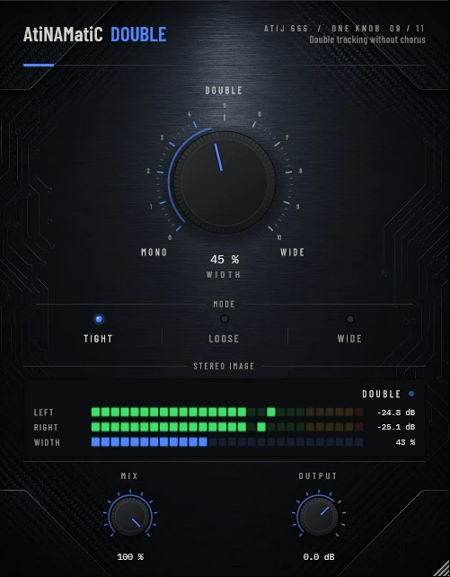

# AtiNAMatiC-Double -- User Manual

**Version 1.0.0** · ATIJ STUDIO · Windows · macOS · Linux · VST3 · CLAP · LV2 · AU (macOS) · Free and open source (GPL v3)



---

## What's new in v1.0.0

- First public release, now **free and open source** (GPL v3).
- New look, shared across the whole ONE KNOB Series.
- **Every plug-in format:** VST3, CLAP and LV2 on Windows, macOS and Linux, plus AU on macOS. (The standalone app has been retired: these work best inside your DAW.)
- New **ONE KNOB Series installers** for Windows and macOS: tick the plug-ins and formats you want, skip the rest. Linux gets an install script that asks the same questions.

## What's new in v0.2.0

- **0 % is now true mono.** The doubled voices fade out below 15 %, so the MONO end no longer adds a centred, comb-filtered copy.
- Width changes are smoothed per sample (no zipper noise), the voices no longer glide in pitch for a few seconds after loading, and each voice has a slightly different tone so they read as two takes rather than two copies.
- **New interface** — machined knob with a printed 0–10 scale, hardware-style mode switches that follow automation and preset recall, consistent value text ("72 %", "+1.5 dB"), resizable window (75–150 %, remembered per session). Double-click any knob to reset it; hold **Shift** while dragging for fine adjustment.

---

## 1. What it is

AtiNAMatiC-Double is a **studio double-tracking simulator** designed to sit after your amp/cab simulator in the signal chain. It produces two virtual "performance" voices from a single take, panned to opposite sides, with independent slow random-walk pitch and timing drift -- giving the perceptual impression of two separate performances without any audible chorus artefacts or comb filtering.

Key design goals:

- **Never sounds like a chorus.** The modulation is a band-limited random walk updating roughly every 0.5--1.5 seconds per voice, not a sine LFO.
- **Mono-safe.** The dry signal is always blended back through the centre so a sum to mono cannot phase-cancel to silence.
- **Always outputs stereo** -- works from a mono or stereo input.
- **One macro.** The WIDTH knob controls delay spread, drift magnitude and pan amount simultaneously through a smooth S-curve so the "natural double" zone sits in the comfortable 30--60% range.

---

## 2. Signal chain placement

```
Guitar  ->  Amp Sim (NAM / Helix / etc.)  ->  Cab / IR  ->  [Reverb/Delay]  ->  * AtiNAMatiC-Double *  ->  Master
```

Place Double **after** cab/IR and any mono reverb/delay. It should be one of the last inserts before the master bus so the stereo image it creates is the final spatial statement of the track.

For parallel double-tracking (blend the "doubled" image under a dry lead):
```
Lead guitar (dry) ------->|
                           +-> Mix -> Master
Doubled send (AtiNAMatiC-Double, MIX 100%) -->|
```

---

## 3. Controls

### WIDTH (large centre knob)
The master macro. Simultaneously scales:
- **Base delay spread** -- 8/11/14 ms (voice A) and 14/19/26 ms (voice B) depending on Mode, all scaled further by WIDTH.
- **Drift magnitude** -- how far each voice's pitch and timing wanders around its base delay.
- **L/R pan amount** -- voice A pans left, voice B pans right; at WIDTH 100% voice A is hard left, voice B is hard right.

A live readout (e.g. "45 %") is displayed at the knob centre.

Tick labels below the knob:

| Label  | Range    | Character                                          |
|--------|----------|----------------------------------------------------|
| MONO   | 0--15%   | Almost no separation; use as a subtle thickener    |
| DOUBLE | 15--70%  | Natural double-tracking sweet spot                 |
| WIDE   | 70--100% | Deliberately wide, more dramatic stereo image      |

### MODE (Tight / Loose / Wide)
Shapes the base delay times and maximum drift swing. Does **not** change the rate of the random walk -- all modes stay slow.

| Mode  | Voice A base | Voice B base | Drift swing | Max pan |
|-------|-------------|-------------|-------------|---------|
| Tight | 8 ms        | 14 ms       | 1.2 ms      | 85%     |
| Loose | 11 ms       | 19 ms       | 2.0 ms      | 90%     |
| Wide  | 14 ms       | 26 ms       | 2.8 ms      | 100%    |

- **Tight** -- studio close-mic double, very coherent, suits rhythm guitars and bass.
- **Loose** -- classic "two takes, different day" spread; the default for most uses.
- **Wide** -- maximum spread, almost M/S-like; good for leads and ambient textures.

### MIX (0--100%)
Wet/dry balance. At 100% you hear the full doubled image with the dry centre blend baked in. Lower it to taste to keep a leaner dry sound under the image.

### OUTPUT (-24 to +12 dB)
Final trim after all processing. The doubling can add perceived loudness; use this to level-match against your bypass.

---

## 4. Stereo Image panel

Located below the mode picker, the STEREO IMAGE panel gives real-time visual feedback:

**Level bars (L / R)** -- RMS dB bars from -60 dBFS to 0 dBFS with colour coding:
- Cyan: normal signal
- Amber: approaching 0 dB
- Red: at or above 0 dB

**Voice dot field** -- a horizontal strip showing voice A (cyan dot, left-biased) and voice B (violet dot, right-biased). Both dots drift around their pan centres as the random walk updates, giving a live picture of the current stereo spread.

---

## 5. System requirements

| Item            | Minimum                                     |
|-----------------|---------------------------------------------|
| OS              | Windows 10 64-bit (or later)                |
| CPU             | Any modern x64 processor                    |
| RAM             | 64 MB per instance                          |
| Plugin formats  | VST3, CLAP, LV2, AU on macOS (DAW) |
| Sample rates    | 44.1 / 48 / 88.2 / 96 / 176.4 / 192 kHz    |
| Latency         | Zero samples (no lookahead)                 |
| DAW             | Any VST3- or CLAP-compatible host           |

---

## 6. Installation

**Windows (64-bit)**

- **Easiest:** run `ONE-KNOB-Series-v1.0.0-Windows-x64-Setup.exe`, tick the plug-ins and formats you want and untick the rest.
- **Just this plug-in:** unzip `AtiNAMatiC-Double-v1.0.0-Windows-x64.zip` and copy:

| File | Copy to |
|---|---|
| `AtiNAMatiC-Double.vst3` | `C:\Program Files\Common Files\VST3\` |
| `AtiNAMatiC-Double.clap` | `C:\Program Files\Common Files\CLAP\` |
| `AtiNAMatiC-Double.lv2` | `C:\Program Files\Common Files\LV2\` |

**macOS 10.15 or later (Apple Silicon and Intel)**

- **Easiest:** open `ONE-KNOB-Series-v1.0.0-macOS-Installer.pkg`, click **Customize** and tick the plug-ins and formats you want.
- **Just this plug-in:** unzip `AtiNAMatiC-Double-v1.0.0-macOS.zip` and copy:

| File | Copy to |
|---|---|
| `AtiNAMatiC-Double.vst3` | `/Library/Audio/Plug-Ins/VST3/` |
| `AtiNAMatiC-Double.component` (AU) | `/Library/Audio/Plug-Ins/Components/` |
| `AtiNAMatiC-Double.clap` | `/Library/Audio/Plug-Ins/CLAP/` |
| `AtiNAMatiC-Double.lv2` | `/Library/Audio/Plug-Ins/LV2/` |

The plug-ins aren't signed by Apple. If macOS blocks the installer, right-click it and choose **Open**. If you copied files from the zip, clear the quarantine flag in Terminal, e.g. `xattr -cr /Library/Audio/Plug-Ins/VST3/AtiNAMatiC-Double.vst3`.

**Linux (x86_64 and ARM64)**

- **Easiest:** extract `ONE-KNOB-Series-v1.0.0-Linux-x86_64.tar.gz` (or `-Linux-ARM64`) and run `./install.sh`. It asks which plug-ins and formats to install. Use `./install.sh --system` to install for all users.
- **Just this plug-in:** unzip `AtiNAMatiC-Double-v1.0.0-Linux-x86_64.zip` (or `-Linux-ARM64`) and copy the `.vst3` folder to `~/.vst3/`, the `.clap` file to `~/.clap/` and the `.lv2` folder to `~/.lv2/`.

Then rescan plug-ins in your DAW.

## 7. Controls reference

| Control | Range         | Default | Unit |
|---------|---------------|---------|------|
| WIDTH   | 0 -- 100      | 45      | %    |
| MODE    | Tight/Loose/Wide | Tight | --  |
| MIX     | 0 -- 100      | 100     | %    |
| OUTPUT  | -24 -- +12    | 0       | dB   |

---

## 8. Internal signal chain

```
Input (mono or stereo)
  |
  v
[Mono sum (L+R)*0.5]
  |
  +-----> [Voice A delay line]  <-- slow random-walk drift (rate ~0.7-1.6 s)
  |            |  fractional-sample read tap
  |            v
  |       [Pan A: left-biased]
  |
  +-----> [Voice B delay line]  <-- independent random-walk drift (rate ~0.9-1.8 s)
  |            |  fractional-sample read tap
  |            v
  |       [Pan B: right-biased]
  |
  +-----> [Dry centre blend]  (always present, scales with WIDTH for mono safety)
  |
  v
[MIX crossfade with dry input]
  |
  v
[OUTPUT gain trim]
  |
  v
Stereo output
```

All delay taps use linear interpolation and a slewed read position (the slew itself creates the micro-pitch variation). There is no nonlinear processing and therefore no oversampling requirement.

---

## 9. Typical use cases

### Rhythm guitars (hard double)
- WIDTH: 70%, MODE: Tight, MIX: 100%  
  Tight base delays with hard pan give a classic "guitars left and right" image from one track.

### Natural double (two-take feel)
- WIDTH: 45%, MODE: Loose, MIX: 100%  
  The sweet spot -- sounds like two separate performances.

### Subtle thickener (mono mix)
- WIDTH: 15%, MODE: Tight, MIX: 100%  
  Very little separation; mainly adds density without obviously stereo-ising the track.

### Wide lead guitar
- WIDTH: 60%, MODE: Wide, MIX: 80%  
  Spread lead over the stereo field; back off MIX slightly to keep a centred anchor.

### Parallel double-tracking
- Send a copy of the track to AtiNAMatiC-Double, WIDTH: 80%, MIX: 100%.  
  Blend the return under the dry lead at -6 to -12 dB.

---

## 10. Tips

- **Start with MODE: Loose at WIDTH 40--50%** -- this is the most natural starting point for most tracks.
- **Watch the stereo image panel** -- if the voice dots drift too wide apart the image may collapse oddly on mono playback; bring WIDTH down until they sit within the centre 60% of the strip.
- **Automate WIDTH** for a build-up: start a verse at 30%, push to 60% in the chorus for a dramatic stereo expansion.
- **Do not use after reverb.** Applying double-tracking to a reverb tail causes audible smearing. Put reverb after Double, not before.
- **MIX at less than 100%** is useful when blending with a dry lead; this lets you keep a tight centre while still getting separation on the sides.
- **Output trim**: doubling two voices at 0.55 gain each adds roughly +1.5 dB perceived loudness at WIDTH 50%. Use OUTPUT -1.5 dB to level-match for A/B comparison.

---

## 11. About

**AtiNAMatiC-Double** is part of the **AtiNAMatiC Series** -- a family of focused, hardware-flavoured guitar tools for the modern post-amp signal chain.

- Design & development: **ATIJ** (Atij 666 Studio)
- Built with **JUCE 8** (juce.com)
- CLAP support via **clap-juce-extensions** (free-audio)
- Built with MSVC / CMake
- Thanks to the open-source community

Personal and commercial use permitted on machines you own.
Bug reports and feature requests: click the **AtiNAMatiC-Double** title badge in the plug-in window to open the About screen.

---

*AtiNAMatiC-Double -- Instant double tracking. No chorus. No comb.*
