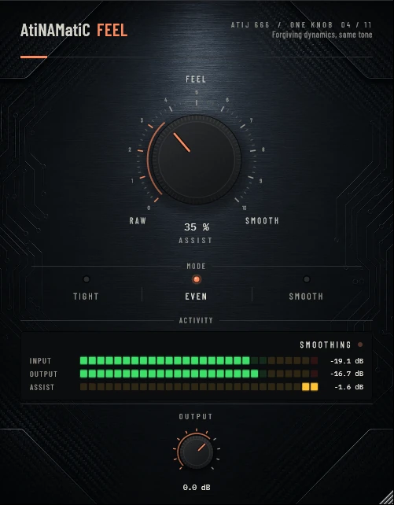

# AtiNAMatiC-Feel -- User Manual

**Version 1.0.0** · ATIJ STUDIO · Windows · macOS · Linux · VST3 · CLAP · LV2 · AU (macOS) · Free and open source (GPL v3)



---

## What's new in v1.0.0

- First public release, now **free and open source** (GPL v3).
- New look, shared across the whole ONE KNOB Series.
- **Every plug-in format:** VST3, CLAP and LV2 on Windows, macOS and Linux, plus AU on macOS. (The standalone app has been retired: these work best inside your DAW.)
- New **ONE KNOB Series installers** for Windows and macOS: tick the plug-ins and formats you want, skip the rest. Linux gets an install script that asks the same questions.

## What's new in v0.2.0

- **Actually tames pick spikes now.** The compressor uses a peak-hold detector with near-instant attack, so spikes come out smaller instead of larger (the old 3.5–18 ms attacks let the first half-millisecond of every attack through at full make-up gain). Still zero latency.
- **No more low-note distortion.** Both detectors used to ripple with the waveform on low notes (up to -22 dB THD on a low E); distortion is now below -60 dB.
- Make-up gain is now calibrated on DI guitar so the level stays within about ±1 dB across the ASSIST sweep; detection is stereo-linked (loudest channel).
- **New interface** — machined knob with a printed 0–10 scale, hardware-style mode switches that follow automation and preset recall, consistent value text ("72 %", "+1.5 dB"), resizable window (75–150 %, remembered per session). Double-click any knob to reset it; hold **Shift** while dragging for fine adjustment.

---

## 1. What it is

AtiNAMatiC-Feel is a **feel enhancer** designed to be placed *before* your amp sim. One large knob shapes how your raw pick attack and dynamics are transformed -- from completely transparent to deeply smoothed -- so you can stay focused on playing while the plug-in quietly makes everything respond better.

Under the hood it is a three-stage processing chain:

- **DC blocker (HPF @ 25 Hz)** -- removes subsonic rumble and DC offset so the compressor envelope is never confused by non-audio content.
- **Transient softener** -- a dual-envelope (1.5 ms fast / 20 ms slow attack, shared release) detector finds the exact spike of each pick attack and applies up to 5 dB of gentle duck, only during the initial milliseconds. Long sustain passes completely unaffected.
- **Feedforward soft-knee compressor (log-domain)** -- a single-sidechain stereo-coherent compressor with an auto-threshold that descends as ASSIST rises. Ratio and knee widen simultaneously, giving a smooth, consistent squeeze rather than sudden gain clamps. Stereo image is preserved because both channels share the same gain envelope from the left/right detection chain.
- **Auto make-up gain** -- static, calibrated on DI guitar (gain reduction at a -4.5 dBFS peak reference), so the output stays within about ±1 dB across the full ASSIST sweep.

Zero latency. No lookahead. No oversampling. Behaves identically to an analogue insert in front of your amp sim.

---

## 2. Signal chain placement

```
Guitar  -->  *** AtiNAMatiC-Feel ***  -->  Amp Sim (NAM / Helix / ML / etc.)  -->  Cab / IR
                                                                                    -->  AtiNAMatiC-Air / Reverb / Master
```

Place Feel **directly before your amp sim**, as the first insert in the chain. This is where it has the most impact -- it shapes the raw pick dynamics before the amp's own non-linearity acts on them.

**Not** recommended after the cab/IR or in a parallel reverb return -- the transient softener and compressor are tuned for unprocessed guitar signal.

---

## 3. Controls

### ASSIST (large centre knob, 0 -- 100%)

The single master macro. Everything is driven by this one control:

| ASSIST value | Threshold | Ratio | Knee | Transient softening | Resulting character |
|-------------|-----------|-------|------|--------------------|--------------------|
| 0% (RAW)    | off       | 1:1   | --   | none               | fully transparent   |
| 35% (default) | ~-22 dB | ~1.7:1 | 6 dB | moderate        | comfortable, slightly rounded |
| 65% (FEEL)  | ~-29 dB  | ~2.3:1 | 6 dB | substantial      | noticeably smoother, forgiving |
| 100% (PILLOW) | ~-34 dB | 3:1 | 6 dB | maximum           | very compressed, very smooth  |

The ASSIST pill (bottom-right of the meter panel) shows a label describing the current character: **RAW**, **EASE**, **FEEL**, **SMOOTH**, or **PILLOW**. A teal LED glows brighter as active softening increases.

Tick marks below the knob label the three anchor points: **RAW** (0%), **FEEL** (50%), and **SMOOTH** (100%).

### MODE (three-position selector)

Shapes the character of both the transient softener and compressor:

| Mode      | Comp attack | Comp release | Max ratio | Transient cut | Best for |
|-----------|------------|--------------|-----------|---------------|---------|
| **Tight** | near-instant | 90 ms      | 2.5:1     | minimal (×0.25) | Articulate playing where you want punch preserved. Palm mutes stay tight and percussive. |
| **Even** (default) | near-instant | 130 ms | 3:1 | moderate (×0.6) | Balanced response that works for most styles -- rhythm and lead alike. |
| **Smooth** | ~0.1 ms  | 220 ms       | 4:1       | maximum (×1.0) | Heavy softening for laid-back playing, heavily distorted tones, or when you want everything to feel effortless. |

### OUTPUT (-24 to +12 dB, default 0 dB)

Master output level after all processing. Use it to match the level of the next plug-in in the chain or compensate for any perceived loudness change. The value is displayed inside the knob's text box.

---

## 4. Activity meter and pill

### Meter panel (ACTIVITY section)

Three horizontal bars show real-time processing status:

| Bar | What it shows |
|-----|---------------|
| **INPUT** | Peak level entering the plug-in (post DC blocker) |
| **GR** (narrow strip) | Gain reduction in dB, filling right-to-left (up to 12 dB range). Teal colour. |
| **OUTPUT** | Peak level after all processing. Colour shifts from grey toward teal as the transient softener becomes active. |

The dB scale below the meter runs from -60 dB to 0 dB.

### FeelPill (bottom-right of the meter row)

A small LED indicator that shows the current processing character and activity:

| Label | ASSIST range | Meaning |
|-------|-------------|---------|
| **RAW** | 0 -- 5%     | No processing |
| **EASE** | 5 -- 30%   | Light touch |
| **FEEL** | 30 -- 65%  | Comfortable zone |
| **SMOOTH** | 65 -- 90% | Strong smoothing |
| **PILLOW** | 90 -- 100% | Maximum softening |

The teal LED brightens proportionally to how much transient softening is currently active. A fast pick on a bright-sounding string will flash the LED; long sustain will keep it dim even at high ASSIST.

---

## 5. Quick-start settings

### Everyday rhythm (feels like a great pick)
- MODE: Even -- ASSIST: 35% -- OUTPUT: 0 dB

### Heavy rhythm, lots of palm mutes (tight but forgiving)
- MODE: Tight -- ASSIST: 50% -- OUTPUT: 0 dB

### Single-note leads (fluid, consistent sustain)
- MODE: Smooth -- ASSIST: 45% -- OUTPUT: 0 dB

### Very aggressive high-gain (tame the harshest attack without killing punch)
- MODE: Tight -- ASSIST: 30% -- OUTPUT: 0 dB

### Effortless practice (maximum comfort, nothing hurts)
- MODE: Smooth -- ASSIST: 75% -- OUTPUT: 0 dB

---

## 6. Latency

AtiNAMatiC-Feel introduces **zero latency** at any sample rate.

No lookahead buffer, no oversampling delay, no latency compensation needed. The plug-in reports 0 samples of latency to the host. Your signal is processed in real time, sample by sample.

---

## 7. System requirements

| | Windows | macOS | Linux |
|--|---------|-------|-------|
| **OS** | Windows 10 / 11 (64-bit) | macOS 10.15 Catalina or later | Ubuntu 20.04+ / equivalent |
| **Formats** | VST3, CLAP, LV2 | VST3, AU, CLAP, LV2 | VST3, CLAP, LV2 |
| **CPU** | x86-64 | Apple Silicon (arm64) or Intel x86-64 | x86-64 |
| **RAM** | 4 GB minimum | 4 GB minimum | 4 GB minimum |
| **Sample rates** | 44.1 -- 192 kHz | 44.1 -- 192 kHz | 44.1 -- 192 kHz |

---

## 8. Installation

**Windows (64-bit)**

- **Easiest:** run `ONE-KNOB-Series-v1.0.0-Windows-x64-Setup.exe`, tick the plug-ins and formats you want and untick the rest.
- **Just this plug-in:** unzip `AtiNAMatiC-Feel-v1.0.0-Windows-x64.zip` and copy:

| File | Copy to |
|---|---|
| `AtiNAMatiC-Feel.vst3` | `C:\Program Files\Common Files\VST3\` |
| `AtiNAMatiC-Feel.clap` | `C:\Program Files\Common Files\CLAP\` |
| `AtiNAMatiC-Feel.lv2` | `C:\Program Files\Common Files\LV2\` |

**macOS 10.15 or later (Apple Silicon and Intel)**

- **Easiest:** open `ONE-KNOB-Series-v1.0.0-macOS-Installer.pkg`, click **Customize** and tick the plug-ins and formats you want.
- **Just this plug-in:** unzip `AtiNAMatiC-Feel-v1.0.0-macOS.zip` and copy:

| File | Copy to |
|---|---|
| `AtiNAMatiC-Feel.vst3` | `/Library/Audio/Plug-Ins/VST3/` |
| `AtiNAMatiC-Feel.component` (AU) | `/Library/Audio/Plug-Ins/Components/` |
| `AtiNAMatiC-Feel.clap` | `/Library/Audio/Plug-Ins/CLAP/` |
| `AtiNAMatiC-Feel.lv2` | `/Library/Audio/Plug-Ins/LV2/` |

The plug-ins aren't signed by Apple. If macOS blocks the installer, right-click it and choose **Open**. If you copied files from the zip, clear the quarantine flag in Terminal, e.g. `xattr -cr /Library/Audio/Plug-Ins/VST3/AtiNAMatiC-Feel.vst3`.

**Linux (x86_64 and ARM64)**

- **Easiest:** extract `ONE-KNOB-Series-v1.0.0-Linux-x86_64.tar.gz` (or `-Linux-ARM64`) and run `./install.sh`. It asks which plug-ins and formats to install. Use `./install.sh --system` to install for all users.
- **Just this plug-in:** unzip `AtiNAMatiC-Feel-v1.0.0-Linux-x86_64.zip` (or `-Linux-ARM64`) and copy the `.vst3` folder to `~/.vst3/`, the `.clap` file to `~/.clap/` and the `.lv2` folder to `~/.lv2/`.

Then rescan plug-ins in your DAW.

## 9. Controls reference

| Control | Range | Default | Description |
|---------|-------|---------|-------------|
| ASSIST | 0 -- 100% | 35% | Master macro. Controls compression threshold, ratio, knee, and transient softening simultaneously. |
| MODE | Tight / Even / Smooth | Even | Selects attack/release time constants and transient-cut intensity. |
| OUTPUT | -24 to +12 dB | 0 dB | Master output level after all processing. |

---

## 10. Internal signal chain

Each audio channel passes through the following stages, in order, every sample:

```
Input
  └─ DC blocker (SVF high-pass, 25 Hz, Q = 0.5)
       └─ Transient softener
            • Fast envelope follower  (τ ≈ 1.5 ms)
            • Slow envelope follower  (τ ≈ 30 ms)
            • Overshoot ratio  =  (fast − slow) / slow   [clamped 0..1]
            • Transient duck   =  −overshoot × ASSIST × mode_scale × 4 dB  [applied as linear gain]
                 └─ Feedforward soft-knee compressor (log domain, per channel,
                    sidechain from Ch0 for stereo coherence)
                         • Threshold = map(ASSIST, 0→1, −10 dB → mode_floor_dB)
                         • Ratio     = 1 + ASSIST × (mode_ratioMax − 1)
                         • Knee      = mode_kneeDb  (soft, applied at ±knee/2 around threshold)
                         • Envelope  = attack when GR increases, release when GR decreases
                              └─ Auto make-up gain  (static GR at −4.5 dBFS peak reference)
                                   └─ OUTPUT trim
Output
```

The compressor's gain envelope is **shared across all channels** (computed from Ch0, applied everywhere), preserving the stereo image. The DC blocker processes each channel independently.

---

## 11. Typical use cases

### Before a NAM amp model
Place Feel as the very first insert before NAM. Set MODE to Even and ASSIST to 30--50%. NAM responds to the dynamics you feed it -- softening the pick transient slightly lets NAM breathe more consistently and removes the harshness that aggressive picking sometimes adds at the amp input stage.

### Before a high-gain amp sim (Helix, Neural DSP, etc.)
High-gain amps amplify both your playing and your inconsistencies. Feel at 40--55% ASSIST (Even or Tight mode) smooths out the pick strength variance so the amp responds like you're always in the sweet spot.

### Comfort playing / practice
When you want everything to feel effortless -- long sessions, sight-reading, or getting ideas down fast -- set MODE to Smooth and ASSIST to 60--80%. The softener takes the edge off harsh attacks and the compressor keeps dynamics forgiving, so you can focus entirely on the music.

### Tracking a lead tone
Leads need consistent sustain without choking the note. Even mode at 45% ASSIST keeps the attack articulate (not squashed) while gently lifting the sustain tail and rounding any sharp pick click.

---

## 12. Tips

- **Start at the default**: MODE Even, ASSIST 35%. This is the calibrated "comfortable" position -- subtle enough that you might not notice it's there, but remove it and you'll miss it.
- **Tight mode for palm mutes**: Tight's short release (80 ms) lets each muted chunk pop distinctly, while still taking the edge off the attack. Great for metal rhythm.
- **Smooth mode for cleans**: On a clean amp, Smooth at 50% ASSIST creates a compressor-pedal-like bloom that suits fingerpicking or chord comping.
- **OUTPUT for gain staging**: If your amp sim or next plug-in is sensitive to input level, use OUTPUT to match unity. Feel's auto make-up covers most of the static GR but you may want a nudge up or down.
- **FeelPill flashing on every pick**: Normal -- it is showing the transient softener firing. If the LED stays bright continuously even between notes, you may have a very hot input signal; lower OUTPUT or the gain into the plug-in.
- **Zero latency means zero offset**: Feel introduces no delay, so no PDC adjustment or manual sample offset is ever needed.

---

## 13. About

**AtiNAMatiC-Feel** is part of the AtiNAMatiC series by **Atij 666 Studio** -- a collection of guitar-focused plug-ins built around a single principle: one knob that does the right thing.

Built with:
- [JUCE](https://juce.com/) -- Raw Material Software Ltd.
- [VST3 SDK](https://www.steinberg.net/vst3sdk) -- Steinberg Media Technologies GmbH
- [clap-juce-extensions](https://github.com/free-audio/clap-juce-extensions) -- Free Audio
- [Neural Amp Modeler (NAM)](https://github.com/sdatkinson/neural-amp-modeler) -- Steven Atkinson & contributors

Thank you to everyone who makes open-source audio tools possible.

---

*AtiNAMatiC-Feel v1.0.0 · Atij 666 Studio · 2026*
