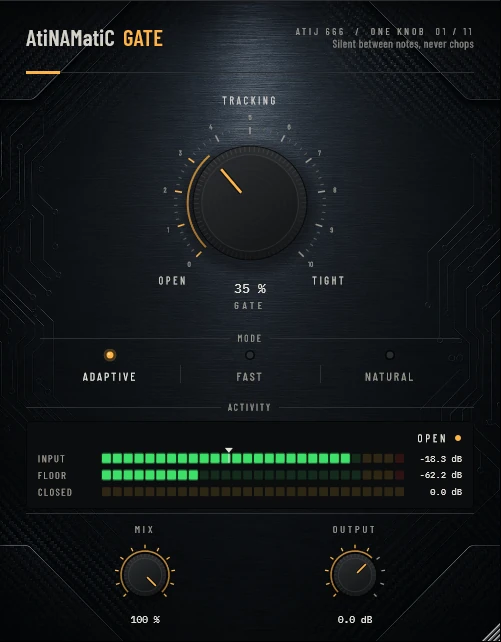

# AtiNAMatiC-Gate -- User Manual

**Version 1.0.0** · ATIJ STUDIO · Windows · macOS · Linux · VST3 · CLAP · LV2 · AU (macOS) · Free and open source (GPL v3)



---

## What's new in v1.0.0

- First public release, now **free and open source** (GPL v3).
- New look, shared across the whole ONE KNOB Series.
- **Every plug-in format:** VST3, CLAP and LV2 on Windows, macOS and Linux, plus AU on macOS. (The standalone app has been retired: these work best inside your DAW.)
- New **ONE KNOB Series installers** for Windows and macOS: tick the plug-ins and formats you want, skip the rest. Linux gets an install script that asks the same questions.

## What's new in v0.2.0

- **ADAPTIVE now adapts in every case.** The noise-floor tracker could only learn while the gate was closed — so if the noise itself held the gate open from the start, Adaptive never raised the threshold. It now also learns from anything quieter than -50 dBFS.
- **New interface** — machined knob with a printed 0–10 scale, hardware-style mode switches that follow automation and preset recall, consistent value text ("72 %", "+1.5 dB"), resizable window (75–150 %, remembered per session). Double-click any knob to reset it; hold **Shift** while dragging for fine adjustment.

---

## 1. What it is

AtiNAMatiC-Gate is a **professional noise gate** built specifically for high-gain guitar. One large knob controls everything -- from threshold and hysteresis to hold time and aggressiveness -- so you stay focused on playing instead of tweaking.

Under the hood it is a full pro-grade gate engine:

- **Sidechain HPF at 90 Hz** -- low-end rumble and hum cannot false-trigger the gate.
- **Dual-time-constant detector** -- a fast peak follower catches transients; a slow RMS follower tracks sustain. Both feed the same decision circuit.
- **Hysteresis (open/close gap)** -- the close threshold is always lower than the open threshold, so the gate never chatters at the boundary.
- **Adaptive noise-floor tracking** -- in Adaptive mode the open threshold automatically lifts 10 dB above the measured noise floor, so a warming amp stays gated even as it heats up.
- **Hold time** -- after the signal falls below the close threshold the gate stays fully open for a short hold period, eliminating end-of-note chatter on palm mutes.
- **Asymmetric attack/release with cubic easing** -- smooth, click-free transitions that do not add audible artifacts.
- **3 ms audio lookahead** -- the gate opens *before* the transient arrives, so it never chops a pick attack even at the Tightest setting.
- **Soft attenuation floor (-65 dB)** -- the gate attenuates instead of hard-muting, so bleed and amp hiss fade out rather than snapping off.

---

## 2. Signal chain placement

```
Guitar  -->  Amp Sim (NAM / Helix / ML Sound Lab / etc.)  -->  Cab / IR
          -->  *** AtiNAMatiC-Gate ***  -->  AtiNAMatiC-Air / Reverb / Master
```

Place the gate **directly after your amp sim / cab IR**, before any time-based effects.
Gating after reverb or delay cuts the tail; gating before the amp sim may change the amp's natural compression and feel.

For a parallel rig (wet/dry/wet), insert the gate on each dry cab channel individually.

---

## 3. Controls

### GATE (large centre knob, 0 -- 100%)
The single master macro. As you turn it clockwise:

| GATE value | Open threshold | Hysteresis gap | Hold time | Aggressiveness |
|------------|---------------|----------------|-----------|----------------|
| 0% (OPEN)  | -78 dB        | 4 dB           | longest   | gentlest       |
| 50%        | -50 dB        | 6 dB           | medium    | moderate       |
| 100% (TIGHT)| -22 dB       | 8 dB           | shortest  | tightest       |

**Start at 35--50%** for most high-gain situations. Increase until the noise between notes disappears. Decrease if the gate is chopping pick attacks or cutting note tails.

The current value is shown as a percentage in the label directly below the knob. Tick marks label the three key positions: **OPEN**, **TRACKING**, and **TIGHT**.

### MODE (three-position selector)
Chooses the time constants used by the gate engine:

| Mode      | Attack  | Release | Hold base | Best for |
|-----------|---------|---------|-----------|----------|
| **Adaptive** (default) | 1.5 ms | 90 ms | 60 ms | Most situations. Threshold follows the noise floor automatically. |
| **Fast**   | 0.4 ms  | 25 ms  | 20 ms | Tight metal / djent riffs where you need near-instant gating between fast palm-mute chops. |
| **Natural**| 2.5 ms | 260 ms | 120 ms | Clean or lightly driven tones, leads, and any source where you want the gate to breathe. |

Hold time scales down with the GATE knob in all modes: the tighter the gate, the shorter the hold.

### MIX (0 -- 100%, default 100%)
Dry/wet blend. At 100% only the gated signal is heard. Lower MIX blends in the original dry signal in parallel, useful if you want just a hint of noise reduction without touching the note tails. Default 100%.

### OUTPUT (-24 to +12 dB, default 0 dB)
Master output level after gating. Use it to compensate for level differences between gate-open and gate-closed moments in a mix, or simply to match the level of an adjacent track. The value is displayed inside the knob's text box.

### ACTIVITY meter (centre panel)
Two horizontal bars showing real-time signal status:

| Bar | What it shows |
|-----|---------------|
| **INPUT** | Peak level of the signal entering the gate (after the lookahead buffer) |
| **THRESHOLD** | The current open threshold -- moves in Adaptive mode as the noise floor is tracked |

The dB scale below the meter runs from -60 dB to 0 dB.

### State pill (bottom centre, below the meter)
A three-state indicator showing the gate's current condition:

| Pill label | Meaning |
|------------|---------|
| **CLOSED** | Gate is attenuating (-65 dB floor applied) |
| **OPEN**   | Gate is fully open, passing signal at unity |
| *(transitioning)* | Gate is in attack or release phase (pill fades between states) |

---

## 4. Quick-start settings

### General high-gain rhythm
- MODE: Adaptive -- GATE: 45% -- MIX: 100% -- OUTPUT: 0 dB

### Tight djent / metal (fast riffs)
- MODE: Fast -- GATE: 65% -- MIX: 100% -- OUTPUT: 0 dB

### Noisy vintage amp (hum reduction)
- MODE: Adaptive -- GATE: 30% -- MIX: 100% -- OUTPUT: 0 dB
*(Low GATE keeps threshold below the amp's harmonic floor so sustain is not affected.)*

### Lead / single-note lines
- MODE: Natural -- GATE: 35% -- MIX: 100% -- OUTPUT: 0 dB

### Parallel blend (keep natural tails)
- MODE: Adaptive -- GATE: 60% -- MIX: 60% -- OUTPUT: 0 dB
*(Gated signal blended with 40% dry preserves the natural decay while cutting most noise.)*

---

## 5. Latency

AtiNAMatiC-Gate introduces exactly **3 ms of lookahead latency** at any sample rate.

This latency is **reported to your DAW** via the standard plug-in latency API, so PDC (Plugin Delay Compensation) is applied automatically -- your gated channel stays phase-aligned with every other track with no manual offset required.

At 44.1 kHz the lookahead is 132 samples. At 48 kHz it is 144 samples. At 96 kHz it is 288 samples.

---

## 6. System requirements

| | Windows | macOS | Linux |
|--|---------|-------|-------|
| **OS** | Windows 10 / 11 (64-bit) | macOS 10.15 Catalina or later | Ubuntu 20.04+ / equivalent |
| **Formats** | VST3, CLAP, LV2 | VST3, AU, CLAP, LV2 | VST3, CLAP, LV2 |
| **CPU** | x86-64 | Apple Silicon (arm64) or Intel x86-64 | x86-64 |
| **RAM** | 4 GB minimum | 4 GB minimum | 4 GB minimum |
| **Sample rates** | 44.1 -- 192 kHz | 44.1 -- 192 kHz | 44.1 -- 192 kHz |

---

## 7. Installation

**Windows (64-bit)**

- **Easiest:** run `ONE-KNOB-Series-v1.0.0-Windows-x64-Setup.exe`, tick the plug-ins and formats you want and untick the rest.
- **Just this plug-in:** unzip `AtiNAMatiC-Gate-v1.0.0-Windows-x64.zip` and copy:

| File | Copy to |
|---|---|
| `AtiNAMatiC-Gate.vst3` | `C:\Program Files\Common Files\VST3\` |
| `AtiNAMatiC-Gate.clap` | `C:\Program Files\Common Files\CLAP\` |
| `AtiNAMatiC-Gate.lv2` | `C:\Program Files\Common Files\LV2\` |

**macOS 10.15 or later (Apple Silicon and Intel)**

- **Easiest:** open `ONE-KNOB-Series-v1.0.0-macOS-Installer.pkg`, click **Customize** and tick the plug-ins and formats you want.
- **Just this plug-in:** unzip `AtiNAMatiC-Gate-v1.0.0-macOS.zip` and copy:

| File | Copy to |
|---|---|
| `AtiNAMatiC-Gate.vst3` | `/Library/Audio/Plug-Ins/VST3/` |
| `AtiNAMatiC-Gate.component` (AU) | `/Library/Audio/Plug-Ins/Components/` |
| `AtiNAMatiC-Gate.clap` | `/Library/Audio/Plug-Ins/CLAP/` |
| `AtiNAMatiC-Gate.lv2` | `/Library/Audio/Plug-Ins/LV2/` |

The plug-ins aren't signed by Apple. If macOS blocks the installer, right-click it and choose **Open**. If you copied files from the zip, clear the quarantine flag in Terminal, e.g. `xattr -cr /Library/Audio/Plug-Ins/VST3/AtiNAMatiC-Gate.vst3`.

**Linux (x86_64 and ARM64)**

- **Easiest:** extract `ONE-KNOB-Series-v1.0.0-Linux-x86_64.tar.gz` (or `-Linux-ARM64`) and run `./install.sh`. It asks which plug-ins and formats to install. Use `./install.sh --system` to install for all users.
- **Just this plug-in:** unzip `AtiNAMatiC-Gate-v1.0.0-Linux-x86_64.zip` (or `-Linux-ARM64`) and copy the `.vst3` folder to `~/.vst3/`, the `.clap` file to `~/.clap/` and the `.lv2` folder to `~/.lv2/`.

Then rescan plug-ins in your DAW.

## 8. Controls reference

| Control | Range | Default | Description |
|---------|-------|---------|-------------|
| GATE | 0 -- 100% | 35% | Master macro. Controls threshold (-78 to -22 dB), hysteresis (4--8 dB), hold time, and aggressiveness. |
| MODE | Adaptive / Fast / Natural | Adaptive | Selects the time constants for attack, release, and hold. |
| MIX | 0 -- 100% | 100% | Dry/wet parallel blend. |
| OUTPUT | -24 to +12 dB | 0 dB | Master output level after gating. |

---

## 9. Internal signal chain

```
Input
  |
  +-- [Sidechain copy] --> HPF @ 90 Hz --> Peak follower + RMS detector
  |                                               |
  |                              Adaptive noise floor tracker
  |                                               |
  |                              Gate decision (open / hold / close)
  |                                               |
  |                              Attack / release with cubic easing
  |                                               |
  +-- [3 ms lookahead delay] ----------> Gain apply (floor: -65 dB)
                                               |
                                         MIX (parallel blend with dry)
                                               |
                                         OUTPUT gain
                                               |
                                           Output
```

The sidechain path is always mono (left channel only for stereo signals) so the gate decision is consistent regardless of stereo phase differences. The gain is applied identically to all output channels.

---

## 10. Typical use cases

**Rhythm guitar (high gain)**
Insert after your amp sim / cab IR. Set MODE: Adaptive, GATE: 45%. The gate silences hum and hiss between riffs while the 3 ms lookahead ensures no pick attack is ever lost. Hold time keeps notes from choking on faster riffs.

**Lead guitar**
Set MODE: Natural, GATE: 30--40%. The longer release (260 ms) preserves sustain and lets vibrato notes decay naturally. MIX at 100%. Lower GATE if the gate is audibly squeezing the end of long bends.

**Drop-tuned / djent (very fast riffs)**
Set MODE: Fast, GATE: 60--75%. The 0.4 ms attack is near-instant. If the gate is still letting a tiny burst of pre-note hiss through, increase GATE by 5--10%.

**Vintage amp hum**
Set MODE: Adaptive, GATE: 25--35%. Adaptive mode tracks the hum floor and parks the threshold just above it, so the gate closes as tightly as needed without needing manual threshold adjustment when the amp warms up.

**Parallel noise reduction**
Set MIX: 40--70%. This blends gated and dry signals together. The noise is reduced without completely removing the natural tail of each note. Works well on clean or lightly crunch tones where hard gating sounds unnatural.

---

## 11. Tips

- **If pick attacks are still being clipped:** lower GATE toward 30%. The threshold may be too high, closing the gate before the pick fully arrives in the lookahead window. Alternatively, check that the gate is after the amp sim (not before) -- amp sims compress the transient which can confuse the detector.

- **If hiss bleeds through between notes:** raise GATE toward 60%. Also check MODE is not set to Natural (long release lets more noise through at the tail of each note).

- **Use GATE + MIX together for parallel gating:** GATE at 70%, MIX at 50% is a common starting point. The gated copy removes most noise while the 50% dry blend preserves natural feel.

- **Adaptive mode with a cold amp:** if your amp sim's noise floor changes as the session warms up, Adaptive tracks it automatically. You rarely need to touch the GATE knob between takes.

- **Automation:** all four parameters (GATE, MODE, MIX, OUTPUT) are fully automatable in any DAW. MODE changes are per-block, so automate it only at section boundaries to avoid audible clicks.

- **3 ms latency:** at 44.1 kHz this is 132 samples -- easily absorbed by any modern DAW with PDC enabled. If you are routing to external hardware, offset your hardware outputs by the same amount.

---

## 12. About

- Design & development: **Atij** (Atij 666 Studio)
- Built with **JUCE 8** (juce.com)
- DSP inspired by the professional gate designs found in classic hardware units
- Neural Amp Modeler (NAM) by **Steven Atkinson** (the amp sims this gate was built to complement)
- Thank you to the open-source audio and guitar-plugin community

---

## 13. License & support

Personal and commercial use permitted on machines you own.
Bug reports and feature requests: click the **AtiNAMatiC-Gate** title badge in the plug-in window to open the About dialog.

---

*AtiNAMatiC-Gate is part of the AtiNAMatiC Series -- a family of focused, hardware-flavoured guitar tools for the modern post-amp signal chain.*
