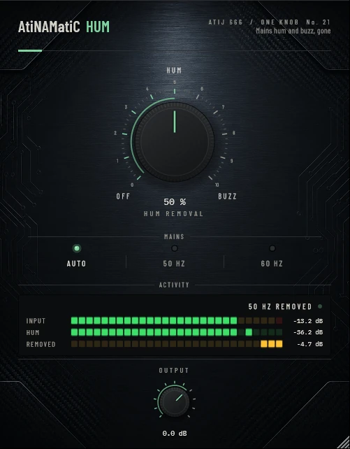

# AtiNAMatiC-Hum — User Manual

**Version 1.0.0** · ATIJ STUDIO · Windows · macOS · Linux · VST3 · CLAP · LV2 · AU (macOS) · Free and open source (GPL v3)



---

## What's new in v1.0.0

- First public release, now **free and open source** (GPL v3).
- New look, shared across the whole ONE KNOB Series.
- **Every plug-in format:** VST3, CLAP and LV2 on Windows, macOS and Linux, plus AU on macOS. (The standalone app has been retired: these work best inside your DAW.)
- New **ONE KNOB Series installers** for Windows and macOS: tick the plug-ins and formats you want, skip the rest. Linux gets an install script that asks the same questions.

## 1. What it is

Single-coil pickups, ground loops and nearby power supplies put a steady **hum** (50 or 60 Hz) and a harsher **buzz** (its upper harmonics) into your DI. An amp sim with lots of gain makes it much louder. A gate only hides it between notes; AtiNAMatiC-Hum removes it while you play.

- A cascade of true notches, each only about 2.5 Hz wide, at the mains frequency and its harmonics. Narrow enough that your notes pass.
- **Auto** works out whether your hum is 50 Hz or 60 Hz by itself.
- Measured: hum removed by about 15 dB (30 %), 22 dB (60 %) and 31–38 dB (100 %); a clean guitar with no hum loses only 0.2–0.3 dB.
- Zero latency.

## 2. Signal chain placement

```
Guitar -> [AtiNAMatiC-Hum] -> Gate -> ... -> Amp sim
```

Put Hum **first**, before the gate and before anything that adds gain.

## 3. Controls

### HUM REMOVAL (big knob, 0–100 %, default 50 %)
Sets both how deep the notches cut (0 → -40 dB) and how many harmonics are treated (2 → 12). The low end of the knob (HUM) takes out the 50/60 Hz hum; higher settings (BUZZ) also remove the upper harmonics that make single-coil buzz.

### MAINS (mode switch)

| Mains | Use |
|---|---|
| **Auto** (default) | detects 50 Hz or 60 Hz from your signal (needs a second or two of hum to decide) |
| **50 Hz** | Europe, Asia, Africa, Australia, most of South America |
| **60 Hz** | North America, parts of South America, Japan (west), Korea, Taiwan, Philippines |

### OUTPUT (-24 to +12 dB)
Final trim.

## 4. Meters

- **INPUT** — peak level.
- **HUM** — energy of the hum series in your input.
- **REMOVED** — how much of it is being taken out, in dB.
- Status: **CLEAN**, **50 HZ HUM** / **60 HZ HUM**, or **… REMOVED**.

## 5. Installation

**Windows (64-bit)**

- **Easiest:** run `ONE-KNOB-Series-v1.0.0-Windows-x64-Setup.exe`, tick the plug-ins and formats you want and untick the rest.
- **Just this plug-in:** unzip `AtiNAMatiC-Hum-v1.0.0-Windows-x64.zip` and copy:

| File | Copy to |
|---|---|
| `AtiNAMatiC-Hum.vst3` | `C:\Program Files\Common Files\VST3\` |
| `AtiNAMatiC-Hum.clap` | `C:\Program Files\Common Files\CLAP\` |
| `AtiNAMatiC-Hum.lv2` | `C:\Program Files\Common Files\LV2\` |

**macOS 10.15 or later (Apple Silicon and Intel)**

- **Easiest:** open `ONE-KNOB-Series-v1.0.0-macOS-Installer.pkg`, click **Customize** and tick the plug-ins and formats you want.
- **Just this plug-in:** unzip `AtiNAMatiC-Hum-v1.0.0-macOS.zip` and copy:

| File | Copy to |
|---|---|
| `AtiNAMatiC-Hum.vst3` | `/Library/Audio/Plug-Ins/VST3/` |
| `AtiNAMatiC-Hum.component` (AU) | `/Library/Audio/Plug-Ins/Components/` |
| `AtiNAMatiC-Hum.clap` | `/Library/Audio/Plug-Ins/CLAP/` |
| `AtiNAMatiC-Hum.lv2` | `/Library/Audio/Plug-Ins/LV2/` |

The plug-ins aren't signed by Apple. If macOS blocks the installer, right-click it and choose **Open**. If you copied files from the zip, clear the quarantine flag in Terminal, e.g. `xattr -cr /Library/Audio/Plug-Ins/VST3/AtiNAMatiC-Hum.vst3`.

**Linux (x86_64 and ARM64)**

- **Easiest:** extract `ONE-KNOB-Series-v1.0.0-Linux-x86_64.tar.gz` (or `-Linux-ARM64`) and run `./install.sh`. It asks which plug-ins and formats to install. Use `./install.sh --system` to install for all users.
- **Just this plug-in:** unzip `AtiNAMatiC-Hum-v1.0.0-Linux-x86_64.zip` (or `-Linux-ARM64`) and copy the `.vst3` folder to `~/.vst3/`, the `.clap` file to `~/.clap/` and the `.lv2` folder to `~/.lv2/`.

Then rescan plug-ins in your DAW.

## 6. Tips

- Start at 40–60 %; go higher only if you still hear buzz after the amp.
- If Auto picks the wrong mains on a near-silent signal, set 50 Hz or 60 Hz manually.
- Double-click any knob to reset it; hold Shift while dragging for fine control.

---

*AtiNAMatiC-Hum v1.0.0 · Atij 666 Studio*
