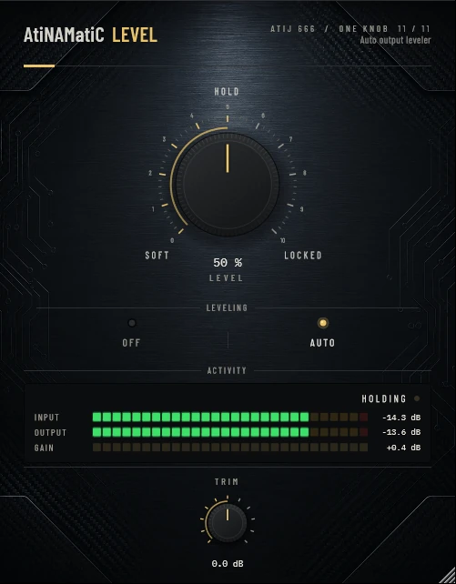

# AtiNAMatiC-Level — User Manual
**Version 1.0.0** · ATIJ STUDIO · Windows · macOS · Linux · VST3 · CLAP · LV2 · AU (macOS) · Free and open source (GPL v3)



---

## What's new in v1.0.0

- First public release, now **free and open source** (GPL v3).
- New look, shared across the whole ONE KNOB Series.
- **Every plug-in format:** VST3, CLAP and LV2 on Windows, macOS and Linux, plus AU on macOS. (The standalone app has been retired: these work best inside your DAW.)
- New **ONE KNOB Series installers** for Windows and macOS: tick the plug-ins and formats you want, skip the rest. Linux gets an install script that asks the same questions.

## What's new in v0.2.0

- **No more lurching or pumping.** Moving the LEVEL knob used to wipe the loudness detector, briefly releasing the gain; and the 1 dB deadband snapped the target back to 0 dB, so levels hovering near ±1 dB toggled (the "wavy" sound). The detector is now continuous and the deadband holds its value instead of snapping.
- Gaps and silence no longer get boosted (the gain holds when the signal falls 30 dB below target). The output safety stage is now a smooth knee from -2 dBFS instead of a near-hard clip at -0.1 dBFS.
- **New interface** — machined knob with a printed 0–10 scale, hardware-style mode switches that follow automation and preset recall, consistent value text ("72 %", "+1.5 dB"), resizable window (75–150 %, remembered per session). Double-click any knob to reset it; hold **Shift** while dragging for fine adjustment.

---

## What It Is

AtiNAMatiC-Level is an **auto output leveler** designed to live at the very end of your guitar signal chain — after your NAM model, cab sim, EQ, and any other processors.

It continuously measures short-term RMS loudness and applies a smooth correction gain to keep your perceived output level consistent, regardless of what happens upstream: palm mutes, big chords, lead boosts, or riff changes. The result is a more controlled, mix-ready signal with less work from the engineer.

When AUTO is off, the correction is bypassed and the gain stage becomes a simple trim — the meters still run so you can A/B the leveling effect at any time.

---

## Signal Chain Placement

```
Guitar → NAM Model → Cab Sim → EQ / FX → [AtiNAMatiC-Level] → DAW track / bus
```

Place Level **last** in the chain. It should see the fully processed signal so it can react to the actual output loudness, not an intermediate stage.

---

## Controls

| Control | Range | Default | Description |
|---------|-------|---------|-------------|
| **LEVEL** | Soft → Locked | 50% | The main macro. Controls how aggressively the leveler works. |
| **AUTO** | ON / OFF | ON | Enables or bypasses the auto-gain correction. Meters always active. |
| **TRIM** | −12 dB … +12 dB | 0 dB | Output offset applied *after* the leveling stage. |

### LEVEL macro in detail

The LEVEL knob simultaneously scales three internal parameters:

| Parameter | Soft (0%) | Locked (100%) |
|-----------|-----------|---------------|
| Detector time | 600 ms | 250 ms |
| Attack time | 250 ms | 20 ms |
| Release time | 1500 ms | 400 ms |
| Max correction | ±4 dB | ±18 dB |

- **Soft** — slow, gentle leveling. Preserves pick dynamics and natural swells. Good for clean tones and recordings where you want to feel the playing.
- **Locked** — fast, tight leveling. Keeps the fader rock-steady. Good for heavy rhythm tracks that need to sit consistently in the mix.
- **Mid (50%)** — a balanced starting point suitable for most uses.

### AUTO toggle

- **ON** — correction gain is computed and applied.
- **OFF** — correction is bypassed; only the TRIM offset is applied. The signal passes through untouched (apart from TRIM). Meters still display input/output levels for A/B comparison.

### TRIM

Shifts the final output level without changing the leveling action. Use it to match the plugin's output to the rest of your mix, or to compensate for level differences between different NAM models.

---

## Meters & Indicators

### Dual-band meter (INPUT / OUTPUT)

- **INPUT** — pre-leveling signal level.
- **OUTPUT** — post-leveling signal level.
- The amber marker at **−18 dBFS** shows the internal RMS target. In Locked mode with a consistent signal, the output should stabilise near this marker.
- The OUTPUT bar colour shifts toward amber as the correction amount increases.

### Level Pill (top-right of meter section)

Shows the current correction state:

| Display | Meaning |
|---------|---------|
| **LOCKED** | Correction < 0.5 dB — the signal is already at target. |
| **+X dB** | Leveler is boosting (signal was too quiet). |
| **−X dB** | Leveler is cutting (signal was too loud). |
| **BYPASS** | AUTO is off. |

The LED dot glows brighter as correction increases.

---

## System Requirements

| | Minimum |
|---|---|
| **OS** | Windows 10 (64-bit) / macOS 10.15+ / Linux (Ubuntu 20.04+) |
| **CPU** | Any modern x64 processor |
| **RAM** | 4 GB |
| **DAW** | Any VST3 or CLAP host |
| **Formats** | VST3, CLAP, LV2 (Windows/Linux); + AU (macOS) |

---

## Installation

**Windows (64-bit)**

- **Easiest:** run `ONE-KNOB-Series-v1.0.0-Windows-x64-Setup.exe`, tick the plug-ins and formats you want and untick the rest.
- **Just this plug-in:** unzip `AtiNAMatiC-Level-v1.0.0-Windows-x64.zip` and copy:

| File | Copy to |
|---|---|
| `AtiNAMatiC-Level.vst3` | `C:\Program Files\Common Files\VST3\` |
| `AtiNAMatiC-Level.clap` | `C:\Program Files\Common Files\CLAP\` |
| `AtiNAMatiC-Level.lv2` | `C:\Program Files\Common Files\LV2\` |

**macOS 10.15 or later (Apple Silicon and Intel)**

- **Easiest:** open `ONE-KNOB-Series-v1.0.0-macOS-Installer.pkg`, click **Customize** and tick the plug-ins and formats you want.
- **Just this plug-in:** unzip `AtiNAMatiC-Level-v1.0.0-macOS.zip` and copy:

| File | Copy to |
|---|---|
| `AtiNAMatiC-Level.vst3` | `/Library/Audio/Plug-Ins/VST3/` |
| `AtiNAMatiC-Level.component` (AU) | `/Library/Audio/Plug-Ins/Components/` |
| `AtiNAMatiC-Level.clap` | `/Library/Audio/Plug-Ins/CLAP/` |
| `AtiNAMatiC-Level.lv2` | `/Library/Audio/Plug-Ins/LV2/` |

The plug-ins aren't signed by Apple. If macOS blocks the installer, right-click it and choose **Open**. If you copied files from the zip, clear the quarantine flag in Terminal, e.g. `xattr -cr /Library/Audio/Plug-Ins/VST3/AtiNAMatiC-Level.vst3`.

**Linux (x86_64 and ARM64)**

- **Easiest:** extract `ONE-KNOB-Series-v1.0.0-Linux-x86_64.tar.gz` (or `-Linux-ARM64`) and run `./install.sh`. It asks which plug-ins and formats to install. Use `./install.sh --system` to install for all users.
- **Just this plug-in:** unzip `AtiNAMatiC-Level-v1.0.0-Linux-x86_64.zip` (or `-Linux-ARM64`) and copy the `.vst3` folder to `~/.vst3/`, the `.clap` file to `~/.clap/` and the `.lv2` folder to `~/.lv2/`.

Then rescan plug-ins in your DAW.

## Controls Reference

| Control | Parameter ID | Type | Range | Default |
|---------|-------------|------|-------|---------|
| LEVEL | `level` | Float | 0.0 – 1.0 | 0.5 |
| AUTO | `autoOn` | Bool | ON / OFF | ON |
| TRIM | `trim` | Float (dB) | −12 – +12 | 0.0 |

---

## Internal Signal Chain

```
Input
  │
  ├─► RMS Measurement (two-stage smoothed, time ∝ LEVEL)
  │         │
  │         ▼
  │   Correction dB = clamp(target/rms, ±maxRange), 1 dB hold band, held in gaps
  │         │
  │         ▼
  │   Asymmetric smoothing (attack < release)
  │         │
  │         ▼
  ├─► Apply correction gain  ◄── AUTO gate
  │
  ├─► TRIM gain
  │
  ├─► Safety knee (smooth, from −2 dBFS, tops out at 0 dBFS)
  │
Output
```

---

## Typical Use Cases

**Consistent rhythm tracks** — Set LEVEL to 70–80%. Palm mutes and full chords will land in the mix at the same perceived level without riding the fader.

**Lead guitar** — Set LEVEL to 40–60% with a slightly slower feel. The leveler smooths out pick-attack variation without killing the expressiveness of the performance.

**Session reamp** — Put Level at the end of the reamp chain. Different takes and NAM models can have wildly different output levels; Level normalises them to a common target before committing to the DAW track.

**A/B leveling** — Toggle AUTO OFF to hear the raw (trim-only) signal. Toggle back ON to hear the leveled version. The meters stay live in both states.

---

## Tips

- **Start at 50% LEVEL.** Adjust up if the output still varies too much between playing styles; adjust down if the leveling feels unnatural.
- **Use TRIM to match other tracks**, not to compensate for gain staging. Keep your input signal healthy (peaking around −12 to −6 dBFS) and let Level do the consistency work.
- **Soft mode respects dynamics.** If you want your clean strums to breathe, stay below 30% LEVEL.
- **Locked mode is a leveling compressor.** At 100%, it behaves almost like a brickwall loudness normaliser — useful for DI tracks going into a heavily distorted amp sim where dynamics don't survive anyway.
- **The −18 dBFS target** is intentionally conservative. It gives headroom for the rest of your mix bus processing.

---

## About

**AtiNAMatiC-Level** is part of the **AtiNAMatiC Series** — a collection of purpose-built guitar tools by Atij 666 Studio.

Built with:
- [JUCE Framework](https://juce.com) — Raw Material Software Ltd.
- [VST3 SDK](https://www.steinberg.net/developers/) — Steinberg Media Technologies GmbH
- [Neural Amp Modeler (NAM)](https://github.com/sdatkinson/neural-amp-modeler) — Steven Atkinson & contributors
- The open-source audio & guitar-plugin community

Thank you to everyone who makes open-source audio tools possible.

*Designed & developed by Atij*
