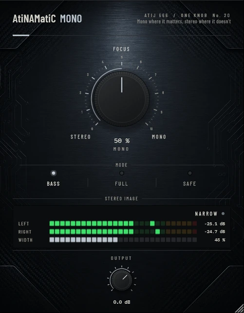

# AtiNAMatiC-Mono — User Manual

**Version 1.0.0** · ATIJ STUDIO · Windows · macOS · Linux · VST3 · CLAP · LV2 · AU (macOS) · Free and open source (GPL v3)



---

## What's new in v1.0.0

- First public release, now **free and open source** (GPL v3).
- New look, shared across the whole ONE KNOB Series.
- **Every plug-in format:** VST3, CLAP and LV2 on Windows, macOS and Linux, plus AU on macOS. (The standalone app has been retired: these work best inside your DAW.)
- New **ONE KNOB Series installers** for Windows and macOS: tick the plug-ins and formats you want, skip the rest. Linux gets an install script that asks the same questions.

## 1. What it is

Stereo amp sims, doublers and wideners are great until the low end gets wide and woolly, or the mix is played on a phone or a club PA in mono. AtiNAMatiC-Mono puts stereo where it helps and mono where it matters, with one knob.

- **Bass:** the low end becomes mono below a crossover you set; the rest of the image is untouched.
- **Full:** narrows the whole image from full stereo to mono.
- **Safe:** like Full, but the lows are always mono and the loudness is held as the image narrows.
- Watches left/right correlation and shows **PHASE ISSUE** when the input would partly cancel in mono.
- Zero latency.

## 2. Signal chain placement

Anywhere after something that makes stereo:

```
Amp sim -> Cab -> Double / Reach / Air -> [AtiNAMatiC-Mono] -> Squash / Level
```

## 3. Controls

### MONO (big knob, 0–100 %, default 50 %)
- **Bass:** the crossover frequency, 40 Hz (0 %) to 400 Hz (100 %), on a log scale. 50 % ≈ 126 Hz.
- **Full / Safe:** how narrow the image is; 0 % = untouched stereo, 100 % = mono.

### MODE (switch)

| Mode | What MONO does | Loudness |
|---|---|---|
| **Bass** | side removed below the crossover (LR4 high-pass on the side only) | unchanged |
| **Full** | whole image narrowed | drops a little as wide content is removed |
| **Safe** | lows below 120 Hz always mono + whole image narrowed | held (compensated) |

### OUTPUT (-24 to +12 dB)
Final trim.

## 4. Meters

- **LEFT / RIGHT** — peak level of each side.
- **WIDTH** — side-to-mid energy of the output (0 % = mono).
- Status: **STEREO**, **NARROW**, **MONO**, or **PHASE ISSUE** (input correlation below -0.1).

Measured on a wide doubled guitar: Bass at 50 % removes the side below ~60 Hz by 13 dB and at 100 % below ~200 Hz by 25 dB, leaving the upper image and the centre untouched; Full and Safe reach true mono at 100 %, Safe within 0.1 dB of the original loudness.

## 5. Installation

**Windows (64-bit)**

- **Easiest:** run `ONE-KNOB-Series-v1.0.0-Windows-x64-Setup.exe`, tick the plug-ins and formats you want and untick the rest.
- **Just this plug-in:** unzip `AtiNAMatiC-Mono-v1.0.0-Windows-x64.zip` and copy:

| File | Copy to |
|---|---|
| `AtiNAMatiC-Mono.vst3` | `C:\Program Files\Common Files\VST3\` |
| `AtiNAMatiC-Mono.clap` | `C:\Program Files\Common Files\CLAP\` |
| `AtiNAMatiC-Mono.lv2` | `C:\Program Files\Common Files\LV2\` |

**macOS 10.15 or later (Apple Silicon and Intel)**

- **Easiest:** open `ONE-KNOB-Series-v1.0.0-macOS-Installer.pkg`, click **Customize** and tick the plug-ins and formats you want.
- **Just this plug-in:** unzip `AtiNAMatiC-Mono-v1.0.0-macOS.zip` and copy:

| File | Copy to |
|---|---|
| `AtiNAMatiC-Mono.vst3` | `/Library/Audio/Plug-Ins/VST3/` |
| `AtiNAMatiC-Mono.component` (AU) | `/Library/Audio/Plug-Ins/Components/` |
| `AtiNAMatiC-Mono.clap` | `/Library/Audio/Plug-Ins/CLAP/` |
| `AtiNAMatiC-Mono.lv2` | `/Library/Audio/Plug-Ins/LV2/` |

The plug-ins aren't signed by Apple. If macOS blocks the installer, right-click it and choose **Open**. If you copied files from the zip, clear the quarantine flag in Terminal, e.g. `xattr -cr /Library/Audio/Plug-Ins/VST3/AtiNAMatiC-Mono.vst3`.

**Linux (x86_64 and ARM64)**

- **Easiest:** extract `ONE-KNOB-Series-v1.0.0-Linux-x86_64.tar.gz` (or `-Linux-ARM64`) and run `./install.sh`. It asks which plug-ins and formats to install. Use `./install.sh --system` to install for all users.
- **Just this plug-in:** unzip `AtiNAMatiC-Mono-v1.0.0-Linux-x86_64.zip` (or `-Linux-ARM64`) and copy the `.vst3` folder to `~/.vst3/`, the `.clap` file to `~/.clap/` and the `.lv2` folder to `~/.lv2/`.

Then rescan plug-ins in your DAW.

## 6. Tips

- After **Double** or **Reach**, Bass at 30–50 % keeps palm mutes centred and tight.
- Use Full at 100 % as a quick mono check of your whole guitar sound.
- Double-click any knob to reset it; hold Shift while dragging for fine control.

---

*AtiNAMatiC-Mono v1.0.0 · Atij 666 Studio*
