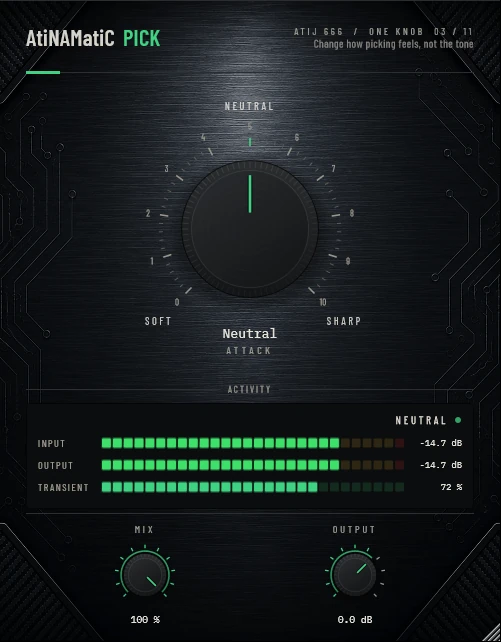

# AtiNAMatiC-Pick — User Manual

**Version 1.0.0** · ATIJ STUDIO · Windows · macOS · Linux · VST3 · CLAP · LV2 · AU (macOS) · Free and open source (GPL v3)



---

## What's new in v1.0.0

- First public release, now **free and open source** (GPL v3).
- New look, shared across the whole ONE KNOB Series.
- **Every plug-in format:** VST3, CLAP and LV2 on Windows, macOS and Linux, plus AU on macOS. (The standalone app has been retired: these work best inside your DAW.)
- New **ONE KNOB Series installers** for Windows and macOS: tick the plug-ins and formats you want, skip the rest. Linux gets an install script that asks the same questions.

## What's new in v0.2.0

- **No fuzz on low notes.** The two envelope followers now share one release, so on sustained notes they move together and only real pick attacks are shaped (they used to ripple at the note frequency and modulate the gain).
- Make-up gain is calibrated so the level stays within ±0.2 dB across the whole SOFT–SHARP range (SOFT used to drop ~3 dB). MIX and OUTPUT are smoothed; detection is stereo-linked.
- **New interface** — machined knob with a printed 0–10 scale, hardware-style mode switches that follow automation and preset recall, consistent value text ("72 %", "+1.5 dB"), resizable window (75–150 %, remembered per session). Double-click any knob to reset it; hold **Shift** while dragging for fine adjustment.

---

## 1. What it is

AtiNAMatiC-Pick is a **pick attack designer** — a transient shaper that reshapes the leading edge of every note in real time. One large bipolar knob lets you make playing feel **softer and more legato** (turn left toward SOFT) or **sharper, snappier, and more percussive** (turn right toward SHARP), all without touching an EQ or compressor.

Under the hood it is a four-stage chain:

- **Dual envelope follower** — a fast peak follower (1.5 ms attack / 25 ms release) and a slow follower (40 ms / 220 ms) run in parallel. The ratio `(fast − slow) / slow` produces a level-invariant transient strength `T` that peaks near 1.0 on a typical guitar attack and falls back to 0 during sustain.
- **Per-sample gain modulation** — the transient strength drives gain by `g = 1 + A · 0.7 · T` where `A` is the knob mapped to ±1. Sharp settings amplify transient peaks; Soft settings attenuate them. Sustained material is untouched.
- **Tilt EQ** — a subtle ±2 dB tilt scales with the knob. Sharp adds a high-shelf lift @ 4 kHz; Soft adds a gentle low-shelf lift @ 160 Hz. Filter coefficients are re-tuned per block with a small change threshold so the audio never zippers.
- **Auto make-up** — calibrated on DI guitar so the level stays within ±0.2 dB across the full SOFT–SHARP sweep.

Zero latency. No lookahead. No oversampling. Mono or stereo input, always stereo gain shared from the left channel so the stereo image stays glued.

---

## 2. Signal chain placement

```
Guitar (DI)
   -->  Noise Gate (optional)
   -->  *** AtiNAMatiC-Pick ***
   -->  Amp Sim (NAM / Helix / ML Sound Lab / etc.)
   -->  Cab / IR
   -->  AtiNAMatiC-Air / Reverb / Master bus
```

**Before the amp sim** is the primary placement — it shapes the raw pick dynamics before the amp's non-linearity acts on them, so the amp responds to the new attack character.

**After the amp sim** also works for a more "mix-bus" use. In that position you are sharpening or softening the already-distorted tone, so use smaller knob deflections (±20–40%).

Place after a noise gate so the gate's closed state does not confuse the envelope follower with near-silence.

---

## 3. The Controls

### ATTACK (large centre knob, bipolar 0 — 100%, neutral at 50%)

The single master macro. The knob is **bipolar**: 50% is neutral (the plugin is essentially transparent), turning left sweeps toward SOFT, turning right sweeps toward SHARP.

| Knob position    | Label       | Character                                                   |
|------------------|-------------|-------------------------------------------------------------|
| 0% (full left)   | Soft −100%  | Maximum transient attenuation. Pillow-soft, very legato.    |
| 25%              | Soft −50%   | Noticeably rounded pick attack. Smoother runs.              |
| 50% (centre)     | Neutral     | Bypass-flat. Knob defaults here. Double-click to return.    |
| 75%              | Sharp +50%  | Brighter, more pronounced pick definition.                  |
| 100% (full right)| Sharp +100% | Razor-sharp percussive snap. Aggressive note articulation.  |

The value below the knob updates live: **Neutral**, **Soft −N%**, or **Sharp +N%**.

Tick labels under the knob colour-code the direction:

- **SOFT** (indigo, left)
- **NEUTRAL** (centre)
- **SHARP** (amber, right)

Most players live in the inner ±50% range. Beyond that the effect becomes deliberate.

### MIX (0 — 100%)

Dry / wet blend. 0% = bypass, 100% = fully processed (default).

Use a partial blend for parallel transient shaping — for example, dial Sharp +80% and set MIX to 35% to glue a hint of pick clarity onto the original signal without changing its overall character.

### OUTPUT (-24 to +12 dB)

Final trim after all processing. Even with auto make-up, different guitars and amp models may need small level matching here. Use it to match the bypassed level before committing to a setting.

### Transient activity pill (top-right of meter area)

A small LED-style indicator that responds to the live transient strength `T`. It glows brighter on each pick attack and inherits the active accent colour:

- **Indigo** when the knob is on the SOFT side.
- **Emerald** when at NEUTRAL.
- **Amber** when on the SHARP side.

Use it as a visual reference for how strong each pick attack is being detected.

### Input / Output meters

Dual horizontal meters at the bottom of the panel (−60 to 0 dBFS) show the input and output peak levels with a 20 ms ballistic decay. Use them to confirm OUTPUT trim is keeping the bypassed level matched.

---

## 4. System Requirements

| | Minimum |
|---|---|
| **OS** | Windows 10 (64-bit) · macOS 10.15+ · Linux (Ubuntu 20.04+) |
| **CPU** | Any modern 64-bit processor (zero-latency, very light DSP) |
| **RAM** | 256 MB |
| **Formats** | VST3 · CLAP · LV2 · AU (macOS) |
| **DAW** | Any VST3 or CLAP host |

---

## 5. Installation

**Windows (64-bit)**

- **Easiest:** run `ONE-KNOB-Series-v1.0.0-Windows-x64-Setup.exe`, tick the plug-ins and formats you want and untick the rest.
- **Just this plug-in:** unzip `AtiNAMatiC-Pick-v1.0.0-Windows-x64.zip` and copy:

| File | Copy to |
|---|---|
| `AtiNAMatiC-Pick.vst3` | `C:\Program Files\Common Files\VST3\` |
| `AtiNAMatiC-Pick.clap` | `C:\Program Files\Common Files\CLAP\` |
| `AtiNAMatiC-Pick.lv2` | `C:\Program Files\Common Files\LV2\` |

**macOS 10.15 or later (Apple Silicon and Intel)**

- **Easiest:** open `ONE-KNOB-Series-v1.0.0-macOS-Installer.pkg`, click **Customize** and tick the plug-ins and formats you want.
- **Just this plug-in:** unzip `AtiNAMatiC-Pick-v1.0.0-macOS.zip` and copy:

| File | Copy to |
|---|---|
| `AtiNAMatiC-Pick.vst3` | `/Library/Audio/Plug-Ins/VST3/` |
| `AtiNAMatiC-Pick.component` (AU) | `/Library/Audio/Plug-Ins/Components/` |
| `AtiNAMatiC-Pick.clap` | `/Library/Audio/Plug-Ins/CLAP/` |
| `AtiNAMatiC-Pick.lv2` | `/Library/Audio/Plug-Ins/LV2/` |

The plug-ins aren't signed by Apple. If macOS blocks the installer, right-click it and choose **Open**. If you copied files from the zip, clear the quarantine flag in Terminal, e.g. `xattr -cr /Library/Audio/Plug-Ins/VST3/AtiNAMatiC-Pick.vst3`.

**Linux (x86_64 and ARM64)**

- **Easiest:** extract `ONE-KNOB-Series-v1.0.0-Linux-x86_64.tar.gz` (or `-Linux-ARM64`) and run `./install.sh`. It asks which plug-ins and formats to install. Use `./install.sh --system` to install for all users.
- **Just this plug-in:** unzip `AtiNAMatiC-Pick-v1.0.0-Linux-x86_64.zip` (or `-Linux-ARM64`) and copy the `.vst3` folder to `~/.vst3/`, the `.clap` file to `~/.clap/` and the `.lv2` folder to `~/.lv2/`.

Then rescan plug-ins in your DAW.

## 6. Controls Reference

| Control  | Range          | Default  | Behaviour |
|----------|----------------|----------|-----------|
| ATTACK   | 0 – 100% (bipolar) | 50% (Neutral) | Master macro. <50% softens transients; >50% sharpens them. Double-click to return to neutral. |
| MIX      | 0 – 100%       | 100%     | Dry / wet blend. |
| OUTPUT   | -24 – +12 dB   | 0 dB     | Final trim after processing. |

---

## 7. Internal Signal Chain

```
Input (mono or stereo)
  │
  ├─► Fast envelope follower (1.5 / 25 ms)  ──┐
  │                                            ├──► Transient strength T = max(0, (fast−slow)/slow)
  └─► Slow envelope follower (40 / 220 ms) ──┘
                                                     │
                                                     ▼
                                          gain g = 1 + A · 0.7 · T
                                                     │
Input ──► × g ──► Tilt EQ (high/low shelf ±2 dB) ──► auto make-up ──► dry/wet ──► OUTPUT trim ──► Out
```

---

## 8. Typical Use Cases

- **Soft +25% on clean guitar** — tames over-eager picking on fingerstyle or jazz parts. Notes flow rather than slap.
- **Soft +50% on hard-strummed acoustic DI** — controls the pick scrape without dulling the body.
- **Sharp +30% on a smooth NAM amp** — restores percussive attack lost in heavy compression / smoothing.
- **Sharp +60% on direct bass** — adds modern slap definition without an EQ boost.
- **Sharp +80%, MIX 35% on a metal rhythm** — parallel transient layer gives the riff bite without changing the rhythm tone itself.
- **Soft +100%, MIX 25% on a lead line** — subtly rounds the attack of every note for a "vocal" lead.

---

## 9. Tips

- The knob is **bipolar** — double-click to snap back to Neutral (50%).
- The activity pill colour tells you which side of neutral you are on at a glance.
- When stacking with **AtiNAMatiC-Tight** or **AtiNAMatiC-Feel**, put Pick **before** Feel/Tight — they expect a stable transient envelope.
- For a single-track double, duplicate the channel and set one instance Soft +30% / one Sharp +30% panned wide.
- If you hear pumping on long sustained notes, you have probably set MIX too high in combination with a large Sharp deflection. Drop MIX to 50–70%.
- The plugin is zero-latency. Safe to use on tracking buses and live monitor paths.

---

## 10. About

AtiNAMatiC-Pick is part of the **AtiNAMatiC One-Knob** series by **Atij 666 Studio** — a family of simple-by-design guitar utility plugins, each focused on doing one job extremely well with a single macro knob.

Click the **AtiNAMatiC-Pick** badge in the top-left of the plugin window for the About overlay.

© 2026 Atij 666 Studio. All rights reserved.
