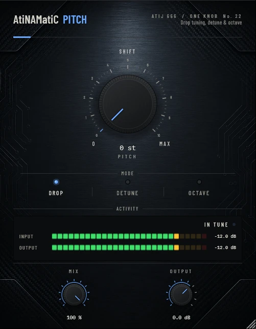

# AtiNAMatiC-Pitch — User Manual

**Version 1.0.0** · ATIJ STUDIO · Windows · macOS · Linux · VST3 · CLAP · LV2 · AU (macOS) · Free and open source (GPL v3)



---

## What's new in v1.0.0

- First public release, now **free and open source** (GPL v3).
- New look, shared across the whole ONE KNOB Series.
- **Every plug-in format:** VST3, CLAP and LV2 on Windows, macOS and Linux, plus AU on macOS. (The standalone app has been retired: these work best inside your DAW.)
- New **ONE KNOB Series installers** for Windows and macOS: tick the plug-ins and formats you want, skip the rest. Linux gets an install script that asks the same questions.

## 1. What it is

AtiNAMatiC-Pitch is a one-knob pitch tool with three jobs:

- **Drop** — play drop-tuned parts without retuning: 0 to -7 semitones, always in whole semitones so it is always in tune.
- **Detune** — stereo "micro-shift" thickening: a voice a few cents up on the left, one a few cents down on the right, under your dry signal.
- **Octave** — an octave-below voice, filtered smooth, added under your playing.

It uses a pitch-synchronous granular shifter: a light pitch tracker finds the period of what you are playing and lines the grains up with the waveform, so single notes stay clean. Measured on steady notes: the shifted note is dominant, with by-products 35–41 dB down.

**Honest limits:** like any real-time shifter, full chords at large shifts (Drop -5 to -7, Octave) warble a little, because a chord has no single period to line up with. Single notes, riffs and small shifts are the cleanest. Drop and Octave also have a short inherent delay (the grain window, roughly 20–30 ms); Detune's delays are part of the effect.

## 2. Signal chain placement

```
Guitar -> [AtiNAMatiC-Pitch] -> ... -> Amp sim          (Drop, Octave: before the amp)
Amp sim -> Cab / IR -> [AtiNAMatiC-Pitch]               (Detune: after the amp, stereo)
```

Drop and Octave track best on a clean DI, so place them first. Detune works best after the amp. Mono in / stereo out is supported.

## 3. Controls

### PITCH (big knob)
Its meaning depends on the mode; the readout under the knob shows the actual value.

| Mode | Knob range | Readout |
|---|---|---|
| **Drop** | 0 → -7 semitones (whole steps) | `-3 st` |
| **Detune** | 0 → 25 cents each way | `12 cents` |
| **Octave** | octave-down level 0 → 100 % | `-1 oct 60 %` |

### MODE (switch)
Drop / Detune / Octave.

### MIX (0–100 %)
Drop: wet/dry (100 % = only the shifted signal). Detune and Octave: how much of the added voice(s) you hear on top of the dry signal.

### OUTPUT (-24 to +12 dB)
Final trim.

## 4. Meters

- **INPUT / OUTPUT** — peak level.
- Status: **IN TUNE**, **DROP -n ST**, **DETUNE +/-n CENTS**, **OCTAVE DOWN**.

## 5. Installation

**Windows (64-bit)**

- **Easiest:** run `ONE-KNOB-Series-v1.0.0-Windows-x64-Setup.exe`, tick the plug-ins and formats you want and untick the rest.
- **Just this plug-in:** unzip `AtiNAMatiC-Pitch-v1.0.0-Windows-x64.zip` and copy:

| File | Copy to |
|---|---|
| `AtiNAMatiC-Pitch.vst3` | `C:\Program Files\Common Files\VST3\` |
| `AtiNAMatiC-Pitch.clap` | `C:\Program Files\Common Files\CLAP\` |
| `AtiNAMatiC-Pitch.lv2` | `C:\Program Files\Common Files\LV2\` |

**macOS 10.15 or later (Apple Silicon and Intel)**

- **Easiest:** open `ONE-KNOB-Series-v1.0.0-macOS-Installer.pkg`, click **Customize** and tick the plug-ins and formats you want.
- **Just this plug-in:** unzip `AtiNAMatiC-Pitch-v1.0.0-macOS.zip` and copy:

| File | Copy to |
|---|---|
| `AtiNAMatiC-Pitch.vst3` | `/Library/Audio/Plug-Ins/VST3/` |
| `AtiNAMatiC-Pitch.component` (AU) | `/Library/Audio/Plug-Ins/Components/` |
| `AtiNAMatiC-Pitch.clap` | `/Library/Audio/Plug-Ins/CLAP/` |
| `AtiNAMatiC-Pitch.lv2` | `/Library/Audio/Plug-Ins/LV2/` |

The plug-ins aren't signed by Apple. If macOS blocks the installer, right-click it and choose **Open**. If you copied files from the zip, clear the quarantine flag in Terminal, e.g. `xattr -cr /Library/Audio/Plug-Ins/VST3/AtiNAMatiC-Pitch.vst3`.

**Linux (x86_64 and ARM64)**

- **Easiest:** extract `ONE-KNOB-Series-v1.0.0-Linux-x86_64.tar.gz` (or `-Linux-ARM64`) and run `./install.sh`. It asks which plug-ins and formats to install. Use `./install.sh --system` to install for all users.
- **Just this plug-in:** unzip `AtiNAMatiC-Pitch-v1.0.0-Linux-x86_64.zip` (or `-Linux-ARM64`) and copy the `.vst3` folder to `~/.vst3/`, the `.clap` file to `~/.clap/` and the `.lv2` folder to `~/.lv2/`.

Then rescan plug-ins in your DAW.

## 6. Tips

- Drop -2 st turns standard tuning into "D standard" for a song; -5 st into "B standard" for single-note riffs.
- Detune 8–15 cents after the amp is a classic stereo thickener on clean parts and leads.
- Octave at 30–50 % under a fuzzy lead gives a huge, organ-like low end.
- Double-click any knob to reset it; hold Shift while dragging for fine control.

---

*AtiNAMatiC-Pitch v1.0.0 · Atij 666 Studio*
