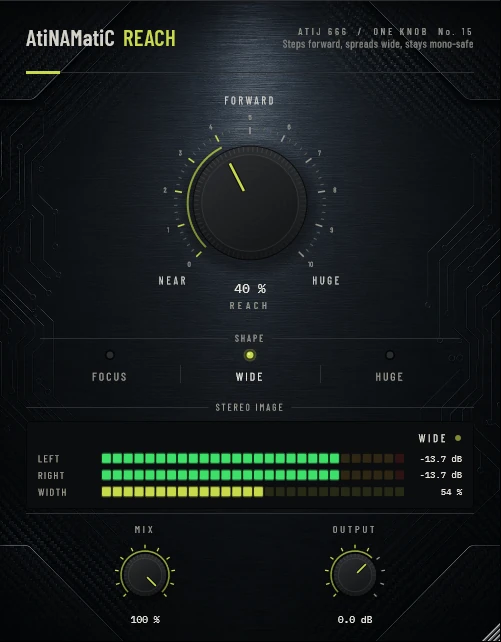

# AtiNAMatiC-Reach — User Manual

**Version 1.0.0** · ATIJ STUDIO · Windows · macOS · Linux · VST3 · CLAP · LV2 · AU (macOS) · Free and open source (GPL v3)



---

## What's new in v1.0.0

- First public release, now **free and open source** (GPL v3).
- New look, shared across the whole ONE KNOB Series.
- **Every plug-in format:** VST3, CLAP and LV2 on Windows, macOS and Linux, plus AU on macOS. (The standalone app has been retired: these work best inside your DAW.)
- New **ONE KNOB Series installers** for Windows and macOS: tick the plug-ins and formats you want, skip the rest. Linux gets an install script that asks the same questions.

## 1. What it is

AtiNAMatiC-Reach makes a guitar **step forward and spread out** in a mix without getting louder, muddier, or falling apart in mono.

- **Projection (centre):** a presence lift around 2.2 kHz (up to +3.5 dB) and a dip around 300 Hz (up to -2 dB). The guitar reads clearly without turning the fader up.
- **Solid low end:** stereo content below about 150 Hz is folded to the centre, so palm mutes stay tight on any system.
- **Spread (sides):** existing stereo content above 1 kHz is widened, and a spread is generated from the guitar's upper range (above 700 Hz, about 1 ms offset), so a **mono amp sim** gets width too.
- **Mono-safe:** the generated spread goes into left and right with opposite signs, so it cancels exactly when the mix is summed to mono. Only the centre's projection EQ remains.
- Accepts a mono input and outputs stereo. Zero latency.

## 2. Signal chain placement

```
Guitar -> ... -> Amp sim -> Cab / IR -> [AtiNAMatiC-Reach] -> Squash / Level
```

Place Reach **after** the amp and cab, on a stereo track (or a mono track whose insert outputs stereo).

## 3. Controls

### REACH (big knob, 0–100 %, default 40 %)
NEAR (0 %) is untouched. Turning it up raises projection and spread together. Level is matched within about ±0.2 dB.

### SHAPE (mode switch)

| Shape | Presence | Widening | Generated spread | Offset |
|---|---|---|---|---|
| **Focus** | +3.5 dB | light | light | 0.8 ms |
| **Wide** (default) | +3 dB | medium | medium | 1.0 ms |
| **Huge** | +2.5 dB | strong | strong | 1.4 ms |

(Values at 100 %.)

### MIX (0–100 %) and OUTPUT (-24 to +12 dB)
Blend with the dry signal and final trim.

## 4. Meters

- **LEFT / RIGHT** — peak level of each side.
- **WIDTH** — side-to-mid energy of the output (0 % = mono). Low notes stay centred by design, so width rises on brighter playing.
- Status: **MONO**, **FOCUSED**, **WIDE**, **HUGE**.

## 5. Signal chain (inside)

```
L/R -> mid / side
mid  -> presence peak 2.2 kHz -> mud dip 300 Hz                      (projection)
side -> minus low-passed side (<150 Hz) + widened side (>1 kHz)
     +  generated spread: mid -> HP 700 Hz -> LP 9 kHz -> ~1 ms delay
-> L = mid + side, R = mid - side -> MIX -> OUTPUT
```

## 6. Latency and CPU

Zero latency. Very light on CPU.

## 7. Installation

**Windows (64-bit)**

- **Easiest:** run `ONE-KNOB-Series-v1.0.0-Windows-x64-Setup.exe`, tick the plug-ins and formats you want and untick the rest.
- **Just this plug-in:** unzip `AtiNAMatiC-Reach-v1.0.0-Windows-x64.zip` and copy:

| File | Copy to |
|---|---|
| `AtiNAMatiC-Reach.vst3` | `C:\Program Files\Common Files\VST3\` |
| `AtiNAMatiC-Reach.clap` | `C:\Program Files\Common Files\CLAP\` |
| `AtiNAMatiC-Reach.lv2` | `C:\Program Files\Common Files\LV2\` |

**macOS 10.15 or later (Apple Silicon and Intel)**

- **Easiest:** open `ONE-KNOB-Series-v1.0.0-macOS-Installer.pkg`, click **Customize** and tick the plug-ins and formats you want.
- **Just this plug-in:** unzip `AtiNAMatiC-Reach-v1.0.0-macOS.zip` and copy:

| File | Copy to |
|---|---|
| `AtiNAMatiC-Reach.vst3` | `/Library/Audio/Plug-Ins/VST3/` |
| `AtiNAMatiC-Reach.component` (AU) | `/Library/Audio/Plug-Ins/Components/` |
| `AtiNAMatiC-Reach.clap` | `/Library/Audio/Plug-Ins/CLAP/` |
| `AtiNAMatiC-Reach.lv2` | `/Library/Audio/Plug-Ins/LV2/` |

The plug-ins aren't signed by Apple. If macOS blocks the installer, right-click it and choose **Open**. If you copied files from the zip, clear the quarantine flag in Terminal, e.g. `xattr -cr /Library/Audio/Plug-Ins/VST3/AtiNAMatiC-Reach.vst3`.

**Linux (x86_64 and ARM64)**

- **Easiest:** extract `ONE-KNOB-Series-v1.0.0-Linux-x86_64.tar.gz` (or `-Linux-ARM64`) and run `./install.sh`. It asks which plug-ins and formats to install. Use `./install.sh --system` to install for all users.
- **Just this plug-in:** unzip `AtiNAMatiC-Reach-v1.0.0-Linux-x86_64.zip` (or `-Linux-ARM64`) and copy the `.vst3` folder to `~/.vst3/`, the `.clap` file to `~/.clap/` and the `.lv2` folder to `~/.lv2/`.

Then rescan plug-ins in your DAW.

## 8. Tips

- Reach and **Air** combine well: Air adds room depth, Reach adds projection and spread.
- For double-tracked guitars already hard-panned, use Focus: projection without extra width.
- Double-click any knob to reset it; hold Shift while dragging for fine control.

---

*AtiNAMatiC-Reach v1.0.0 · Atij 666 Studio*
