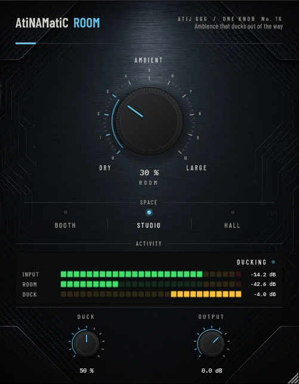

# AtiNAMatiC-Room — User Manual

**Version 1.0.0** · ATIJ STUDIO · Windows · macOS · Linux · VST3 · CLAP · LV2 · AU (macOS) · Free and open source (GPL v3)



---

## What's new in v1.0.0

- First public release, now **free and open source** (GPL v3).
- New look, shared across the whole ONE KNOB Series.
- **Every plug-in format:** VST3, CLAP and LV2 on Windows, macOS and Linux, plus AU on macOS. (The standalone app has been retired: these work best inside your DAW.)
- New **ONE KNOB Series installers** for Windows and macOS: tick the plug-ins and formats you want, skip the rest. Linux gets an install script that asks the same questions.

## 1. What it is

AtiNAMatiC-Room puts a guitar in a real space without blurring it. It is a short, dense room reverb with **ducking**: the reverb dips while you play and blooms back in the gaps, so riffs stay tight and the ambience fills the spaces between them. Built for dense amp-sim mixes, where a normal reverb turns into mud.

- 8-line feedback-delay-network reverb with input diffusion, damping and slow modulation (no metallic ringing).
- The reverb's low end is filtered out (high-pass 180 Hz), so palm mutes stay dry and tight.
- Left and right reverb outputs are decorrelated for a natural stereo room, even from a mono guitar.
- The dry signal is never delayed or changed: zero latency, and ROOM at 0 % is exactly dry.

Measured decay times: Booth ~0.3 s, Studio ~0.6 s, Hall ~1.5 s (at 60 %).

## 2. Signal chain placement

```
Guitar -> ... -> Amp sim -> Cab / IR -> [AtiNAMatiC-Room] -> Level
```

Place Room **after** the amp and cab, as an insert (it keeps the dry signal at unity and adds the room on top). It accepts a mono input and outputs stereo.

## 3. Controls

### ROOM (big knob, 0–100 %, default 30 %)
How much room you hear. The first half of the knob is subtle ambience; the top half is a clearly audible space. ROOM also nudges the size and decay up slightly as it rises.

### SPACE (mode switch)

| Space | Decay | Pre-delay | Character |
|---|---|---|---|
| **Booth** | ~0.35 s | 4 ms | tight, close, almost "just air" |
| **Studio** (default) | ~0.7 s | 12 ms | a live room around the cab |
| **Hall** | ~1.6 s | 24 ms | big and open, for leads and ambient parts |

### DUCK (0–100 %, default 50 %)
How far the reverb dips while you play: up to 10 dB at 100 %. Part of that is given back overall, so the gaps bloom at full size while the notes stay clear.

### OUTPUT (-24 to +12 dB)
Final trim.

## 4. Meters

- **INPUT** — peak level of the dry signal.
- **ROOM** — level of the reverb you hear.
- **DUCK** — how far the reverb is currently ducked, in dB.
- Status: **DRY**, **DUCKING** (while you play), **BLOOMING** (in the gaps).

## 5. Signal chain (inside)

```
dry L/R ───────────────────────────────────────────────┐
mono feed -> pre-delay -> 4 all-pass diffusers          │
          -> 8-line FDN (Hadamard, damping, modulation)  │
          -> 2 decorrelated outputs -> HP 180 Hz / LP 8 kHz
          -> x ROOM level x ducking (from dry envelope) -+-> sum -> OUTPUT
```

## 6. Latency, tail and CPU

Zero latency. Reports a 3 s tail so hosts let the reverb ring out. Moderate CPU (still very light).

## 7. Installation

**Windows (64-bit)**

- **Easiest:** run `ONE-KNOB-Series-v1.0.0-Windows-x64-Setup.exe`, tick the plug-ins and formats you want and untick the rest.
- **Just this plug-in:** unzip `AtiNAMatiC-Room-v1.0.0-Windows-x64.zip` and copy:

| File | Copy to |
|---|---|
| `AtiNAMatiC-Room.vst3` | `C:\Program Files\Common Files\VST3\` |
| `AtiNAMatiC-Room.clap` | `C:\Program Files\Common Files\CLAP\` |
| `AtiNAMatiC-Room.lv2` | `C:\Program Files\Common Files\LV2\` |

**macOS 10.15 or later (Apple Silicon and Intel)**

- **Easiest:** open `ONE-KNOB-Series-v1.0.0-macOS-Installer.pkg`, click **Customize** and tick the plug-ins and formats you want.
- **Just this plug-in:** unzip `AtiNAMatiC-Room-v1.0.0-macOS.zip` and copy:

| File | Copy to |
|---|---|
| `AtiNAMatiC-Room.vst3` | `/Library/Audio/Plug-Ins/VST3/` |
| `AtiNAMatiC-Room.component` (AU) | `/Library/Audio/Plug-Ins/Components/` |
| `AtiNAMatiC-Room.clap` | `/Library/Audio/Plug-Ins/CLAP/` |
| `AtiNAMatiC-Room.lv2` | `/Library/Audio/Plug-Ins/LV2/` |

The plug-ins aren't signed by Apple. If macOS blocks the installer, right-click it and choose **Open**. If you copied files from the zip, clear the quarantine flag in Terminal, e.g. `xattr -cr /Library/Audio/Plug-Ins/VST3/AtiNAMatiC-Room.vst3`.

**Linux (x86_64 and ARM64)**

- **Easiest:** extract `ONE-KNOB-Series-v1.0.0-Linux-x86_64.tar.gz` (or `-Linux-ARM64`) and run `./install.sh`. It asks which plug-ins and formats to install. Use `./install.sh --system` to install for all users.
- **Just this plug-in:** unzip `AtiNAMatiC-Room-v1.0.0-Linux-x86_64.zip` (or `-Linux-ARM64`) and copy the `.vst3` folder to `~/.vst3/`, the `.clap` file to `~/.clap/` and the `.lv2` folder to `~/.lv2/`.

Then rescan plug-ins in your DAW.

## 8. Tips

- For high-gain rhythm: Booth or Studio, ROOM 20–35 %, DUCK 70–100 %.
- For leads: Hall, ROOM 40–60 %, DUCK 30–50 % so the tail sings between phrases.
- Room and **Air** combine well: Air adds the close "amp in the room" depth, Room the space around it.
- Double-click any knob to reset it; hold Shift while dragging for fine control.

---

*AtiNAMatiC-Room v1.0.0 · Atij 666 Studio*
