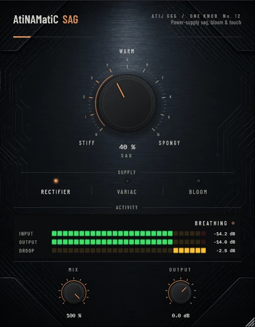

# AtiNAMatiC-Sag — User Manual

**Version 1.0.0** · ATIJ STUDIO · Windows · macOS · Linux · VST3 · CLAP · LV2 · AU (macOS) · Free and open source (GPL v3)



---

## What's new in v1.0.0

- First public release, now **free and open source** (GPL v3).
- New look, shared across the whole ONE KNOB Series.
- **Every plug-in format:** VST3, CLAP and LV2 on Windows, macOS and Linux, plus AU on macOS. (The standalone app has been retired: these work best inside your DAW.)
- New **ONE KNOB Series installers** for Windows and macOS: tick the plug-ins and formats you want, skip the rest. Linux gets an install script that asks the same questions.

## 1. What it is

A real tube amp with a tube rectifier can't hold its supply voltage when you dig in. The voltage droops, the amp loses a little gain and headroom, then recovers over a few hundred milliseconds. Players call it **sag**: hard notes squash slightly, then **bloom** back. It is a big part of why an old amp feels "spongy" and forgiving.

Amp captures are usually taken with steady test signals, so much of that touch response is missing. AtiNAMatiC-Sag puts the droop-and-recover in front of your amp model.

- Below about -36 dBFS nothing happens; the droop grows with how hard you play.
- The supply can't collapse instantly, so your pick attack passes first and the note sags just after, then swells back.
- As the supply droops the headroom drops too: a gentle, slightly asymmetric soft-clip that only appears while the "supply" is loaded.
- Zero latency.

## 2. Signal chain placement

```
Guitar -> Gate -> [AtiNAMatiC-Sag] -> Boost / Dirt -> Amp sim -> Cab / IR
```

Place Sag **before** the amp sim. It works on clean, crunch and high-gain models; the effect is most obvious on edge-of-breakup tones.

## 3. Controls

### SAG (big knob, 0–100 %, default 40 %)
How far the supply droops when you dig in.

| Position | Feel |
|---|---|
| 0 % (STIFF) | Clean pass-through. Nothing changes. |
| 30–50 % (WARM) | Notes give a little under hard picking; chords feel rounder. |
| 70–100 % (SPONGY) | Obvious squash and bloom; soft playing stays open, hard playing compresses. |

Level is calibrated so turning SAG does not make the signal louder or quieter (within about ±1 dB on typical guitar).

### SUPPLY (mode switch)

| Mode | Droop / recovery | Max droop | Character |
|---|---|---|---|
| **Rectifier** | 20 ms / 180 ms | 9 dB | Classic tube-rectifier sag. |
| **Variac** | 40 ms / 320 ms | 6 dB | "Running at low voltage": softer, earlier clipping, slower. |
| **Bloom** | 6 ms / 450 ms | 12 dB | Fast dip, long recovery: notes dip then swell back up. |

### MIX (0–100 %)
Blend with the dry signal for a subtler effect.

### OUTPUT (-24 to +12 dB)
Final level trim.

## 4. Meters

- **INPUT / OUTPUT** — peak level.
- **DROOP** — how far the supply is currently sagging, in dB.
- Status: **STIFF** (no droop), **BREATHING** (light), **SAGGING** (more than 3 dB).

## 5. Signal chain (inside)

```
Input -> supply envelope (linked L/R) -> gain droop (smoothed 5 ms)
      -> headroom stage: soft clip whose drive and asymmetry follow the droop
      -> DC blocker -> static make-up -> MIX -> OUTPUT
```

## 6. Latency and CPU

Zero latency. Very light on CPU.

## 7. Installation

**Windows (64-bit)**

- **Easiest:** run `ONE-KNOB-Series-v1.0.0-Windows-x64-Setup.exe`, tick the plug-ins and formats you want and untick the rest.
- **Just this plug-in:** unzip `AtiNAMatiC-Sag-v1.0.0-Windows-x64.zip` and copy:

| File | Copy to |
|---|---|
| `AtiNAMatiC-Sag.vst3` | `C:\Program Files\Common Files\VST3\` |
| `AtiNAMatiC-Sag.clap` | `C:\Program Files\Common Files\CLAP\` |
| `AtiNAMatiC-Sag.lv2` | `C:\Program Files\Common Files\LV2\` |

**macOS 10.15 or later (Apple Silicon and Intel)**

- **Easiest:** open `ONE-KNOB-Series-v1.0.0-macOS-Installer.pkg`, click **Customize** and tick the plug-ins and formats you want.
- **Just this plug-in:** unzip `AtiNAMatiC-Sag-v1.0.0-macOS.zip` and copy:

| File | Copy to |
|---|---|
| `AtiNAMatiC-Sag.vst3` | `/Library/Audio/Plug-Ins/VST3/` |
| `AtiNAMatiC-Sag.component` (AU) | `/Library/Audio/Plug-Ins/Components/` |
| `AtiNAMatiC-Sag.clap` | `/Library/Audio/Plug-Ins/CLAP/` |
| `AtiNAMatiC-Sag.lv2` | `/Library/Audio/Plug-Ins/LV2/` |

The plug-ins aren't signed by Apple. If macOS blocks the installer, right-click it and choose **Open**. If you copied files from the zip, clear the quarantine flag in Terminal, e.g. `xattr -cr /Library/Audio/Plug-Ins/VST3/AtiNAMatiC-Sag.vst3`.

**Linux (x86_64 and ARM64)**

- **Easiest:** extract `ONE-KNOB-Series-v1.0.0-Linux-x86_64.tar.gz` (or `-Linux-ARM64`) and run `./install.sh`. It asks which plug-ins and formats to install. Use `./install.sh --system` to install for all users.
- **Just this plug-in:** unzip `AtiNAMatiC-Sag-v1.0.0-Linux-x86_64.zip` (or `-Linux-ARM64`) and copy the `.vst3` folder to `~/.vst3/`, the `.clap` file to `~/.clap/` and the `.lv2` folder to `~/.lv2/`.

Then rescan plug-ins in your DAW.

## 8. Tips

- Pair with **Feel** for a very forgiving practice tone: Feel evens out the picking, Sag adds the bloom.
- Bloom mode at 40–60 % on a clean amp gives a nice "swell" on sustained chords.
- Double-click any knob to reset it; hold Shift while dragging for fine control.

---

*AtiNAMatiC-Sag v1.0.0 · Atij 666 Studio*
