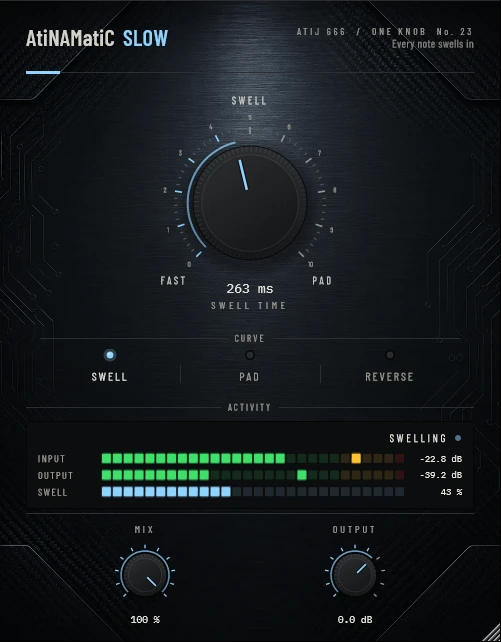

# AtiNAMatiC-Slow — User Manual

**Version 1.0.0** · ATIJ STUDIO · Windows · macOS · Linux · VST3 · CLAP · LV2 · AU (macOS) · Free and open source (GPL v3)



---

## What's new in v1.0.0

- First public release, now **free and open source** (GPL v3).
- New look, shared across the whole ONE KNOB Series.
- **Every plug-in format:** VST3, CLAP and LV2 on Windows, macOS and Linux, plus AU on macOS. (The standalone app has been retired: these work best inside your DAW.)
- New **ONE KNOB Series installers** for Windows and macOS: tick the plug-ins and formats you want, skip the rest. Linux gets an install script that asks the same questions.

## 1. What it is

Violin-style volume swells without touching a volume knob or pedal. AtiNAMatiC-Slow hides the pick attack of every note and fades the note in, like a classic "slow gear" pedal.

- Every new pick is detected automatically, including picks over strings that are still ringing: besides the overall level, the detector watches the pick click above 4 kHz. It re-arms only once the previous attack has settled, so a note never triggers twice.
- At each new attack the level dips to silence in 4 ms (the last note's tail fades instead of clicking), then the new note swells in over the swell time.
- Noise below about -50 dBFS never triggers a swell.
- 6 ms latency, reported to your DAW (which compensates). Slow uses it to look ahead: the volume is already closed when the pick arrives, so none of the pick click gets through. The delay is inaudible because the attack is hidden anyway.

Measured on picked notes at the default 263 ms swell: 13 % level at 60 ms, 60 % at 150 ms, full level by 270 ms, the same on every note.

## 2. Signal chain placement

```
Guitar -> [AtiNAMatiC-Slow] -> Amp sim -> Cab / IR -> Room / delay / reverb
```

Before the amp for the classic swell into distortion; after the amp for smoother, more "pad"-like swells. A reverb or delay after it makes the effect bloom.

## 3. Controls

### SWELL TIME (big knob, 50 ms → 2 s)
How long each note takes to fade in. The readout shows the time. Short settings soften the attack; long settings give ambient pads.

### CURVE (mode switch)

| Curve | Shape | Feel |
|---|---|---|
| **Swell** (default) | smooth S-curve | the classic slow-gear swell |
| **Pad** | slow rise in dB, softest start | string-pad, the attack completely hidden |
| **Reverse** | holds back, then rushes in at the end | "reversed note" feel |

### MIX (0–100 %)
100 % = full swell; lower settings let some of the pick attack through.

### OUTPUT (-24 to +12 dB)
Final trim.

## 4. Meters

- **INPUT / OUTPUT** — peak level.
- **SWELL** — the current swell level (0 % at a new attack, 100 % once open).
- Status: **WAITING**, **SWELLING**, **OPEN**.

## 5. Installation

**Windows (64-bit)**

- **Easiest:** run `ONE-KNOB-Series-v1.0.0-Windows-x64-Setup.exe`, tick the plug-ins and formats you want and untick the rest.
- **Just this plug-in:** unzip `AtiNAMatiC-Slow-v1.0.0-Windows-x64.zip` and copy:

| File | Copy to |
|---|---|
| `AtiNAMatiC-Slow.vst3` | `C:\Program Files\Common Files\VST3\` |
| `AtiNAMatiC-Slow.clap` | `C:\Program Files\Common Files\CLAP\` |
| `AtiNAMatiC-Slow.lv2` | `C:\Program Files\Common Files\LV2\` |

**macOS 10.15 or later (Apple Silicon and Intel)**

- **Easiest:** open `ONE-KNOB-Series-v1.0.0-macOS-Installer.pkg`, click **Customize** and tick the plug-ins and formats you want.
- **Just this plug-in:** unzip `AtiNAMatiC-Slow-v1.0.0-macOS.zip` and copy:

| File | Copy to |
|---|---|
| `AtiNAMatiC-Slow.vst3` | `/Library/Audio/Plug-Ins/VST3/` |
| `AtiNAMatiC-Slow.component` (AU) | `/Library/Audio/Plug-Ins/Components/` |
| `AtiNAMatiC-Slow.clap` | `/Library/Audio/Plug-Ins/CLAP/` |
| `AtiNAMatiC-Slow.lv2` | `/Library/Audio/Plug-Ins/LV2/` |

The plug-ins aren't signed by Apple. If macOS blocks the installer, right-click it and choose **Open**. If you copied files from the zip, clear the quarantine flag in Terminal, e.g. `xattr -cr /Library/Audio/Plug-Ins/VST3/AtiNAMatiC-Slow.vst3`.

**Linux (x86_64 and ARM64)**

- **Easiest:** extract `ONE-KNOB-Series-v1.0.0-Linux-x86_64.tar.gz` (or `-Linux-ARM64`) and run `./install.sh`. It asks which plug-ins and formats to install. Use `./install.sh --system` to install for all users.
- **Just this plug-in:** unzip `AtiNAMatiC-Slow-v1.0.0-Linux-x86_64.zip` (or `-Linux-ARM64`) and copy the `.vst3` folder to `~/.vst3/`, the `.clap` file to `~/.clap/` and the `.lv2` folder to `~/.lv2/`.

Then rescan plug-ins in your DAW.

## 6. Tips

- Swell at 300–600 ms with **Room** (Hall) after the amp is an instant ambient guitar.
- Play legato for continuous pads; a new pick restarts the swell.
- For faster playing, shorten the swell time. A note picked again before its swell finishes is faded out while it is still rising.
- Double-click any knob to reset it; hold Shift while dragging for fine control.

---

*AtiNAMatiC-Slow v1.0.0 · Atij 666 Studio*
