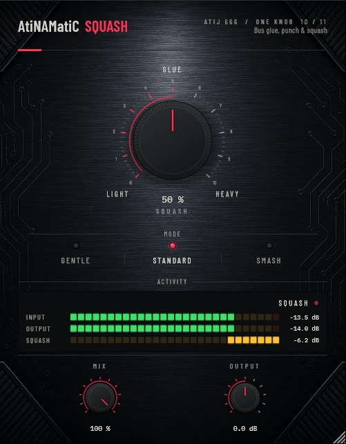

# AtiNAMatiC-Squash — User Manual
**Version 1.0.0** · ATIJ STUDIO · Windows · macOS · Linux · VST3 · CLAP · LV2 · AU (macOS) · Free and open source (GPL v3)



---

## What's new in v1.0.0

- First public release, now **free and open source** (GPL v3).
- New look, shared across the whole ONE KNOB Series.
- **Every plug-in format:** VST3, CLAP and LV2 on Windows, macOS and Linux, plus AU on macOS. (The standalone app has been retired: these work best inside your DAW.)
- New **ONE KNOB Series installers** for Windows and macOS: tick the plug-ins and formats you want, skip the rest. Linux gets an install script that asks the same questions.

## What's new in v0.2.0

- **Compression at real-world levels.** The old thresholds assumed a very hot signal: on a typical guitar bus Gentle and Standard barely compressed at all, while the auto make-up added up to +9 dB. Thresholds are re-mapped (tables below) and make-up is calibrated so loudness stays within about ±1 dB across the knob.
- Faster 5 ms RMS detector, stereo-linked gain, smoothed MIX/OUTPUT, and new input/output meters.
- **New interface** — machined knob with a printed 0–10 scale, hardware-style mode switches that follow automation and preset recall, consistent value text ("72 %", "+1.5 dB"), resizable window (75–150 %, remembered per session). Double-click any knob to reset it; hold **Shift** while dragging for fine adjustment.

---

## What It Is

AtiNAMatiC-Squash is a **one-knob feedforward RMS compressor** designed for guitar and bass processing — from subtle bus glue to aggressive, punchy squash. A single **SQUASH** macro knob sets the compression intensity, while three **MODE** characters shape how the compression behaves. A **MIX** control lets you blend the compressed signal in parallel for New York-style compression without touching a ratio or threshold.

Squash is intended to sit after your NAM model and cab sim, adding the final punch and glue that makes a tracked guitar feel controlled and present in the mix without audible pumping.

---

## Signal Chain Placement

```
Guitar -> NAM Model -> Cab Sim -> EQ / FX -> [AtiNAMatiC-Squash] -> DAW track / bus
```

Place Squash **after** your amp sim and cab. It should see the fully processed, speaker-coloured signal. Placing it before the cab will compress the sharp transients before cabinet filtering, which can sound unnatural.

For parallel bus processing, insert Squash on an aux channel and blend using MIX or the host send level.

---

## Controls

| Control | Range | Default | Description |
|---------|-------|---------|-------------|
| **SQUASH** | Light to Heavy | 50% | Main compression intensity macro. Controls threshold, ratio, attack, release, and knee simultaneously. |
| **MODE** | Gentle / Standard / Smash | Standard | Selects the compression character. |
| **MIX** | 0 to 100% | 100% | Parallel wet/dry blend. 100% = fully compressed. |
| **OUTPUT** | -24 to +24 dB | 0 dB | Output trim applied after the compressor and mix blend. |

---

## The SQUASH Knob

The SQUASH knob is a smooth macro that scales all five compressor parameters simultaneously. A **smoothstep curve** is applied so the lower half of the travel is more subtle — useful for transparent glue — while the upper half becomes progressively more aggressive.

At **Light (0%)** the plugin is essentially transparent: threshold is high, ratio is minimal, attack is slow, and the soft knee is at its widest.

At **Heavy (100%)** the threshold drops to its lowest point, ratio climbs to the mode maximum, attack tightens to its fastest, and (in Standard and Smash modes) the knee hardens.

Auto makeup gain is static and calibrated for a typical guitar-bus level (around -18 dBFS RMS), so loudness stays within about ±1 dB as you turn the knob. It is applied *after* the time-constant smoother so mode switches never cause gain pumping.

---

## Modes

### GENTLE
Slow, transparent bus glue with a wide soft knee. Preserves pick dynamics and natural playing feel. Good for clean tones, acoustic processing, and final bus glue.

| Parameter | Light (0%) | Heavy (100%) |
|-----------|------------|--------------|
| Threshold | -12 dB | -30 dB |
| Ratio | 1.5 : 1 | 3 : 1 |
| Attack | 50 ms | 12 ms |
| Release | 300 ms | 80 ms |
| Knee | 8 dB | 4 dB |

### STANDARD
All-purpose character: snappy but musical. Covers the widest range of applications. Good starting point for any source.

| Parameter | Light (0%) | Heavy (100%) |
|-----------|------------|--------------|
| Threshold | -14 dB | -34 dB |
| Ratio | 2 : 1 | 8 : 1 |
| Attack | 25 ms | 3 ms |
| Release | 200 ms | 40 ms |
| Knee | 6 dB | 1.5 dB |

### SMASH
Aggressive, fast, and tight. Very low thresholds, high ratios, near-zero attack. Adds punch and density. Best used with MIX below 100% to keep transient feel (New York parallel style).

| Parameter | Light (0%) | Heavy (100%) |
|-----------|------------|--------------|
| Threshold | -16 dB | -40 dB |
| Ratio | 4 : 1 | 20 : 1 |
| Attack | 8 ms | 0.5 ms |
| Release | 100 ms | 15 ms |
| Knee | 4 dB | 0 dB (hard) |

---

## GR Meter

The horizontal segmented bar at the bottom of the plugin displays **Gain Reduction** in real time.

- **Range:** 0 to 18 dB GR
- **Colour zones:**
  - Green: 0 to 9 dB GR (normal compression range)
  - Amber: 9 to 13.5 dB GR (medium compression)
  - Red: 13.5 to 18 dB GR (heavy compression)
- **Peak hold** — a bright marker holds at the highest GR reached for ~2 seconds, then decays slowly.
- **Tick marks** at -6 dB, -12 dB, and -18 dB GR.

The meter has **instant attack** and **100 ms visual release**, giving a fast, responsive readout that mirrors what you hear.

---

## System Requirements

| | Minimum |
|---|---|
| **OS** | Windows 10 (64-bit) / macOS 10.15+ / Linux (Ubuntu 20.04+) |
| **CPU** | Any modern x64 processor |
| **RAM** | 4 GB |
| **DAW** | Any VST3 or CLAP host |
| **Formats** | VST3, CLAP, LV2 (Windows/Linux); + AU (macOS) |

---

## Installation

**Windows (64-bit)**

- **Easiest:** run `ONE-KNOB-Series-v1.0.0-Windows-x64-Setup.exe`, tick the plug-ins and formats you want and untick the rest.
- **Just this plug-in:** unzip `AtiNAMatiC-Squash-v1.0.0-Windows-x64.zip` and copy:

| File | Copy to |
|---|---|
| `AtiNAMatiC-Squash.vst3` | `C:\Program Files\Common Files\VST3\` |
| `AtiNAMatiC-Squash.clap` | `C:\Program Files\Common Files\CLAP\` |
| `AtiNAMatiC-Squash.lv2` | `C:\Program Files\Common Files\LV2\` |

**macOS 10.15 or later (Apple Silicon and Intel)**

- **Easiest:** open `ONE-KNOB-Series-v1.0.0-macOS-Installer.pkg`, click **Customize** and tick the plug-ins and formats you want.
- **Just this plug-in:** unzip `AtiNAMatiC-Squash-v1.0.0-macOS.zip` and copy:

| File | Copy to |
|---|---|
| `AtiNAMatiC-Squash.vst3` | `/Library/Audio/Plug-Ins/VST3/` |
| `AtiNAMatiC-Squash.component` (AU) | `/Library/Audio/Plug-Ins/Components/` |
| `AtiNAMatiC-Squash.clap` | `/Library/Audio/Plug-Ins/CLAP/` |
| `AtiNAMatiC-Squash.lv2` | `/Library/Audio/Plug-Ins/LV2/` |

The plug-ins aren't signed by Apple. If macOS blocks the installer, right-click it and choose **Open**. If you copied files from the zip, clear the quarantine flag in Terminal, e.g. `xattr -cr /Library/Audio/Plug-Ins/VST3/AtiNAMatiC-Squash.vst3`.

**Linux (x86_64 and ARM64)**

- **Easiest:** extract `ONE-KNOB-Series-v1.0.0-Linux-x86_64.tar.gz` (or `-Linux-ARM64`) and run `./install.sh`. It asks which plug-ins and formats to install. Use `./install.sh --system` to install for all users.
- **Just this plug-in:** unzip `AtiNAMatiC-Squash-v1.0.0-Linux-x86_64.zip` (or `-Linux-ARM64`) and copy the `.vst3` folder to `~/.vst3/`, the `.clap` file to `~/.clap/` and the `.lv2` folder to `~/.lv2/`.

Then rescan plug-ins in your DAW.

## Controls Reference

| Control | Parameter ID | Type | Range | Default |
|---------|-------------|------|-------|---------|
| SQUASH | `squash` | Float | 0.0 to 1.0 | 0.5 |
| MODE | `mode` | Choice | Gentle / Standard / Smash | Standard (1) |
| MIX | `mix` | Float | 0.0 to 1.0 | 1.0 |
| OUTPUT | `output` | Float (dB) | -24 to +24 | 0.0 |

All parameters are fully automatable and support DAW recall and preset saving.

---

## Internal Signal Chain

```
Input (stereo)
  |
  +-> RMS Envelope Detector (5 ms, stereo-linked: max of L+R)
  |         |
  |         v
  |   Input level in dBFS
  |         |
  |         v
  |   Gain Computer (threshold + soft-knee + ratio set by SQUASH + MODE)
  |         |
  |         v
  |   Per-sample Attack / Release smoother
  |   (both channels track the stereo-linked detector, stereo image preserved)
  |         |
  |         v
  +-> Apply compression gain
  |         |
  |         v
  |   Auto makeup gain (calibrated static, applied after smoother)
  |
  +-> Parallel MIX blend (dry x (1 - MIX) + wet x MIX)
  |
  +-> OUTPUT trim
  |
Output (stereo)
```

The compressor uses **stereo linking**: the RMS detector takes the maximum across both channels so both L and R always receive the same gain reduction, preserving the stereo image under heavy compression.

---

## Typical Use Cases

**Rhythm guitar glue (GENTLE, 50-70%)** — Tightens palm mutes and power chords without audibly clamping the attack. The wide knee and slow attack let the pick transient through before clamping down.

**Lead guitar sustain (STANDARD, 60-80%)** — Longer notes and bends sustain more evenly. The shorter release at heavier settings keeps the compressor active between phrases, reducing the perception of the signal pumping up between notes.

**Parallel drum-room crush (SMASH, 80-100%, MIX 40-60%)** — Full SMASH at high SQUASH destroys dynamics and adds density. Blend back with MIX to taste — the dry transients from the parallel path restore punch while the crushed signal adds body and sustain.

**DI bass (STANDARD or SMASH, 50-70%)** — Controls the dynamic range of bass lines so low notes and high frets sit at the same level in the mix.

**Bus finaliser (GENTLE, 30-50%)** — Last insert on a guitar bus. Subtle glue that makes multiple guitar tracks feel like they were played in the same room.

---

## Tips

- **Start in STANDARD at 50%.** Adjust SQUASH until the GR meter shows 3-6 dB on peaks, then stop.
- **Use MIX for parallel compression.** SMASH mode at 90% with MIX at 50% is a classic New York compression sound — dense, punchy, still has transient feel.
- **Watch the amber zone (9-13 dB).** For most guitar work, staying in the green is correct; amber and red zones are for intentional effect.
- **GENTLE at 20-30% is nearly invisible** but makes a mix bus sit more consistently. This is the set-it-and-forget-it zone.
- **The peak hold marker** is useful during tracking. Set a phrase, watch where the peak hold lands, then adjust SQUASH so it lands in the 3-6 dB green zone for the loudest moments.
- **OUTPUT after MIX** — OUTPUT is applied after the parallel blend, so adjusting it does not change the compression behaviour, only the final level.

---

## About

**AtiNAMatiC-Squash** is part of the **One-Knob Series** by Atij 666 Studio — a collection of purpose-built, single-focus audio tools designed for fast, confident sound shaping.

Built with:
- [JUCE Framework](https://juce.com) - Raw Material Software Ltd.
- [VST3 SDK](https://www.steinberg.net/developers/) - Steinberg Media Technologies GmbH
- [CLAP](https://github.com/free-audio/clap) - Free Audio / Alexandre Bique and contributors
