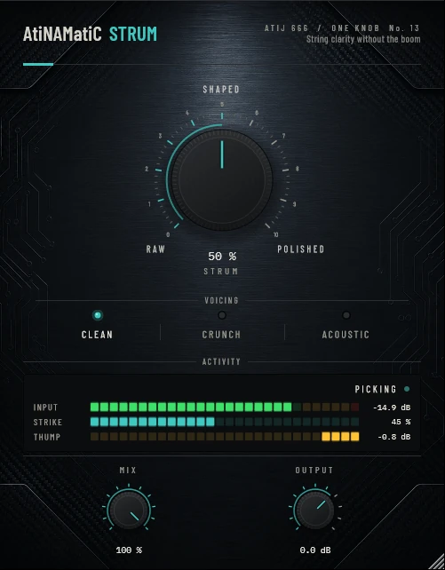

# AtiNAMatiC-Strum — User Manual

**Version 1.0.0** · ATIJ STUDIO · Windows · macOS · Linux · VST3 · CLAP · LV2 · AU (macOS) · Free and open source (GPL v3)



---

## What's new in v1.0.0

- First public release, now **free and open source** (GPL v3).
- New look, shared across the whole ONE KNOB Series.
- **Every plug-in format:** VST3, CLAP and LV2 on Windows, macOS and Linux, plus AU on macOS. (The standalone app has been retired: these work best inside your DAW.)
- New **ONE KNOB Series installers** for Windows and macOS: tick the plug-ins and formats you want, skip the rest. Linux gets an install script that asks the same questions.

## 1. What it is

A strum is six strings hit at once. A normal full-band transient shaper treats it as one event: lift the attack and the low "thump" of the pick across the strings comes up along with the sparkle, so chords get boomy before they get clear.

AtiNAMatiC-Strum splits the signal into three bands and shapes each one differently:

| Band | Range | What STRUM does |
|---|---|---|
| Low | below 250 Hz | pulls the attack **down**: tames boom and thump |
| Mid | 250 Hz – 2.5 kHz | a little attack and a little extra ring |
| High | above 2.5 kHz | pushes the attack **up**: string definition and sparkle |

The result is strummed chords that sound articulate and "produced" without getting louder or boomier.

- Each band has its own transient detector, linked across left and right so the stereo image stays still.
- The detectors share one release, so sustained notes are left alone; only real strikes are shaped.
- The three bands add back to exactly the input: at 0 % the signal passes untouched.
- Zero latency.

## 2. Signal chain placement

```
Guitar -> [AtiNAMatiC-Strum] -> Amp sim -> Cab / IR              (electric)
Acoustic / clean DI -> [AtiNAMatiC-Strum] -> EQ / Reverb         (acoustic)
```

Before the amp sim for electric guitar; anywhere on a clean or acoustic track.

## 3. Controls

### STRUM (big knob, 0–100 %, default 50 %)
How strongly the three bands are shaped. RAW (0 %) is a clean pass-through; POLISHED (100 %) is the full effect. Level is matched across the knob (within about ±0.2 dB).

### VOICING (mode switch)

| Voicing | Low attack | Mid attack / ring | High attack | For |
|---|---|---|---|---|
| **Clean** | -5 dB | +1.5 / +1 dB | +5 dB | clean electric strumming |
| **Crunch** | -6 dB | +2 / 0 dB | +3.5 dB | driven rhythm, keeps the amp from flubbing |
| **Acoustic** | -5 dB | +1 / +2 dB | +6 dB | acoustic and piezo: sparkle and body ring |

(Values at 100 %; they scale with the knob.)

### MIX (0–100 %) and OUTPUT (-24 to +12 dB)
Blend with the dry signal (never combs, the bands are phase-exact) and final trim.

## 4. Meters

- **INPUT** — peak level.
- **STRIKE** — how much high-band attack is being lifted right now.
- **THUMP** — how much low-band attack is being pulled down, in dB.
- Status: **RINGING** (sustain), **PICKING**, **STRUMMING**.

## 5. Signal chain (inside)

```
Input -> low = LR4 low-pass 250 Hz, rest = input - low
      -> mid = LR4 low-pass 2.5 kHz (of rest), high = rest - mid
      -> per-band linked transient shaper (1 ms / 25 ms attack, shared 100 ms release)
      -> sum -> make-up -> MIX -> OUTPUT
```

## 6. Latency and CPU

Zero latency. Light on CPU.

## 7. Installation

**Windows (64-bit)**

- **Easiest:** run `ONE-KNOB-Series-v1.0.0-Windows-x64-Setup.exe`, tick the plug-ins and formats you want and untick the rest.
- **Just this plug-in:** unzip `AtiNAMatiC-Strum-v1.0.0-Windows-x64.zip` and copy:

| File | Copy to |
|---|---|
| `AtiNAMatiC-Strum.vst3` | `C:\Program Files\Common Files\VST3\` |
| `AtiNAMatiC-Strum.clap` | `C:\Program Files\Common Files\CLAP\` |
| `AtiNAMatiC-Strum.lv2` | `C:\Program Files\Common Files\LV2\` |

**macOS 10.15 or later (Apple Silicon and Intel)**

- **Easiest:** open `ONE-KNOB-Series-v1.0.0-macOS-Installer.pkg`, click **Customize** and tick the plug-ins and formats you want.
- **Just this plug-in:** unzip `AtiNAMatiC-Strum-v1.0.0-macOS.zip` and copy:

| File | Copy to |
|---|---|
| `AtiNAMatiC-Strum.vst3` | `/Library/Audio/Plug-Ins/VST3/` |
| `AtiNAMatiC-Strum.component` (AU) | `/Library/Audio/Plug-Ins/Components/` |
| `AtiNAMatiC-Strum.clap` | `/Library/Audio/Plug-Ins/CLAP/` |
| `AtiNAMatiC-Strum.lv2` | `/Library/Audio/Plug-Ins/LV2/` |

The plug-ins aren't signed by Apple. If macOS blocks the installer, right-click it and choose **Open**. If you copied files from the zip, clear the quarantine flag in Terminal, e.g. `xattr -cr /Library/Audio/Plug-Ins/VST3/AtiNAMatiC-Strum.vst3`.

**Linux (x86_64 and ARM64)**

- **Easiest:** extract `ONE-KNOB-Series-v1.0.0-Linux-x86_64.tar.gz` (or `-Linux-ARM64`) and run `./install.sh`. It asks which plug-ins and formats to install. Use `./install.sh --system` to install for all users.
- **Just this plug-in:** unzip `AtiNAMatiC-Strum-v1.0.0-Linux-x86_64.zip` (or `-Linux-ARM64`) and copy the `.vst3` folder to `~/.vst3/`, the `.clap` file to `~/.clap/` and the `.lv2` folder to `~/.lv2/`.

Then rescan plug-ins in your DAW.

## 8. Tips

- For palm-muted metal rhythm use **Tight** instead; Strum is voiced for open chords.
- Acoustic voicing at 40–60 % is a quick "mix-ready" acoustic strum.
- Double-click any knob to reset it; hold Shift while dragging for fine control.

---

*AtiNAMatiC-Strum v1.0.0 · Atij 666 Studio*
