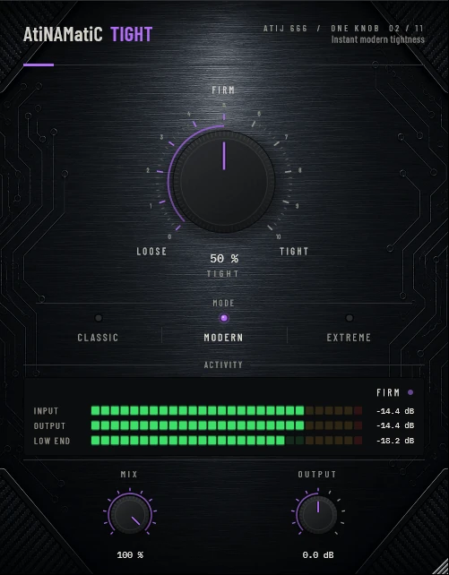

# AtiNAMatiC-Tight -- User Manual

**Version 1.0.0** · ATIJ STUDIO · Windows · macOS · Linux · VST3 · CLAP · LV2 · AU (macOS) · Free and open source (GPL v3)



---

## What's new in v1.0.0

- First public release, now **free and open source** (GPL v3).
- New look, shared across the whole ONE KNOB Series.
- **Every plug-in format:** VST3, CLAP and LV2 on Windows, macOS and Linux, plus AU on macOS. (The standalone app has been retired: these work best inside your DAW.)
- New **ONE KNOB Series installers** for Windows and macOS: tick the plug-ins and formats you want, skip the rest. Linux gets an install script that asks the same questions.

## What's new in v0.2.0

- **Transient shaper rebuilt.** It now uses one stereo-linked detector with a shared release (no more gain ripple / fuzz on low notes) and tops out at about +6 dB on attacks instead of +9 dB, which produced +11–14 dB spikes into the amp.
- Removed a memory allocation that happened on the audio thread every block (a potential source of dropouts); MIX and OUTPUT are smoothed; new input/output meters.
- **New interface** — machined knob with a printed 0–10 scale, hardware-style mode switches that follow automation and preset recall, consistent value text ("72 %", "+1.5 dB"), resizable window (75–150 %, remembered per session). Double-click any knob to reset it; hold **Shift** while dragging for fine adjustment.

---

## 1. What it is

AtiNAMatiC-Tight is a **guitar tightener and transient enhancer**. One large knob shapes everything from low-end tightness and body clarity to pick attack definition -- so you can dial in exactly the weight and snap you need without touching an EQ or transient shaper separately.

Under the hood it is a four-stage DSP chain, all pure signal processing with zero machine-learning models:

- **High-pass filter (4th-order Butterworth, dual cascaded biquads)** -- removes sub-bass mud and low-end bleed so every note starts clean. Cut frequency rises with the TIGHT knob so harder settings trim progressively more low-end.
- **Low-mid dip (peaking EQ, 280 Hz)** -- surgically reduces the boxy "cardboard" resonance common on both high-gain guitar and direct bass. Deeper at higher TIGHT values.
- **Presence shelf (2.5 kHz)** -- adds upper-mid detail and cut that brings the attack of pick strikes forward in a mix without harshness.
- **Transient shaper** -- a parallel dynamic processor that boosts the first few milliseconds of each note relative to the sustain tail. Stronger in Extreme mode, gentlest in Classic. Zero look-ahead latency.
- **Block-rate parameter smoother** -- all three filter targets use a 40 ms one-pole smoother so sweeping the TIGHT knob in real-time produces no zipper noise or clicks.

---

## 2. Signal chain placement

```
Guitar (DI or amp mic)
   -->  Noise Gate (e.g. AtiNAMatiC-Gate)
   -->  *** AtiNAMatiC-Tight ***
   -->  Amp Sim (NAM / Helix / ML Sound Lab / etc.)
   -->  Cab / IR
   -->  AtiNAMatiC-Air / Reverb / Master bus
```

**Before the amp sim** is the primary placement. Tightening the source signal before saturation prevents the amp from compressing and fattening up low-end mud -- it gives the amp sim a clean, focused note to work with.

**After the amp sim** also works and is useful when the amp's own compression has already softened pick attack too much. In that case raise TIGHT more conservatively (30--50%) to avoid over-thinning a post-distortion sound.

For a parallel DI/recorded rig, insert on each dry channel individually before the amp.

---

## 3. Controls

### TIGHT (large centre knob, 0 -- 100%)
The single master macro. As you turn it clockwise all four DSP stages intensify simultaneously, scaled by the current MODE:

| TIGHT value | Effect |
|-------------|--------|
| 0% (LOOSE)  | HPF near the lowest setting for the mode, minimal dip, minimal presence boost, no transient shaping -- the signal is essentially flat through the plug-in. |
| 50%         | Moderate HPF trim, audible low-mid clean-up, slight presence lift, subtle pick definition. Good starting point for most clean or lightly driven tones. |
| 100% (TIGHT)| Full HPF for the mode, maximum low-mid dip, full presence shelf, strongest transient shaping. Aggressive -- designed for down-tuned or 7/8-string high-gain. |

**Suggested starting points:**

- Single-coil / Strat clean: 25--45%
- Humbucker crunch: 40--60%
- High-gain drop-tuned: 55--80%
- Bass guitar direct: 30--55%

The current value is displayed as a percentage in the label below the knob. Tick marks at the left and right ends label **LOOSE** and **TIGHT**.

### MODE (three-position selector)
Sets the overall aggressiveness of the processing at any given TIGHT value.

| Mode        | HPF range  | Low-mid dip (max) | Presence (max) | Transient peak (max) | Best for |
|-------------|------------|------------------|----------------|---------------------|----------|
| **Classic** | 45--110 Hz | -3 dB            | +1.5 dB        | ~+2.7 dB            | Clean tones, vintage amp sims, jazz, country -- you want tightness without losing warmth. |
| **Modern**  | 55--150 Hz | -5.5 dB          | +3 dB          | ~+5 dB              | The default. Modern high-gain, rock, metal -- balanced tightness and presence. |
| **Extreme** | 70--220 Hz | -8 dB            | +4.5 dB        | ~+6.6 dB            | Djent, drop-tuned 7/8 string, heavily saturated amp sims -- you need maximum clarity under extreme gain. |

Switching MODE at any TIGHT setting produces an immediate change in character. If you find that TIGHT above 60% becomes too thin in a particular mode, drop to the mode below rather than reducing TIGHT.

### MIX (0 -- 100%, default 100%)
Dry/wet blend. At 100% only the processed signal is heard. Reducing MIX blends in the original unprocessed signal in parallel, which is useful if the full effect is too drastic but you still want some tightening. For most guitar work keep at 100%.

### OUTPUT (-24 to +24 dB, default 0 dB)
Master output level after all processing. The HPF and low-mid dip together remove energy, so higher TIGHT values may reduce perceived loudness slightly. Use OUTPUT to compensate and level-match against a bypass.

---

## 4. Meter

### LOW END (left panel)
A single vertical bar meter showing the real-time energy of the ~80 Hz band of the **input** signal. This lets you see how much sub-bass content the HPF is working against, even before it is removed.

- **No bar / very dim**: signal is already clean at the low end. HPF may have little to remove.
- **Moderate bar**: typical for a direct guitar with some pickup resonance or single-coil hum. Nominal operating range.
- **Full bar**: significant low-end content -- often a bass guitar, sub-bass synth, or a guitar with pickup placed very close to the bridge. Increase TIGHT to address it.

The dB scale runs from -60 dB to 0 dB in 10 dB steps.

---

## 5. System Requirements

| Item | Minimum |
|------|---------|
| OS | Windows 10 64-bit or later |
| CPU | Any modern 64-bit x86 processor |
| RAM | 16 MB (plug-in itself; host requirements vary) |
| Plugin format | VST3 or CLAP, LV2 (DAW) |
| Latency | 0 samples (no look-ahead) |

---

## 6. Installation

**Windows (64-bit)**

- **Easiest:** run `ONE-KNOB-Series-v1.0.0-Windows-x64-Setup.exe`, tick the plug-ins and formats you want and untick the rest.
- **Just this plug-in:** unzip `AtiNAMatiC-Tight-v1.0.0-Windows-x64.zip` and copy:

| File | Copy to |
|---|---|
| `AtiNAMatiC-Tight.vst3` | `C:\Program Files\Common Files\VST3\` |
| `AtiNAMatiC-Tight.clap` | `C:\Program Files\Common Files\CLAP\` |
| `AtiNAMatiC-Tight.lv2` | `C:\Program Files\Common Files\LV2\` |

**macOS 10.15 or later (Apple Silicon and Intel)**

- **Easiest:** open `ONE-KNOB-Series-v1.0.0-macOS-Installer.pkg`, click **Customize** and tick the plug-ins and formats you want.
- **Just this plug-in:** unzip `AtiNAMatiC-Tight-v1.0.0-macOS.zip` and copy:

| File | Copy to |
|---|---|
| `AtiNAMatiC-Tight.vst3` | `/Library/Audio/Plug-Ins/VST3/` |
| `AtiNAMatiC-Tight.component` (AU) | `/Library/Audio/Plug-Ins/Components/` |
| `AtiNAMatiC-Tight.clap` | `/Library/Audio/Plug-Ins/CLAP/` |
| `AtiNAMatiC-Tight.lv2` | `/Library/Audio/Plug-Ins/LV2/` |

The plug-ins aren't signed by Apple. If macOS blocks the installer, right-click it and choose **Open**. If you copied files from the zip, clear the quarantine flag in Terminal, e.g. `xattr -cr /Library/Audio/Plug-Ins/VST3/AtiNAMatiC-Tight.vst3`.

**Linux (x86_64 and ARM64)**

- **Easiest:** extract `ONE-KNOB-Series-v1.0.0-Linux-x86_64.tar.gz` (or `-Linux-ARM64`) and run `./install.sh`. It asks which plug-ins and formats to install. Use `./install.sh --system` to install for all users.
- **Just this plug-in:** unzip `AtiNAMatiC-Tight-v1.0.0-Linux-x86_64.zip` (or `-Linux-ARM64`) and copy the `.vst3` folder to `~/.vst3/`, the `.clap` file to `~/.clap/` and the `.lv2` folder to `~/.lv2/`.

Then rescan plug-ins in your DAW.

## 7. Controls Reference

| Control | Range | Default | Unit |
|---------|-------|---------|------|
| TIGHT | 0 -- 100 | 50 | % |
| MODE | Classic / Modern / Extreme | Modern | -- |
| MIX | 0 -- 100 | 100 | % |
| OUTPUT | -24 -- +24 | 0 | dB |

---

## 8. Internal Signal Chain

```
Input
  |
  +-- [DC Blocker]
  |
  +-- [HPF x2, 4th-order Butterworth]
  |      Cutoff: MODE-dependent linear scale × TIGHT
  |      Classic: 45–110 Hz  |  Modern: 55–150 Hz  |  Extreme: 70–220 Hz
  |
  +-- [Low-mid peaking EQ, 280 Hz]
  |      Gain: 0 to –3 / –5.5 / –8 dB (Classic / Modern / Extreme) × TIGHT
  |      Q: 0.8
  |
  +-- [Presence shelf, 2.5 kHz]
  |      Gain: 0 to +1.5 / +3.0 / +4.5 dB (Classic / Modern / Extreme) × TIGHT
  |
  +-- [Transient shaper]
         Fast envelope (1 ms attack) vs. slow envelope (30 ms attack), shared 120 ms release, stereo-linked
         Differential gain scales with MODE aggressiveness × TIGHT
  |
  +-- [MIX: parallel blend with dry input]
  |
  +-- [OUTPUT gain]
  |
Output
```

All filter target parameters are smoothed at block rate (40 ms one-pole) to prevent parameter-sweep artifacts.

---

## 9. Typical Use Cases

### Drop-tuned electric guitar (high-gain metal)
Set MODE to **Extreme**, start TIGHT at 65%. The HPF cuts the sub-90 Hz content that would otherwise build up into mud under heavy distortion. The low-mid dip reduces the "boxy" 280 Hz resonance that makes down-tuned guitars sound congested. The presence boost restores pick definition lost under the gain stage.

### Bright clean electric / Strat
Set MODE to **Classic**, TIGHT at 30--40%. You want tightness without losing the warmth of the single-coil pickup. Classic mode keeps the HPF at a modest frequency and the dip very subtle.

### Direct-in bass guitar
Set MODE to **Modern**, TIGHT at 40--55%. The low-mid dip at 280 Hz removes the nasal resonance common to direct bass. Keep the HPF moderate to preserve fundamental weight. Watch the LOW END meter -- if it is consistently at the top, reduce TIGHT to retain low-end energy.

### Acoustic guitar body resonance
Set MODE to **Classic**, TIGHT at 20--40%, MIX at 60--80%. Light parallel tightening removes room boom and body resonance without dulling the top end.

### Before amp simulation (best)
Insert AtiNAMatiC-Tight before the amp sim so it feeds a clean, focused source into the distortion stage. The amp's gain will then emphasise the tightened note instead of compressing and fattening the low-end mud.

---

## 10. Tips

- **Compare LOOSE vs TIGHT at 100% MIX** to hear the maximum range of the plug-in, then dial back to the appropriate level for your source.
- **Use the MIX knob for parallel tightening** when the full effect thins out the tone too much -- 60--80% blend often gives the best of both worlds.
- **Automation**: TIGHT is designed to be automated safely -- the 40 ms parameter smoother prevents clicks even when values jump between notes.
- **Stack with AtiNAMatiC-Gate**: Gate first (pre-amp) to silence the noise floor, then Tight to shape the tone of the notes that pass through.
- **Stack with AtiNAMatiC-Air**: Place Air after the cab IR to add high-frequency shimmer back on top of Tight's controlled low-mid response.
- **Output level**: If you use Tight before an amp sim, check that the output level into the amp is similar to bypass. The dip and HPF remove energy so you may need to add +1--3 dB on the OUTPUT knob.

---

## 11. About

**AtiNAMatiC-Tight** is part of the **AtiNAMatiC Series** by **Atij 666 Studio** -- a collection of focused, single-purpose tools built for guitar production.

Built with [JUCE](https://juce.com/) 8. No machine-learning models, no online activation.

&copy; 2024 Atij 666 Studio. All rights reserved.
