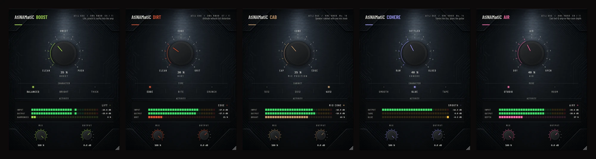

# ONE KNOB Series

23 free, open-source audio plug-ins for guitar amp-sim rigs (NAM · ToneX · Neural DSP · Kemper etc.).  
Each plug-in does one thing exceptionally well, controlled by a single knob.

**Formats:** VST3 · CLAP · LV2 (Windows, macOS, Linux) · AU (macOS). Plug-ins only, no standalone apps.  
**Platforms:** Windows 10+ x64 · macOS 10.15+ Universal · Linux x86\_64 · Linux ARM64  
**Manual:** [all 23 plug-ins in one PDF](docs/ONE-KNOB-Series-Manual.pdf), plus a manual in each plug-in's `docs/` folder.



---

## Plug-ins

| Plug-in | What it does |
|---------|-------------|
| **AtiNAMatiC-Air** | Post-cab "amp-in-the-room" feel — adds air, presence and stereo depth after your IR |
| **AtiNAMatiC-Boost** | Front-end clean boost — life, punch and clarity before the amp sim |
| **AtiNAMatiC-Dirt** | Harmonic saturation — adds grit and bite without muddying the low end |
| **AtiNAMatiC-Double** | Natural double-tracker — thickens a mono signal without chorus artefacts |
| **AtiNAMatiC-Feel** | Touch-sensitivity shaper — controls how the amp sim responds to pick attack |
| **AtiNAMatiC-Gate** | Intelligent noise gate — silences hum and buzz between notes |
| **AtiNAMatiC-HitZone** | Sweet-spot compressor — finds and locks in the most musical dynamic range |
| **AtiNAMatiC-Level** | Auto output leveler — keeps volume consistent across different amp sims |
| **AtiNAMatiC-Pick** | Pick-attack shaper — dials in the transient character from soft to percussive |
| **AtiNAMatiC-Squash** | Bus and mix compressor — glue and punch for the final mix |
| **AtiNAMatiC-Tight** | Low-end tightener — controls flub and mud in downtuned or high-gain rigs |
| **AtiNAMatiC-Sag** | Power-supply sag — notes droop under hard picking and bloom back, like a tube rectifier |
| **AtiNAMatiC-Strum** | Three-band strum shaper — string clarity without the boom of a strum |
| **AtiNAMatiC-Cohere** | Dynamic harshness tamer + glue — catches amp-sim fizz only when it sticks out |
| **AtiNAMatiC-Reach** | Projection + mono-safe stereo spread — steps forward, spreads wide, mono lows |
| **AtiNAMatiC-Room** | Ducking room ambience — dips while you play, blooms in the gaps |
| **AtiNAMatiC-Bloom** | Sustain bloom — held notes swell and sing toward their attack level |
| **AtiNAMatiC-Cab** | One-knob speaker cabinet — mic position from cap to edge, 1x12 / 2x12 / 4x12 |
| **AtiNAMatiC-Choke** | Decay shortener — tighter stops for staccato and djent riffs |
| **AtiNAMatiC-Mono** | Stereo-to-mono tool — mono bass, narrow or collapse the image, phase check |
| **AtiNAMatiC-Hum** | Mains hum and buzz remover — very narrow notches, auto 50/60 Hz |
| **AtiNAMatiC-Pitch** | Drop tuning, stereo detune and octave-down in one knob |
| **AtiNAMatiC-Slow** | Auto volume swell — every note fades in, slow-gear style |

**Recommended chain order:**
`Hum → Gate → Tight → Pick → Strum → Feel → Sag → Bloom → Slow → HitZone → Pitch → Boost → Dirt → [amp sim] → Cab → Choke → Cohere → Air → Reach → Double → Room → Mono → Squash → Level`

Series numbers: 01–11 follow the original chain (01 Gate … 11 Level); 12 Sag, 13 Strum, 14 Cohere, 15 Reach, 16 Room, 17 Bloom, 18 Cab, 19 Choke, 20 Mono, 21 Hum, 22 Pitch, 23 Slow.

See [AUDIT.md](AUDIT.md) for the v0.2.0 audit: measured issues, fixes and remaining recommendations.

---

## Download

Everything is on the [Releases](../../releases/latest) page, free, no account needed.

| System | All-in-one installer: tick the plug-ins and formats you want | Just one plug-in |
|---|---|---|
| Windows 10/11 x64 | `ONE-KNOB-Series-vX.X.X-Windows-x64-Setup.exe` | `AtiNAMatiC-<Name>-vX.X.X-Windows-x64.zip` |
| macOS 10.15+ (Universal) | `ONE-KNOB-Series-vX.X.X-macOS-Installer.pkg` (click **Customize**) | `AtiNAMatiC-<Name>-vX.X.X-macOS.zip` |
| Linux x86_64 / ARM64 | `ONE-KNOB-Series-vX.X.X-Linux-<arch>.tar.gz`, then `./install.sh` | `AtiNAMatiC-<Name>-vX.X.X-Linux-<arch>.zip` |

Each single-plug-in zip contains every format plus that plug-in's manual. Where the files go:

| Format | Windows | macOS | Linux |
|---|---|---|---|
| VST3 | `C:\Program Files\Common Files\VST3\` | `/Library/Audio/Plug-Ins/VST3/` | `~/.vst3/` |
| CLAP | `C:\Program Files\Common Files\CLAP\` | `/Library/Audio/Plug-Ins/CLAP/` | `~/.clap/` |
| LV2 | `C:\Program Files\Common Files\LV2\` | `/Library/Audio/Plug-Ins/LV2/` | `~/.lv2/` |
| AU | — | `/Library/Audio/Plug-Ins/Components/` | — |

> **macOS:** builds are unsigned. If macOS blocks the installer, right-click it → **Open**. For files copied from a zip, run  
> `xattr -cr /Library/Audio/Plug-Ins/VST3/AtiNAMatiC-<Name>.vst3` (and the same for the other formats).

Linux: `./install.sh` asks which plug-ins and formats to install; `--all` installs everything without asking, `--system` installs for all users, `--uninstall` removes them.

---

## Building from Source

### Prerequisites

| Platform | Requirements |
|----------|-------------|
| All | CMake 3.22+ (JUCE 8.0.4 is auto-downloaded if not found locally) |
| Windows | Visual Studio 2022 with "Desktop development with C++" workload |
| macOS | Xcode 14+ command-line tools |
| Linux | See apt deps below |

Linux dependencies:
```bash
sudo apt-get install -y cmake ninja-build build-essential pkg-config \
  libasound2-dev libjack-jackd2-dev libfreetype6-dev libfontconfig1-dev \
  libgl1-mesa-dev libx11-dev libxrandr-dev libxinerama-dev libxcursor-dev \
  libxcomposite-dev libxext-dev libgtk-3-dev libwebkit2gtk-4.1-dev
```

### All 23 plug-ins at once

```bash
# macOS / Linux (add -DCMAKE_OSX_ARCHITECTURES="arm64;x86_64" on macOS for a Universal build)
bash packaging/build-all.sh
```
```powershell
# Windows, from a "x64 Native Tools" Visual Studio prompt
.\packaging\build-all.ps1
```

Results are staged in `dist/stage/` (JUCE and clap-juce-extensions are downloaded once into `dist/deps/`). The installers are built from there:
`packaging/windows/ONE-KNOB-Series.iss` (Inno Setup, generated by `packaging/windows/generate-iss.py`) and `packaging/macos/build-pkg.sh`.
The plug-in list for all of these is `packaging/plugins.txt`.

### One plug-in on Windows
```powershell
cd AtiNAMatiC-Air
.\build.ps1
```
Builds VST3, CLAP and LV2 in Release, then runs that plug-in's own Inno Setup script if Inno Setup is installed.

### One plug-in on macOS (Universal Binary)
```bash
cd AtiNAMatiC-Air
cmake -S . -B build -G Ninja -DCMAKE_BUILD_TYPE=Release \
  -DCMAKE_OSX_ARCHITECTURES="arm64;x86_64" \
  -DCMAKE_OSX_DEPLOYMENT_TARGET=10.15
cmake --build build --parallel
```

### One plug-in on Linux
```bash
cd AtiNAMatiC-Air
cmake -S . -B build -G Ninja -DCMAKE_BUILD_TYPE=Release
cmake --build build --parallel $(nproc)
```

---

## CI / Releases

GitHub Actions builds all platforms on every push. To publish a release, push a version tag:

```bash
git tag v1.0.0
git push origin v1.0.0
```

The Release workflow (`.github/workflows/release.yml`) builds Windows x64, macOS Universal, Linux x86_64 and Linux ARM64, makes the single-plug-in zips and the all-in-one installers, and publishes them with the combined manual and `packaging/RELEASE_NOTES.md` as a GitHub Release. Builds are not code-signed.

---

## License

Copyright © 2024–2026 ATIJ STUDIO (Atij 666 Studio)  
Licensed under the [GNU General Public License v3.0](LICENSE).
